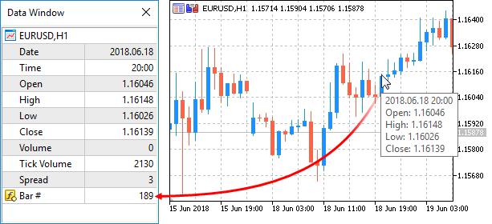

# ArraySetAsSeries

ArraySetAsSeries

The function sets the AS\_SERIES flag to a selected [object of a dynamic array](../../Language-Basics/Data-Types/Dynamic-Array-Object/Dynamic-Array-Object.md), and elements will be indexed like in [timeseries](../../Timeseries-and-Indicators-Access/Timeseries-and-Indicators-Access.md).

|  |
| --- |
| bool  ArraySetAsSeries(     const void&  array[],    // array by reference     bool         flag        // true denotes reverse order of indexing     ); |

Parameters

array[]

[in][out]  Numeric array to set.

flag

[in]  Array indexing direction.

Return Value

The function returns true on success, otherwise  - false.

Note

The [AS\_SERIES](../ArrayGetAsSeries/ArrayGetAsSeries.md) flag can't be set for multi-dimensional arrays or static arrays (arrays, whose size in square brackets is preset already on the compilation stage). Indexing in timeseries differs from a common array in that the elements of timeseries are indexed from the end towards the beginning (from the newest to oldest data).

Example: Indicator that shows bar number

 

|  |
| --- |
| #property indicator\_chart\_window  #property indicator\_buffers 1  #property indicator\_plots   1  //---- plot Numeration  #property indicator\_label1  "Numeration"  #property indicator\_type1   DRAW\_LINE  #property indicator\_color1  CLR\_NONE  //--- indicator buffers  double         NumerationBuffer[];  //+------------------------------------------------------------------+  //| Custom indicator initialization function                         |  //+------------------------------------------------------------------+  int OnInit()    {  //--- indicator buffers mapping     SetIndexBuffer(0,NumerationBuffer,INDICATOR\_DATA);  //--- set indexing for the buffer like in timeseries     ArraySetAsSeries(NumerationBuffer,true);  //--- set accuracy of showing in DataWindow     IndicatorSetInteger(INDICATOR\_DIGITS,0);  //--- how the name of the indicator array is displayed in DataWindow     PlotIndexSetString(0,PLOT\_LABEL,"Bar #");   //---     return(INIT\_SUCCEEDED);    }  //+------------------------------------------------------------------+  //| Custom indicator iteration function                              |  //+------------------------------------------------------------------+  int OnCalculate(const int rates\_total,                  const int prev\_calculated,                  const datetime &time[],                  const double &open[],                  const double &high[],                  const double &low[],                  const double &close[],                  const long &tick\_volume[],                  const long &volume[],                  const int &spread[])    {  //---  we'll store the time of the current zero bar opening     static datetime currentBarTimeOpen=0;  //--- revert access to array time[] - do it like in timeseries     ArraySetAsSeries(time,true);  //--- If time of zero bar differs from the stored one     if(currentBarTimeOpen!=time[0])       {       //--- enumerate all bars from the current to the chart depth        for(int i=rates\_total-1;i>=0;i--) NumerationBuffer[i]=i;        currentBarTimeOpen=time[0];       }  //--- return value of prev\_calculated for next call     return(rates\_total);    } |

See also

[Access to timeseries](../../Timeseries-and-Indicators-Access/Timeseries-and-Indicators-Access.md), [ArrayGetAsSeries](../ArrayGetAsSeries/ArrayGetAsSeries.md)
