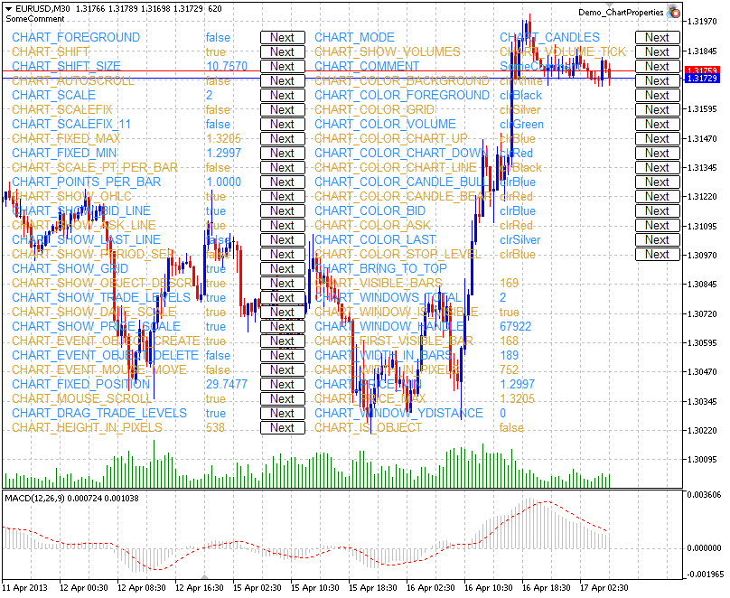

# Examples of Working with the Chart

Examples of Working with the Chart

This section contains examples of working with chart properties. One or two complete functions are displayed for each property. These functions allow setting/receiving the value of the property. These functions can be used "as is" in custom mql5 applications.

The screenshot below demonstrates the graphic panel illustrating how changing of [the chart property](../Chart-Properties/Chart-Properties.md) changes its appearance. Clicking Next button allows setting the new value of the appropriate property and view the changes in the chart window.

The panel's source code is located [below](Examples-of-Working-with-the-Chart.md#chart_properties_panel).

Chart Properties and Sample Functions for Working with Them

- CHART\_IS\_OBJECT defines if an object is a real chart or a [graphic object](../../Objects-Constants/Object-Types/Object-Types.md).

| //+------------------------------------------------------------------+  //| Checks if an object is a chart. If it is a graphic object,       |  //| the result is true. If it is a real chart, the result variable   |  //| has the value of false.                                          |  //+------------------------------------------------------------------+  bool ChartIsObject(bool &result,const long chart\_ID=0)    {  //--- prepare the variable to get the property value     long value;  //--- reset the error value     ResetLastError();  //--- get the chart property     if(!ChartGetInteger(chart\_ID,CHART\_IS\_OBJECT,0,value))       {        //--- display the error message in Experts journal        Print(\_\_FUNCTION\_\_+", Error Code = ",GetLastError());        //--- return false        return(false);       }  //--- store the value of the chart property in memory     result=value;  //--- successful execution     return(true);    } |
| --- |
|  |

 

- CHART\_BRING\_TO\_TOP shows the chart on top of all others.

|  |
| --- |
| //+----------------------------------------------------------------------+  //| Sends command to the terminal to display the chart above all others  |  //+----------------------------------------------------------------------+  bool ChartBringToTop(const long chart\_ID=0)    {  //--- reset the error value     ResetLastError();  //--- show the chart on top of all others     if(!ChartSetInteger(chart\_ID,CHART\_BRING\_TO\_TOP,0,true))       {        //--- display the error message in Experts journal        Print(\_\_FUNCTION\_\_+", Error Code = ",GetLastError());        return(false);       }  //--- successful execution     return(true);    } |

 

- CHART\_MOUSE\_SCROLL is a property for scrolling the chart using left mouse button.

|  |
| --- |
| //+--------------------------------------------------------------------------+  //| Checks if scrolling of chart using left mouse button is enabled          |  //+--------------------------------------------------------------------------+  bool ChartMouseScrollGet(bool &result,const long chart\_ID=0)    {  //--- prepare the variable to get the property value     long value;  //--- reset the error value     ResetLastError();  //--- receive the property value     if(!ChartGetInteger(chart\_ID,CHART\_MOUSE\_SCROLL,0,value))       {        //--- display the error message in Experts journal        Print(\_\_FUNCTION\_\_+", Error Code = ",GetLastError());        return(false);       }  //--- store the value of the chart property in memory     result=value;  //--- successful execution     return(true);    }  //+--------------------------------------------------------------------+  //| Enables/disables scrolling of chart using left mouse button        |  //+--------------------------------------------------------------------+  bool ChartMouseScrollSet(const bool value,const long chart\_ID=0)    {  //--- reset the error value     ResetLastError();  //--- set property value     if(!ChartSetInteger(chart\_ID,CHART\_MOUSE\_SCROLL,0,value))       {        //--- display the error message in Experts journal        Print(\_\_FUNCTION\_\_+", Error Code = ",GetLastError());        return(false);       }  //--- successful execution     return(true);    } |

 

- CHART\_EVENT\_MOUSE\_MOVE  is a property of sending messages concerning move events and mouse clicks to mql5 applications ([CHARTEVENT\_MOUSE\_MOVE](../Types-of-Chart-Events/Types-of-Chart-Events.md)).

|  |
| --- |
| //+------------------------------------------------------------------+  //| Checks if messages concerning move events and mouse clicks       |  //| are sent to all MQL5 applications on the chart                   |  //+------------------------------------------------------------------+  bool ChartEventMouseMoveGet(bool &result,const long chart\_ID=0)    {  //--- prepare the variable to get the property value     long value;  //--- reset the error value     ResetLastError();  //--- receive the property value     if(!ChartGetInteger(chart\_ID,CHART\_EVENT\_MOUSE\_MOVE,0,value))       {        //--- display the error message in Experts journal        Print(\_\_FUNCTION\_\_+", Error Code = ",GetLastError());        return(false);       }  //--- store the value of the chart property in memory     result=value;  //--- successful execution     return(true);    }  //+------------------------------------------------------------------------------+  //| Enables/disables the mode of sending messages concerning move events and     |  //| mouse clicks to MQL5 applications on the chart                               |  //+------------------------------------------------------------------------------+  bool ChartEventMouseMoveSet(const bool value,const long chart\_ID=0)    {  //--- reset the error value     ResetLastError();  //--- set property value     if(!ChartSetInteger(chart\_ID,CHART\_EVENT\_MOUSE\_MOVE,0,value))       {        //--- display the error message in Experts journal        Print(\_\_FUNCTION\_\_+", Error Code = ",GetLastError());        return(false);       }  //--- successful execution     return(true);    } |

 

- CHART\_EVENT\_OBJECT\_CREATE is a property of sending messages concerning the event of a graphic object creation to mql5 applications ([CHARTEVENT\_OBJECT\_CREATE](../Types-of-Chart-Events/Types-of-Chart-Events.md)).

|  |
| --- |
| //+---------------------------------------------------------------------+  //| Checks if messages concerning the event of a graphic                |  //| object creation are sent to all MQL5 applications on the chart      |  //+---------------------------------------------------------------------+  bool ChartEventObjectCreateGet(bool &result,const long chart\_ID=0)    {  //--- prepare the variable to get the property value     long value;  //--- reset the error value     ResetLastError();  //--- receive the property value     if(!ChartGetInteger(chart\_ID,CHART\_EVENT\_OBJECT\_CREATE,0,value))       {        //--- display the error message in Experts journal        Print(\_\_FUNCTION\_\_+", Error Code = ",GetLastError());        return(false);       }  //--- store the value of the chart property in memory     result=value;  //--- successful execution     return(true);    }  //+--------------------------------------------------------------------------+  //| Enables/disables the mode of sending messages concerning the event of a  |  //| graphic object creation to all mql5 applications on the chart            |  //+--------------------------------------------------------------------------+  bool ChartEventObjectCreateSet(const bool value,const long chart\_ID=0)    {  //--- reset the error value     ResetLastError();  //--- set property value     if(!ChartSetInteger(chart\_ID,CHART\_EVENT\_OBJECT\_CREATE,0,value))       {        //--- display the error message in Experts journal        Print(\_\_FUNCTION\_\_+", Error Code = ",GetLastError());        return(false);       }  //--- successful execution     return(true);    } |

 

- CHART\_EVENT\_OBJECT\_DELETE is a property of sending messages concerning the event of a graphic object deletion to mql5 applications ([CHARTEVENT\_OBJECT\_DELETE](../Types-of-Chart-Events/Types-of-Chart-Events.md)).

|  |
| --- |
| //+---------------------------------------------------------------------+  //| Checks if messages concerning the event of a graphic object         |  //| deletion are sent to all mql5 applications on the chart             |  //+---------------------------------------------------------------------+  bool ChartEventObjectDeleteGet(bool &result,const long chart\_ID=0)    {  //--- prepare the variable to get the property value     long value;  //--- reset the error value     ResetLastError();  //--- receive the property value     if(!ChartGetInteger(chart\_ID,CHART\_EVENT\_OBJECT\_DELETE,0,value))       {        //--- display the error message in Experts journal        Print(\_\_FUNCTION\_\_+", Error Code = ",GetLastError());        return(false);       }  //--- store the value of the chart property in memory     result=value;  //--- successful execution     return(true);    }  //+--------------------------------------------------------------------------+  //| Enables/disables the mode of sending messages concerning the event of a  |  //| graphic object deletion to all mql5 applications on the chart            |  //+--------------------------------------------------------------------------+  bool ChartEventObjectDeleteSet(const bool value,const long chart\_ID=0)    {  //--- reset the error value     ResetLastError();  //--- set property value     if(!ChartSetInteger(chart\_ID,CHART\_EVENT\_OBJECT\_DELETE,0,value))       {        //--- display the error message in Experts journal        Print(\_\_FUNCTION\_\_+", Error Code = ",GetLastError());        return(false);       }  //--- successful execution     return(true);    } |

 

- CHART\_MODE – type of the chart (candlesticks, bars or line).

|  |
| --- |
| //+------------------------------------------------------------------+  //| Gets chart display type (candlesticks, bars or line)             |  //+------------------------------------------------------------------+  ENUM\_CHART\_MODE ChartModeGet(const long chart\_ID=0)    {  //--- prepare the variable to get the property value     long result=WRONG\_VALUE;  //--- reset the error value     ResetLastError();  //--- receive the property value     if(!ChartGetInteger(chart\_ID,CHART\_MODE,0,result))       {        //--- display the error message in Experts journal        Print(\_\_FUNCTION\_\_+", Error Code = ",GetLastError());       }  //--- return the value of the chart property     return((ENUM\_CHART\_MODE)result);    }  //+------------------------------------------------------------------+  //| Sets chart display type (candlesticks, bars or line)             |  //+------------------------------------------------------------------+  bool ChartModeSet(const long value,const long chart\_ID=0)    {  //--- reset the error value     ResetLastError();  //--- set property value     if(!ChartSetInteger(chart\_ID,CHART\_MODE,value))       {        //--- display the error message in Experts journal        Print(\_\_FUNCTION\_\_+", Error Code = ",GetLastError());        return(false);       }  //--- successful execution     return(true);    } |

 

- CHART\_FOREGROUND is a property of displaying a price chart in the foreground.

|  |
| --- |
| //+------------------------------------------------------------------+  //| Checks if a price chart is displayed in the foreground           |  //+------------------------------------------------------------------+  bool ChartForegroundGet(bool &result,const long chart\_ID=0)    {  //--- prepare the variable to get the property value     long value;  //--- reset the error value     ResetLastError();  //--- receive the property value     if(!ChartGetInteger(chart\_ID,CHART\_FOREGROUND,0,value))       {        //--- display the error message in Experts journal        Print(\_\_FUNCTION\_\_+", Error Code = ",GetLastError());        return(false);       }  //--- store the value of the chart property in memory     result=value;  //--- successful execution     return(true);    }  //+------------------------------------------------------------------+  //| Enables/disables displaying of a price chart on the foreground   |  //+------------------------------------------------------------------+  bool ChartForegroundSet(const bool value,const long chart\_ID=0)    {  //--- reset the error value     ResetLastError();  //--- set property value     if(!ChartSetInteger(chart\_ID,CHART\_FOREGROUND,0,value))       {        //--- display the error message in Experts journal        Print(\_\_FUNCTION\_\_+", Error Code = ",GetLastError());        return(false);       }  //--- successful execution     return(true);    } |

 

- CHART\_SHIFT – mode of shift of the price chart from the right border.

|  |
| --- |
| //+-------------------------------------------------------------------+  //| Checks if shifting a price chart from the right border is enabled |  //+-------------------------------------------------------------------+  bool ChartShiftGet(bool &result,const long chart\_ID=0)    {  //--- prepare the variable to get the property value     long value;  //--- reset the error value     ResetLastError();  //--- receive the property value     if(!ChartGetInteger(chart\_ID,CHART\_SHIFT,0,value))       {        //--- display the error message in Experts journal        Print(\_\_FUNCTION\_\_+", Error Code = ",GetLastError());        return(false);       }  //--- store the value of the chart property in memory     result=value;  //--- successful execution     return(true);    }  //+---------------------------------------------------------------------------------+  //| Enables/disables displaying of a price chart with a shift from the right border |  //+---------------------------------------------------------------------------------+  bool ChartShiftSet(const bool value,const long chart\_ID=0)    {  //--- reset the error value     ResetLastError();  //--- set property value     if(!ChartSetInteger(chart\_ID,CHART\_SHIFT,0,value))       {        //--- display the error message in Experts journal        Print(\_\_FUNCTION\_\_+", Error Code = ",GetLastError());        return(false);       }  //--- successful execution     return(true);    } |

 

- CHART\_AUTOSCROLL – the mode of automatic shift to the right border of the chart.

|  |
| --- |
| //+------------------------------------------------------------------+  //| Checks if automatic scrolling of a chart to the right            |  //| on new ticks arrival is enabled                                  |  //+------------------------------------------------------------------+  bool ChartAutoscrollGet(bool &result,const long chart\_ID=0)    {  //--- prepare the variable to get the property value     long value;  //--- reset the error value     ResetLastError();  //--- receive the property value     if(!ChartGetInteger(chart\_ID,CHART\_AUTOSCROLL,0,value))       {        //--- display the error message in Experts journal        Print(\_\_FUNCTION\_\_+", Error Code = ",GetLastError());        return(false);       }  //--- store the value of the chart property in memory     result=value;  //--- successful execution     return(true);    }  //+------------------------------------------------------------------+  //| Enables/disables automatic scrolling of a chart to the right     |  //| on new ticks arrival                                             |  //+------------------------------------------------------------------+  bool ChartAutoscrollSet(const bool value,const long chart\_ID=0)    {  //--- reset the error value     ResetLastError();  //--- set property value     if(!ChartSetInteger(chart\_ID,CHART\_AUTOSCROLL,0,value))       {        //--- display the error message in Experts journal        Print(\_\_FUNCTION\_\_+", Error Code = ",GetLastError());        return(false);       }  //--- successful execution     return(true);    } |
|  |
|  |

 

- CHART\_SCALE – chart scale property.

|  |
| --- |
| //+------------------------------------------------------------------+  //| Gets chart scale (from 0 to 5)                                   |  //+------------------------------------------------------------------+  int ChartScaleGet(const long chart\_ID=0)    {  //--- prepare the variable to get the property value     long result=-1;  //--- reset the error value     ResetLastError();  //--- receive the property value     if(!ChartGetInteger(chart\_ID,CHART\_SCALE,0,result))       {        //--- display the error message in Experts journal        Print(\_\_FUNCTION\_\_+", Error Code = ",GetLastError());       }  //--- return the value of the chart property     return((int)result);    }  //+------------------------------------------------------------------+  //| Sets chart scale (from 0 to 5)                                   |  //+------------------------------------------------------------------+  bool ChartScaleSet(const long value,const long chart\_ID=0)    {  //--- reset the error value     ResetLastError();  //--- set property value     if(!ChartSetInteger(chart\_ID,CHART\_SCALE,0,value))       {        //--- display the error message in Experts journal        Print(\_\_FUNCTION\_\_+", Error Code = ",GetLastError());        return(false);       }  //--- successful execution     return(true);    } |

 

- CHART\_SCALEFIX – the mode of fixed chart scale.

|  |
| --- |
| //+------------------------------------------------------------------+  //| Checks if the fixed scale mode is enabled                        |  //+------------------------------------------------------------------+  bool ChartScaleFixGet(bool &result,const long chart\_ID=0)    {  //--- prepare the variable to get the property value     long value;  //--- reset the error value     ResetLastError();  //--- receive the property value     if(!ChartGetInteger(chart\_ID,CHART\_SCALEFIX,0,value))       {        //--- display the error message in Experts journal        Print(\_\_FUNCTION\_\_+", Error Code = ",GetLastError());        return(false);       }  //--- store the value of the chart property in memory     result=value;  //--- successful execution     return(true);    }  //+------------------------------------------------------------------+  //| Enables/disables the fixed scale mode                            |  //+------------------------------------------------------------------+  bool ChartScaleFixSet(const bool value,const long chart\_ID=0)    {  //--- reset the error value     ResetLastError();  //--- set property value     if(!ChartSetInteger(chart\_ID,CHART\_SCALEFIX,0,value))       {        //--- display the error message in Experts journal        Print(\_\_FUNCTION\_\_+", Error Code = ",GetLastError());        return(false);       }  //--- successful execution     return(true);    } |

 

- CHART\_SCALEFIX\_11 – 1:1 chart scale mode.

|  |
| --- |
| //+------------------------------------------------------------------+  //| Checks if the "1:1" scale is enabled                             |  //+------------------------------------------------------------------+  bool ChartScaleFix11Get(bool &result,const long chart\_ID=0)    {  //--- prepare the variable to get the property value     long value;  //--- reset the error value     ResetLastError();  //--- receive the property value     if(!ChartGetInteger(chart\_ID,CHART\_SCALEFIX\_11,0,value))       {        //--- display the error message in Experts journal        Print(\_\_FUNCTION\_\_+", Error Code = ",GetLastError());        return(false);       }  //--- store the value of the chart property in memory     result=value;  //--- successful execution     return(true);    }  //+------------------------------------------------------------------+  //| Enables/disables the "1:1" scale mode                            |  //+------------------------------------------------------------------+  bool ChartScaleFix11Set(const bool value,const long chart\_ID=0)    {  //--- reset the error value     ResetLastError();  //--- set property value     if(!ChartSetInteger(chart\_ID,CHART\_SCALEFIX\_11,0,value))       {        //--- display the error message in Experts journal        Print(\_\_FUNCTION\_\_+", Error Code = ",GetLastError());        return(false);       }  //--- successful execution     return(true);    } |

 

- CHART\_SCALE\_PT\_PER\_BAR – the mode of specifying the chart scale in points per bar.

|  |
| --- |
| //+------------------------------------------------------------------+  //| Checks if the "points per bar" chart scaling mode is enabled     |  //+------------------------------------------------------------------+  bool ChartScalePerBarGet(bool &result,const long chart\_ID=0)    {  //--- prepare the variable to get the property value     long value;  //--- reset the error value     ResetLastError();  //--- receive the property value     if(!ChartGetInteger(chart\_ID,CHART\_SCALE\_PT\_PER\_BAR,0,value))       {        //--- display the error message in Experts journal        Print(\_\_FUNCTION\_\_+", Error Code = ",GetLastError());        return(false);       }  //--- store the value of the chart property in memory     result=value;  //--- successful execution     return(true);    }  //+------------------------------------------------------------------+  //| Enables/disables the "points per bar" chart scaling mode         |  //+------------------------------------------------------------------+  bool ChartScalePerBarSet(const bool value,const long chart\_ID=0)    {  //--- reset the error value     ResetLastError();  //--- set property value     if(!ChartSetInteger(chart\_ID,CHART\_SCALE\_PT\_PER\_BAR,0,value))       {        //--- display the error message in Experts journal        Print(\_\_FUNCTION\_\_+", Error Code = ",GetLastError());        return(false);       }  //--- successful execution     return(true);    } |

 

- CHART\_SHOW\_OHLC – the property of displaying OHLC values in the upper left corner.

|  |
| --- |
| //+----------------------------------------------------------------------------------+  //| Checks if displaying of OHLC values in the upper left corner of chart is enabled |  //+----------------------------------------------------------------------------------+  bool ChartShowOHLCGet(bool &result,const long chart\_ID=0)    {  //--- prepare the variable to get the property value     long value;  //--- reset the error value     ResetLastError();  //--- receive the property value     if(!ChartGetInteger(chart\_ID,CHART\_SHOW\_OHLC,0,value))       {        //--- display the error message in Experts journal        Print(\_\_FUNCTION\_\_+", Error Code = ",GetLastError());        return(false);       }  //--- store the value of the chart property in memory     result=value;  //--- successful execution     return(true);    }  //+------------------------------------------------------------------------------+  //| Enables/disables displaying of OHLC values in the upper left corner of chart |  //+------------------------------------------------------------------------------+  bool ChartShowOHLCSet(const bool value,const long chart\_ID=0)    {  //--- reset the error value     ResetLastError();  //--- set property value     if(!ChartSetInteger(chart\_ID,CHART\_SHOW\_OHLC,0,value))       {        //--- display the error message in Experts journal        Print(\_\_FUNCTION\_\_+", Error Code = ",GetLastError());        return(false);       }  //--- successful execution     return(true);    } |

 

- CHART\_SHOW\_BID\_LINE – the property of displaying Bid value as a horizontal line on the chart.

|  |
| --- |
| //+------------------------------------------------------------------+  //| Checks if displaying of Bid line on chart is enabled             |  //+------------------------------------------------------------------+  bool ChartShowBidLineGet(bool &result,const long chart\_ID=0)    {  //--- prepare the variable to get the property value     long value;  //--- reset the error value     ResetLastError();  //--- receive the property value     if(!ChartGetInteger(chart\_ID,CHART\_SHOW\_BID\_LINE,0,value))       {        //--- display the error message in Experts journal        Print(\_\_FUNCTION\_\_+", Error Code = ",GetLastError());        return(false);       }  //--- store the value of the chart property in memory     result=value;  //--- successful execution     return(true);    }  //+------------------------------------------------------------------+  //| Enables/disables displaying of Bid line on chart                 |  //+------------------------------------------------------------------+  bool ChartShowBidLineSet(const bool value,const long chart\_ID=0)    {  //--- reset the error value     ResetLastError();  //--- set property value     if(!ChartSetInteger(chart\_ID,CHART\_SHOW\_BID\_LINE,0,value))       {        //--- display the error message in Experts journal        Print(\_\_FUNCTION\_\_+", Error Code = ",GetLastError());        return(false);       }  //--- successful execution     return(true);    } |

 

- CHART\_SHOW\_ASK\_LINE – the property of displaying Ask value as a horizontal line on a chart.

|  |
| --- |
| //+------------------------------------------------------------------+  //| Checks if displaying of Ask line on chart is enabled             |  //+------------------------------------------------------------------+  bool ChartShowAskLineGet(bool &result,const long chart\_ID=0)    {  //--- prepare the variable to get the property value     long value;  //--- reset the error value     ResetLastError();  //--- receive the property value     if(!ChartGetInteger(chart\_ID,CHART\_SHOW\_ASK\_LINE,0,value))       {        //--- display the error message in Experts journal        Print(\_\_FUNCTION\_\_+", Error Code = ",GetLastError());        return(false);       }  //--- store the value of the chart property in memory     result=value;  //--- successful execution     return(true);    }  //+------------------------------------------------------------------+  //| Enables/disables displaying of Ask line on chart                 |  //+------------------------------------------------------------------+  bool ChartShowAskLineSet(const bool value,const long chart\_ID=0)    {  //--- reset the error value     ResetLastError();  //--- set property value     if(!ChartSetInteger(chart\_ID,CHART\_SHOW\_ASK\_LINE,0,value))       {        //--- display the error message in Experts journal        Print(\_\_FUNCTION\_\_+", Error Code = ",GetLastError());        return(false);       }  //--- successful execution     return(true);    } |

 

- CHART\_SHOW\_LAST\_LINE – the property of displaying Last value as a horizontal line on a chart.

|  |
| --- |
| //+-----------------------------------------------------------------------------+  //| Checks if displaying of line for the last performed deal's price is enabled |  //+-----------------------------------------------------------------------------+  bool ChartShowLastLineGet(bool &result,const long chart\_ID=0)    {  //--- prepare the variable to get the property value     long value;  //--- reset the error value     ResetLastError();  //--- receive the property value     if(!ChartGetInteger(chart\_ID,CHART\_SHOW\_LAST\_LINE,0,value))       {        //--- display the error message in Experts journal        Print(\_\_FUNCTION\_\_+", Error Code = ",GetLastError());        return(false);       }  //--- store the value of the chart property in memory     result=value;  //--- successful execution     return(true);    }  //+-------------------------------------------------------------------------+  //| Enables/disables displaying of line for the last performed deal's price |  //+-------------------------------------------------------------------------+  bool ChartShowLastLineSet(const bool value,const long chart\_ID=0)    {  //--- reset the error value     ResetLastError();  //--- set property value     if(!ChartSetInteger(chart\_ID,CHART\_SHOW\_LAST\_LINE,0,value))       {        //--- display the error message in Experts journal        Print(\_\_FUNCTION\_\_+", Error Code = ",GetLastError());        return(false);       }  //--- successful execution     return(true);    } |

 

- CHART\_SHOW\_PERIOD\_SEP – the property of displaying vertical separators between adjacent periods.

|  |
| --- |
| //+---------------------------------------------------------------------------------+  //| Checks if displaying of vertical separators between adjacent periods is enabled |  //+---------------------------------------------------------------------------------+  bool ChartShowPeriodSeparatorGet(bool &result,const long chart\_ID=0)    {  //--- prepare the variable to get the property value     long value;  //--- reset the error value     ResetLastError();  //--- receive the property value     if(!ChartGetInteger(chart\_ID,CHART\_SHOW\_PERIOD\_SEP,0,value))       {        //--- display the error message in Experts journal        Print(\_\_FUNCTION\_\_+", Error Code = ",GetLastError());        return(false);       }  //--- store the value of the chart property in memory     result=value;  //--- successful execution     return(true);    }  //+-----------------------------------------------------------------------------+  //| Enables/disables displaying of vertical separators between adjacent periods |  //+-----------------------------------------------------------------------------+  bool ChartShowPeriodSepapatorSet(const bool value,const long chart\_ID=0)    {  //--- reset the error value     ResetLastError();  //--- set property value     if(!ChartSetInteger(chart\_ID,CHART\_SHOW\_PERIOD\_SEP,0,value))       {        //--- display the error message in Experts journal        Print(\_\_FUNCTION\_\_+", Error Code = ",GetLastError());        return(false);       }  //--- successful execution     return(true);    } |

 

- CHART\_SHOW\_GRID – the property of displaying the chart grid.

|  |
| --- |
| //+------------------------------------------------------------------+  //| Checks if the chart grid is displayed                            |  //+------------------------------------------------------------------+  bool ChartShowGridGet(bool &result,const long chart\_ID=0)    {  //--- prepare the variable to get the property value     long value;  //--- reset the error value     ResetLastError();  //--- receive the property value     if(!ChartGetInteger(chart\_ID,CHART\_SHOW\_GRID,0,value))       {        //--- display the error message in Experts journal        Print(\_\_FUNCTION\_\_+", Error Code = ",GetLastError());        return(false);       }  //--- store the value of the chart property in memory     result=value;  //--- successful execution     return(true);    }  //+------------------------------------------------------------------+  //| Enables/disables displaying of grid on chart                     |  //+------------------------------------------------------------------+  bool ChartShowGridSet(const bool value,const long chart\_ID=0)    {  //--- reset the error value     ResetLastError();  //--- set the property value     if(!ChartSetInteger(chart\_ID,CHART\_SHOW\_GRID,0,value))       {        //--- display the error message in Experts journal        Print(\_\_FUNCTION\_\_+", Error Code = ",GetLastError());        return(false);       }  //--- successful execution     return(true);    } |

 

- CHART\_SHOW\_VOLUMES – the property of displaying the volumes on a chart.

|  |
| --- |
| //+------------------------------------------------------------------+  //| Checks if volumes are displayed on a chart                       |  //| The flag indicates the volumes showing mode                      |  //+------------------------------------------------------------------+  ENUM\_CHART\_VOLUME\_MODE ChartShowVolumesGet(const long chart\_ID=0)    {  //--- prepare the variable to get the property value     long result=WRONG\_VALUE;  //--- reset the error value     ResetLastError();  //--- receive the property value     if(!ChartGetInteger(chart\_ID,CHART\_SHOW\_VOLUMES,0,result))       {        //--- display the error message in Experts journal        Print(\_\_FUNCTION\_\_+", Error Code = ",GetLastError());       }  //--- return the value of the chart property     return((ENUM\_CHART\_VOLUME\_MODE)result);    }  //+------------------------------------------------------------------+  //| Sets mode of displaying volumes on chart                         |  //+------------------------------------------------------------------+  bool ChartShowVolumesSet(const long value,const long chart\_ID=0)    {  //--- reset the error value     ResetLastError();  //--- set property value     if(!ChartSetInteger(chart\_ID,CHART\_SHOW\_VOLUMES,value))       {        //--- display the error message in Experts journal        Print(\_\_FUNCTION\_\_+", Error Code = ",GetLastError());        return(false);       }  //--- successful execution     return(true);    } |
|  |

 

- CHART\_SHOW\_OBJECT\_DESCR – the property of graphical object pop-up descriptions.

|  |
| --- |
| //+-------------------------------------------------------------------+  //| Checks if pop-up descriptions of graphical objects are displayed  |  //| when hovering mouse over them                                     |  //+-------------------------------------------------------------------+  bool ChartShowObjectDescriptionGet(bool &result,const long chart\_ID=0)    {  //--- prepare the variable to get the property value     long value;  //--- reset the error value     ResetLastError();  //--- receive the property value     if(!ChartGetInteger(chart\_ID,CHART\_SHOW\_OBJECT\_DESCR,0,value))       {        //--- display the error message in Experts journal        Print(\_\_FUNCTION\_\_+", Error Code = ",GetLastError());        return(false);       }  //--- store the value of the chart property in memory     result=value;  //--- successful execution     return(true);    }  //+-------------------------------------------------------------------------+  //| Enables/disables displaying of pop-up descriptions of graphical objects |  //| when hovering mouse over them                                           |  //+-------------------------------------------------------------------------+  bool ChartShowObjectDescriptionSet(const bool value,const long chart\_ID=0)    {  //--- reset the error value     ResetLastError();  //--- set property value     if(!ChartSetInteger(chart\_ID,CHART\_SHOW\_OBJECT\_DESCR,0,value))       {        //--- display the error message in Experts journal        Print(\_\_FUNCTION\_\_+", Error Code = ",GetLastError());        return(false);       }  //--- successful execution     return(true);    } |

 

- CHART\_VISIBLE\_BARS defines the number of bars on a chart that are available for display.

|  |
| --- |
| //+----------------------------------------------------------------------+  //| Gets the number of bars that are displayed (visible) in chart window |  //+----------------------------------------------------------------------+  int ChartVisibleBars(const long chart\_ID=0)    {  //--- prepare the variable to get the property value     long result=-1;  //--- reset the error value     ResetLastError();  //--- receive the property value     if(!ChartGetInteger(chart\_ID,CHART\_VISIBLE\_BARS,0,result))       {        //--- display the error message in Experts journal        Print(\_\_FUNCTION\_\_+", Error Code = ",GetLastError());       }  //--- return the value of the chart property     return((int)result);    } |

 

- CHART\_WINDOWS\_TOTAL defines the total number of chart windows including indicator subwindows.

|  |
| --- |
| //+-----------------------------------------------------------------------+  //| Gets the total number of chart windows including indicator subwindows |  //+-----------------------------------------------------------------------+  int ChartWindowsTotal(const long chart\_ID=0)    {  //--- prepare the variable to get the property value     long result=-1;  //--- reset the error value     ResetLastError();  //--- receive the property value     if(!ChartGetInteger(chart\_ID,CHART\_WINDOWS\_TOTAL,0,result))       {        //--- display the error message in Experts journal        Print(\_\_FUNCTION\_\_+", Error Code = ",GetLastError());       }  //--- return the value of the chart property     return((int)result);    } |

 

- CHART\_WINDOW\_IS\_VISIBLE defines the subwindow's visibility.

|  |
| --- |
| //+------------------------------------------------------------------+  //| Checks if the current chart window or subwindow is visible       |  //+------------------------------------------------------------------+  bool ChartWindowsIsVisible(bool &result,const long chart\_ID=0,const int sub\_window=0)    {  //--- prepare the variable to get the property value     long value;  //--- reset the error value     ResetLastError();  //--- receive the property value     if(!ChartGetInteger(chart\_ID,CHART\_WINDOW\_IS\_VISIBLE,sub\_window,value))       {        //--- display the error message in Experts journal        Print(\_\_FUNCTION\_\_+", Error Code = ",GetLastError());        return(false);       }  //--- store the value of the chart property in memory     result=value;  //--- successful execution     return(true);    } |

 

- CHART\_WINDOW\_HANDLE returns the chart handle.

|  |
| --- |
| //+------------------------------------------------------------------+  //| Gets the chart handle                                            |  //+------------------------------------------------------------------+  int ChartWindowsHandle(const long chart\_ID=0)    {  //--- prepare the variable to get the property value     long result=-1;  //--- reset the error value     ResetLastError();  //--- receive the property value     if(!ChartGetInteger(chart\_ID,CHART\_WINDOW\_HANDLE,0,result))       {        //--- display the error message in Experts journal        Print(\_\_FUNCTION\_\_+", Error Code = ",GetLastError());       }  //--- return the value of the chart property     return((int)result);    } |

 

- CHART\_WINDOW\_YDISTANCE defines the distance in pixels between the upper frame of the indicator subwindow and the upper frame of the chart's main window.

|  |
| --- |
| //+------------------------------------------------------------------+  //| Gets the distance in pixels between the upper border of          |  //| subwindow and the upper border of chart's main window            |  //+------------------------------------------------------------------+  int ChartWindowsYDistance(const long chart\_ID=0,const int sub\_window=0)    {  //--- prepare the variable to get the property value     long result=-1;  //--- reset the error value     ResetLastError();  //--- receive the property value     if(!ChartGetInteger(chart\_ID,CHART\_WINDOW\_YDISTANCE,sub\_window,result))       {        //--- display the error message in Experts journal        Print(\_\_FUNCTION\_\_+", Error Code = ",GetLastError());       }  //--- return the value of the chart property     return((int)result);    } |

 

- CHART\_FIRST\_VISIBLE\_BAR returns the number of the first visible bar on the chart (bar indexing corresponds to the [time series](../../../Timeseries-and-Indicators-Access/Timeseries-and-Indicators-Access.md)).

|  |
| --- |
| //+------------------------------------------------------------------------------+  //| Gets the index of the first visible bar on chart.                            |  //| Indexing is performed like in timeseries: latest bars have smallest indices. |  //+------------------------------------------------------------------------------+  int ChartFirstVisibleBar(const long chart\_ID=0)    {  //--- prepare the variable to get the property value     long result=-1;  //--- reset the error value     ResetLastError();  //--- receive the property value     if(!ChartGetInteger(chart\_ID,CHART\_FIRST\_VISIBLE\_BAR,0,result))       {        //--- display the error message in Experts journal        Print(\_\_FUNCTION\_\_+", Error Code = ",GetLastError());       }  //--- return the value of the chart property     return((int)result);    } |

 

- CHART\_WIDTH\_IN\_BARS returns the chart width in bars.

|  |
| --- |
| //+------------------------------------------------------------------+  //| Gets the width of chart (in bars)                                |  //+------------------------------------------------------------------+  int ChartWidthInBars(const long chart\_ID=0)    {  //--- prepare the variable to get the property value     long result=-1;  //--- reset the error value     ResetLastError();  //--- receive the property value     if(!ChartGetInteger(chart\_ID,CHART\_WIDTH\_IN\_BARS,0,result))       {        //--- display the error message in Experts journal        Print(\_\_FUNCTION\_\_+", Error Code = ",GetLastError());       }  //--- return the value of the chart property     return((int)result);    } |

 

- CHART\_WIDTH\_IN\_PIXELS returns the chart width in pixels.

|  |
| --- |
| //+------------------------------------------------------------------+  //| Gets the width of chart (in pixels)                              |  //+------------------------------------------------------------------+  int ChartWidthInPixels(const long chart\_ID=0)    {  //--- prepare the variable to get the property value     long result=-1;  //--- reset the error value     ResetLastError();  //--- receive the property value     if(!ChartGetInteger(chart\_ID,CHART\_WIDTH\_IN\_PIXELS,0,result))       {        //--- display the error message in Experts journal        Print(\_\_FUNCTION\_\_+", Error Code = ",GetLastError());       }  //--- return the value of the chart property     return((int)result);    } |

 

- CHART\_HEIGHT\_IN\_PIXELS – chart height property in pixels.

|  |
| --- |
| //+------------------------------------------------------------------+  //| Gets the height of chart (in pixels)                             |  //+------------------------------------------------------------------+  int ChartHeightInPixelsGet(const long chart\_ID=0,const int sub\_window=0)    {  //--- prepare the variable to get the property value     long result=-1;  //--- reset the error value     ResetLastError();  //--- receive the property value     if(!ChartGetInteger(chart\_ID,CHART\_HEIGHT\_IN\_PIXELS,sub\_window,result))       {        //--- display the error message in Experts journal        Print(\_\_FUNCTION\_\_+", Error Code = ",GetLastError());       }  //--- return the value of the chart property     return((int)result);    }  //+------------------------------------------------------------------+  //| Sets the height of chart (in pixels)                             |  //+------------------------------------------------------------------+  bool ChartHeightInPixelsSet(const int value,const long chart\_ID=0,const int sub\_window=0)    {  //--- reset the error value     ResetLastError();  //--- set property value     if(!ChartSetInteger(chart\_ID,CHART\_HEIGHT\_IN\_PIXELS,sub\_window,value))       {        //--- display the error message in Experts journal        Print(\_\_FUNCTION\_\_+", Error Code = ",GetLastError());        return(false);       }  //--- successful execution     return(true);    } |

 

- CHART\_COLOR\_BACKGROUND - chart background color.

|  |
| --- |
| //+------------------------------------------------------------------+  //| Gets the background color of chart                               |  //+------------------------------------------------------------------+  color ChartBackColorGet(const long chart\_ID=0)    {  //--- prepare the variable to receive the color     long result=clrNONE;  //--- reset the error value     ResetLastError();  //--- receive chart background color     if(!ChartGetInteger(chart\_ID,CHART\_COLOR\_BACKGROUND,0,result))       {        //--- display the error message in Experts journal        Print(\_\_FUNCTION\_\_+", Error Code = ",GetLastError());       }  //--- return the value of the chart property     return((color)result);    }  //+------------------------------------------------------------------+  //| Sets the background color of chart                               |  //+------------------------------------------------------------------+  bool ChartBackColorSet(const color clr,const long chart\_ID=0)    {  //--- reset the error value     ResetLastError();  //--- set the chart background color     if(!ChartSetInteger(chart\_ID,CHART\_COLOR\_BACKGROUND,clr))       {        //--- display the error message in Experts journal        Print(\_\_FUNCTION\_\_+", Error Code = ",GetLastError());        return(false);       }  //--- successful execution     return(true);    } |

 

- CHART\_COLOR\_FOREGROUND – color of axes, scale and OHLC line.

|  |
| --- |
| //+------------------------------------------------------------------+  //| Gets the color of axes, scale and OHLC line                      |  //+------------------------------------------------------------------+  color ChartForeColorGet(const long chart\_ID=0)    {  //--- prepare the variable to receive the color     long result=clrNONE;  //--- reset the error value     ResetLastError();  //--- receive the color of axes, scale and OHLC line     if(!ChartGetInteger(chart\_ID,CHART\_COLOR\_FOREGROUND,0,result))       {        //--- display the error message in Experts journal        Print(\_\_FUNCTION\_\_+", Error Code = ",GetLastError());       }  //--- return the value of the chart property     return((color)result);    }  //+------------------------------------------------------------------+  //| Sets the color of axes, scale and OHLC line                      |  //+------------------------------------------------------------------+  bool ChartForeColorSet(const color clr,const long chart\_ID=0)    {  //--- reset the error value     ResetLastError();  //--- set the color of axes, scale and OHLC line     if(!ChartSetInteger(chart\_ID,CHART\_COLOR\_FOREGROUND,clr))       {        //--- display the error message in Experts journal        Print(\_\_FUNCTION\_\_+", Error Code = ",GetLastError());        return(false);       }  //--- successful execution     return(true);    } |

 

- CHART\_COLOR\_GRID – chart grid color.

|  |
| --- |
| //+------------------------------------------------------------------+  //| Gets the color of chart grid                                     |  //+------------------------------------------------------------------+  color ChartGridColorGet(const long chart\_ID=0)    {  //--- prepare the variable to receive the color     long result=clrNONE;  //--- reset the error value     ResetLastError();  //--- receive chart grid color     if(!ChartGetInteger(chart\_ID,CHART\_COLOR\_GRID,0,result))       {        //--- display the error message in Experts journal        Print(\_\_FUNCTION\_\_+", Error Code = ",GetLastError());       }  //--- return the value of the chart property     return((color)result);    }  //+------------------------------------------------------------------+  //| Sets the color of chart grid                                     |  //+------------------------------------------------------------------+  bool ChartGridColorSet(const color clr,const long chart\_ID=0)    {  //--- reset the error value     ResetLastError();  //--- set chart grid color     if(!ChartSetInteger(chart\_ID,CHART\_COLOR\_GRID,clr))       {        //--- display the error message in Experts journal        Print(\_\_FUNCTION\_\_+", Error Code = ",GetLastError());        return(false);       }  //--- successful execution     return(true);    } |

 

- CHART\_COLOR\_VOLUME - color of volumes and position opening levels.

|  |
| --- |
| //+------------------------------------------------------------------+  //| Gets the color of volumes and market entry levels                |  //+------------------------------------------------------------------+  color ChartVolumeColorGet(const long chart\_ID=0)    {  //--- prepare the variable to receive the color     long result=clrNONE;  //--- reset the error value     ResetLastError();  //--- receive color of volumes and market entry levels     if(!ChartGetInteger(chart\_ID,CHART\_COLOR\_VOLUME,0,result))       {        //--- display the error message in Experts journal        Print(\_\_FUNCTION\_\_+", Error Code = ",GetLastError());       }  //--- return the value of the chart property     return((color)result);    }  //+------------------------------------------------------------------+  //| Sets the color of volumes and market entry levels                |  //+------------------------------------------------------------------+  bool ChartVolumeColorSet(const color clr,const long chart\_ID=0)    {  //--- reset the error value     ResetLastError();  //--- set color of volumes and market entry levels     if(!ChartSetInteger(chart\_ID,CHART\_COLOR\_VOLUME,clr))       {        //--- display the error message in Experts journal        Print(\_\_FUNCTION\_\_+", Error Code = ",GetLastError());        return(false);       }  //--- successful execution     return(true);    } |

 

- CHART\_COLOR\_CHART\_UP – color of up bar, its shadow and border of a bullish candlestick's body.

|  |
| --- |
| //+-----------------------------------------------------------------------------+  //| Gets the color of up bar, shadow and border of a bullish candlestick's body |  //+-----------------------------------------------------------------------------+  color ChartUpColorGet(const long chart\_ID=0)    {  //--- prepare the variable to receive the color     long result=clrNONE;  //--- reset the error value     ResetLastError();  //--- receive the color of up bar, its shadow and border of bullish candlestick's body     if(!ChartGetInteger(chart\_ID,CHART\_COLOR\_CHART\_UP,0,result))       {        //--- display the error message in Experts journal        Print(\_\_FUNCTION\_\_+", Error Code = ",GetLastError());       }  //--- return the value of the chart property     return((color)result);    }  //+------------------------------------------------------------------+  //| Sets the color of up bar, shadow and border of a bullish candlestick's body |  //+------------------------------------------------------------------+  bool ChartUpColorSet(const color clr,const long chart\_ID=0)    {  //--- reset the error value     ResetLastError();  //--- set the color of up bar, its shadow and border of body of a bullish candlestick     if(!ChartSetInteger(chart\_ID,CHART\_COLOR\_CHART\_UP,clr))       {        //--- display the error message in Experts journal        Print(\_\_FUNCTION\_\_+", Error Code = ",GetLastError());        return(false);       }  //--- successful execution     return(true);    } |

 

- CHART\_COLOR\_CHART\_DOWN – color of down bar, its shadow and border of bearish candlestick's body.

|  |
| --- |
| //+-------------------------------------------------------------------------------+  //| Gets the color of down bar, shadow and border of a bearish candlestick's body |  //+-------------------------------------------------------------------------------+  color ChartDownColorGet(const long chart\_ID=0)    {  //--- prepare the variable to receive the color     long result=clrNONE;  //--- reset the error value     ResetLastError();  //--- receive the color of down bar, its shadow and border of bearish candlestick's body     if(!ChartGetInteger(chart\_ID,CHART\_COLOR\_CHART\_DOWN,0,result))       {        //--- display the error message in Experts journal        Print(\_\_FUNCTION\_\_+", Error Code = ",GetLastError());       }  //--- return the value of the chart property     return((color)result);    }  //+-------------------------------------------------------------------------------+  //| Sets the color of down bar, shadow and border of a bearish candlestick's body |  //+-------------------------------------------------------------------------------+  bool ChartDownColorSet(const color clr,const long chart\_ID=0)    {  //--- reset the error value     ResetLastError();  //--- set the color of down bar, its shadow and border of bearish candlestick's body     if(!ChartSetInteger(chart\_ID,CHART\_COLOR\_CHART\_DOWN,clr))       {        //--- display the error message in Experts journal        Print(\_\_FUNCTION\_\_+", Error Code = ",GetLastError());        return(false);       }  //--- successful execution     return(true);    } |

 

- CHART\_COLOR\_CHART\_LINE – color of the chart line and Doji candlesticks.

|  |
| --- |
| //+------------------------------------------------------------------+  //| Gets the color of chart line and Doji candlesticks               |  //+------------------------------------------------------------------+  color ChartLineColorGet(const long chart\_ID=0)    {  //--- prepare the variable to receive the color     long result=clrNONE;  //--- reset the error value     ResetLastError();  //--- receive color of the chart line and Doji candlesticks     if(!ChartGetInteger(chart\_ID,CHART\_COLOR\_CHART\_LINE,0,result))       {        //--- display the error message in Experts journal        Print(\_\_FUNCTION\_\_+", Error Code = ",GetLastError());       }  //--- return the value of the chart property     return((color)result);    }  //+------------------------------------------------------------------+  //| Sets the color of chart line and Doji candlesticks               |  //+------------------------------------------------------------------+  bool ChartLineColorSet(const color clr,const long chart\_ID=0)    {  //--- reset the error value     ResetLastError();  //--- set color of the chart line and Doji candlesticks     if(!ChartSetInteger(chart\_ID,CHART\_COLOR\_CHART\_LINE,clr))       {        //--- display the error message in Experts journal        Print(\_\_FUNCTION\_\_+", Error Code = ",GetLastError());        return(false);       }  //--- successful execution     return(true);    } |

 

- CHART\_COLOR\_CANDLE\_BULL – color of bullish candlestick's body.

|  |
| --- |
| //+------------------------------------------------------------------+  //| Gets the color of bullish candlestick's body                     |  //+------------------------------------------------------------------+  color ChartBullColorGet(const long chart\_ID=0)    {  //--- prepare the variable to receive the color     long result=clrNONE;  //--- reset the error value     ResetLastError();  //--- receive the color of bullish candlestick's body     if(!ChartGetInteger(chart\_ID,CHART\_COLOR\_CANDLE\_BULL,0,result))       {        //--- display the error message in Experts journal        Print(\_\_FUNCTION\_\_+", Error Code = ",GetLastError());       }  //--- return the value of the chart property     return((color)result);    }  //+------------------------------------------------------------------+  //| Sets the color of bullish candlestick's body                     |  //+------------------------------------------------------------------+  bool ChartBullColorSet(const color clr,const long chart\_ID=0)    {  //--- reset the error value     ResetLastError();  //--- set the color of bullish candlestick's body     if(!ChartSetInteger(chart\_ID,CHART\_COLOR\_CANDLE\_BULL,clr))       {        //--- display the error message in Experts journal        Print(\_\_FUNCTION\_\_+", Error Code = ",GetLastError());        return(false);       }  //--- successful execution     return(true);    } |

 

- CHART\_COLOR\_CANDLE\_BEAR – color of bearish candlestick's body.

|  |
| --- |
| //+------------------------------------------------------------------+  //| Gets the color of bearish candlestick's body                     |  //+------------------------------------------------------------------+  color ChartBearColorGet(const long chart\_ID=0)    {  //--- prepare the variable to receive the color     long result=clrNONE;  //--- reset the error value     ResetLastError();  //--- receive the color of bearish candlestick's body     if(!ChartGetInteger(chart\_ID,CHART\_COLOR\_CANDLE\_BEAR,0,result))       {        //--- display the error message in Experts journal        Print(\_\_FUNCTION\_\_+", Error Code = ",GetLastError());       }  //--- return the value of the chart property     return((color)result);    }  //+------------------------------------------------------------------+  //| Sets the color of bearish candlestick's body                     |  //+------------------------------------------------------------------+  bool ChartBearColorSet(const color clr,const long chart\_ID=0)    {  //--- reset the error value     ResetLastError();  //--- set the color of bearish candlestick's body     if(!ChartSetInteger(chart\_ID,CHART\_COLOR\_CANDLE\_BEAR,clr))       {        //--- display the error message in Experts journal        Print(\_\_FUNCTION\_\_+", Error Code = ",GetLastError());        return(false);       }  //--- successful execution     return(true);    } |

 

- CHART\_COLOR\_BID – Bid price line color.

|  |
| --- |
| //+------------------------------------------------------------------+  //| Gets the color of Bid line                                       |  //+------------------------------------------------------------------+  color ChartBidColorGet(const long chart\_ID=0)    {  //--- prepare the variable to receive the color     long result=clrNONE;  //--- reset the error value     ResetLastError();  //--- receive the color of Bid price line     if(!ChartGetInteger(chart\_ID,CHART\_COLOR\_BID,0,result))       {        //--- display the error message in Experts journal        Print(\_\_FUNCTION\_\_+", Error Code = ",GetLastError());       }  //--- return the value of the chart property     return((color)result);    }  //+------------------------------------------------------------------+  //| Sets the color of Bid line                                       |  //+------------------------------------------------------------------+  bool ChartBidColorSet(const color clr,const long chart\_ID=0)    {  //--- reset the error value     ResetLastError();  //--- set the color of Bid price line     if(!ChartSetInteger(chart\_ID,CHART\_COLOR\_BID,clr))       {        //--- display the error message in Experts journal        Print(\_\_FUNCTION\_\_+", Error Code = ",GetLastError());        return(false);       }  //--- successful execution     return(true);    } |

 

- CHART\_COLOR\_ASK – Ask price line color.

|  |
| --- |
| //+------------------------------------------------------------------+  //| Gets the color of Ask line                                       |  //+------------------------------------------------------------------+  color ChartAskColorGet(const long chart\_ID=0)    {  //--- prepare the variable to receive the color     long result=clrNONE;  //--- reset the error value     ResetLastError();  //--- receive the color of Ask price line     if(!ChartGetInteger(chart\_ID,CHART\_COLOR\_ASK,0,result))       {        //--- display the error message in Experts journal        Print(\_\_FUNCTION\_\_+", Error Code = ",GetLastError());       }  //--- return the value of the chart property     return((color)result);    }  //+------------------------------------------------------------------+  //| Sets the color of Ask line                                       |  //+------------------------------------------------------------------+  bool ChartAskColorSet(const color clr,const long chart\_ID=0)    {  //--- reset the error value     ResetLastError();  //--- set the color of Ask price line     if(!ChartSetInteger(chart\_ID,CHART\_COLOR\_ASK,clr))       {        //--- display the error message in Experts journal        Print(\_\_FUNCTION\_\_+", Error Code = ",GetLastError());        return(false);       }  //--- successful execution     return(true);    } |

 

- CHART\_COLOR\_LAST – color of the last performed deal's price line (Last).

|  |
| --- |
| //+------------------------------------------------------------------+  //| Gets the color of the last performed deal's price line           |  //+------------------------------------------------------------------+  color ChartLastColorGet(const long chart\_ID=0)    {  //--- prepare the variable to receive the color     long result=clrNONE;  //--- reset the error value     ResetLastError();  //--- receive color of the last performed deal's price line (Last)     if(!ChartGetInteger(chart\_ID,CHART\_COLOR\_LAST,0,result))       {        //--- display the error message in Experts journal        Print(\_\_FUNCTION\_\_+", Error Code = ",GetLastError());       }  //--- return the value of the chart property     return((color)result);    }  //+------------------------------------------------------------------+  //| Sets the color of the last performed deal's price line           |  //+------------------------------------------------------------------+  bool ChartLastColorSet(const color clr,const long chart\_ID=0)    {  //--- reset the error value     ResetLastError();  //--- set color of the last performed deal's price line (Last)     if(!ChartSetInteger(chart\_ID,CHART\_COLOR\_LAST,clr))       {        //--- display the error message in Experts journal        Print(\_\_FUNCTION\_\_+", Error Code = ",GetLastError());        return(false);       }  //--- successful execution     return(true);    } |

 

- CHART\_COLOR\_STOP\_LEVEL – stop order level color (Stop Loss and Take Profit).

|  |
| --- |
| //+------------------------------------------------------------------+  //| Gets the color of Stop Loss and Take Profit levels               |  //+------------------------------------------------------------------+  color ChartStopLevelColorGet(const long chart\_ID=0)    {  //--- prepare the variable to receive the color     long result=clrNONE;  //--- reset the error value     ResetLastError();  //--- receive the color of stop order levels (Stop Loss and Take Profit)     if(!ChartGetInteger(chart\_ID,CHART\_COLOR\_STOP\_LEVEL,0,result))       {        //--- display the error message in Experts journal        Print(\_\_FUNCTION\_\_+", Error Code = ",GetLastError());       }  //--- return the value of the chart property     return((color)result);    }  //+------------------------------------------------------------------+  //| Sets the color of Stop Loss and Take Profit levels               |  //+------------------------------------------------------------------+  bool ChartStopLevelColorSet(const color clr,const long chart\_ID=0)    {  //--- reset the error value     ResetLastError();  //--- set the color of stop order levels (Stop Loss and Take Profit)     if(!ChartSetInteger(chart\_ID,CHART\_COLOR\_STOP\_LEVEL,clr))       {        //--- display the error message in Experts journal        Print(\_\_FUNCTION\_\_+", Error Code = ",GetLastError());        return(false);       }  //--- successful execution     return(true);    } |

 

- CHART\_SHOW\_TRADE\_LEVELS – property of displaying trade levels on the chart (levels of open positions, Stop Loss, Take Profit and pending orders).

|  |
| --- |
| //+------------------------------------------------------------------+  //| Checks if trading levels are displayed on chart                  |  //+------------------------------------------------------------------+  bool ChartShowTradeLevelsGet(bool &result,const long chart\_ID=0)    {  //--- prepare the variable to get the property value     long value;  //--- reset the error value     ResetLastError();  //--- receive the property value     if(!ChartGetInteger(chart\_ID,CHART\_SHOW\_TRADE\_LEVELS,0,value))       {        //--- display the error message in Experts journal        Print(\_\_FUNCTION\_\_+", Error Code = ",GetLastError());        return(false);       }  //--- store the value of the chart property in memory     result=value;  //--- successful execution     return(true);    }  //+------------------------------------------------------------------+  //| Enables/disables displaying of trading levels                    |  //+------------------------------------------------------------------+  bool ChartShowTradeLevelsSet(const bool value,const long chart\_ID=0)    {  //--- reset the error value     ResetLastError();  //--- set property value     if(!ChartSetInteger(chart\_ID,CHART\_SHOW\_TRADE\_LEVELS,0,value))       {        //--- display the error message in Experts journal        Print(\_\_FUNCTION\_\_+", Error Code = ",GetLastError());        return(false);       }  //--- successful execution     return(true);    } |

 

- CHART\_DRAG\_TRADE\_LEVELS – property of enabling the ability to drag trading levels on a chart using mouse.

|  |
| --- |
| //+----------------------------------------------------------------------+  //| Checks if dragging of trading levels on chart using mouse is allowed |  //+----------------------------------------------------------------------+  bool ChartDragTradeLevelsGet(bool &result,const long chart\_ID=0)    {  //--- prepare the variable to get the property value     long value;  //--- reset the error value     ResetLastError();  //--- receive the property value     if(!ChartGetInteger(chart\_ID,CHART\_DRAG\_TRADE\_LEVELS,0,value))       {        //--- display the error message in Experts journal        Print(\_\_FUNCTION\_\_+", Error Code = ",GetLastError());        return(false);       }  //--- store the value of the chart property in memory     result=value;  //--- successful execution     return(true);    }  //+------------------------------------------------------------------+  //| Enables/disables dragging of trading levels on chart using mouse |  //+------------------------------------------------------------------+  bool ChartDragTradeLevelsSet(const bool value,const long chart\_ID=0)    {  //--- reset the error value     ResetLastError();  //--- set property value     if(!ChartSetInteger(chart\_ID,CHART\_DRAG\_TRADE\_LEVELS,0,value))       {        //--- display the error message in Experts journal        Print(\_\_FUNCTION\_\_+", Error Code = ",GetLastError());        return(false);       }  //--- successful execution     return(true);    } |

 

- CHART\_SHOW\_DATE\_SCALE – property of displaying the time scale on a chart.

|  |
| --- |
| //+------------------------------------------------------------------+  //| Checks if the time scale is displayed on chart                   |  //+------------------------------------------------------------------+  bool ChartShowDateScaleGet(bool &result,const long chart\_ID=0)    {  //--- prepare the variable to get the property value     long value;  //--- reset the error value     ResetLastError();  //--- receive the property value     if(!ChartGetInteger(chart\_ID,CHART\_SHOW\_DATE\_SCALE,0,value))       {        //--- display the error message in Experts journal        Print(\_\_FUNCTION\_\_+", Error Code = ",GetLastError());        return(false);       }  //--- store the value of the chart property in memory     result=value;  //--- successful execution     return(true);    }  //+------------------------------------------------------------------+  //| Enables/disables displaying of the time scale on chart           |  //+------------------------------------------------------------------+  bool ChartShowDateScaleSet(const bool value,const long chart\_ID=0)    {  //--- reset the error value     ResetLastError();  //--- set property value     if(!ChartSetInteger(chart\_ID,CHART\_SHOW\_DATE\_SCALE,0,value))       {        //--- display the error message in Experts journal        Print(\_\_FUNCTION\_\_+", Error Code = ",GetLastError());        return(false);       }  //--- successful execution     return(true);    } |

 

- CHART\_SHOW\_PRICE\_SCALE – property of displaying the price scale on a chart.

|  |
| --- |
| //+------------------------------------------------------------------+  //| Checks if the price scale is displayed on chart                  |  //+------------------------------------------------------------------+  bool ChartShowPriceScaleGet(bool &result,const long chart\_ID=0)    {  //--- prepare the variable to get the property value     long value;  //--- reset the error value     ResetLastError();  //--- receive the property value     if(!ChartGetInteger(chart\_ID,CHART\_SHOW\_PRICE\_SCALE,0,value))       {        //--- display the error message in Experts journal        Print(\_\_FUNCTION\_\_+", Error Code = ",GetLastError());        return(false);       }  //--- store the value of the chart property in memory     result=value;  //--- successful execution     return(true);    }  //+------------------------------------------------------------------+  //| Enables/disables displaying of the price scale on chart          |  //+------------------------------------------------------------------+  bool ChartShowPriceScaleSet(const bool value,const long chart\_ID=0)    {  //--- reset the error value     ResetLastError();  //--- set property value     if(!ChartSetInteger(chart\_ID,CHART\_SHOW\_PRICE\_SCALE,0,value))       {        //--- display the error message in Experts journal        Print(\_\_FUNCTION\_\_+", Error Code = ",GetLastError());        return(false);       }  //--- successful execution     return(true);    } |

 

- CHART\_SHOW\_ONE\_CLICK – property of displaying the "One click trading" panel on a chart.

|  |
| --- |
| //+------------------------------------------------------------------+  //| Checks if the "One click trading" panel is displayed on chart    |  //+------------------------------------------------------------------+  bool ChartShowOneClickPanelGet(bool &result,const long chart\_ID=0)    {  //--- prepare the variable to get the property value     long value;  //--- reset the error value     ResetLastError();  //--- receive the property value     if(!ChartGetInteger(chart\_ID,CHART\_SHOW\_ONE\_CLICK,0,value))       {        //--- display the error message in Experts journal        Print(\_\_FUNCTION\_\_+", Error Code = ",GetLastError());        return(false);       }  //--- store the value of the chart property in memory     result=value;  //--- successful execution     return(true);    }  //+------------------------------------------------------------------+  //| Enables/disables displaying of the "One click trading" panel     |  //| on chart                                                         |  //+------------------------------------------------------------------+  bool ChartShowOneClickPanelSet(const bool value,const long chart\_ID=0)    {  //--- reset the error value     ResetLastError();  //--- set property value     if(!ChartSetInteger(chart\_ID,CHART\_SHOW\_ONE\_CLICK,0,value))       {        //--- display the error message in Experts journal        Print(\_\_FUNCTION\_\_+", Error Code = ",GetLastError());        return(false);       }  //--- successful execution     return(true);    } |

 

- CHART\_SHIFT\_SIZE – shift size of the zero bar from the right border in percentage values.

|  |
| --- |
| //+-----------------------------------------------------------------+  //| Gets the size of shifting of the zero bar from the right border |  //| of the chart in percentage values (from 10% up to 50%)          |  //+-----------------------------------------------------------------+  double ChartShiftSizeGet(const long chart\_ID=0)    {  //--- prepare the variable to get the result     double result=EMPTY\_VALUE;  //--- reset the error value     ResetLastError();  //--- receive the property value     if(!ChartGetDouble(chart\_ID,CHART\_SHIFT\_SIZE,0,result))       {        //--- display the error message in Experts journal        Print(\_\_FUNCTION\_\_+", Error Code = ",GetLastError());       }  //--- return the value of the chart property     return(result);    }  //+-----------------------------------------------------------------------------+  //| Gets the size of shifting of the zero bar from the right border             |  //| of the chart in percentage values (from 10% up to 50%).                     |  //| To enable the shift mode, CHART\_SHIFT property value should be set to true. |  //+-----------------------------------------------------------------------------+  bool ChartShiftSizeSet(const double value,const long chart\_ID=0)    {  //--- reset the error value     ResetLastError();  //--- set property value     if(!ChartSetDouble(chart\_ID,CHART\_SHIFT\_SIZE,value))       {        //--- display the error message in Experts journal        Print(\_\_FUNCTION\_\_+", Error Code = ",GetLastError());        return(false);       }  //--- successful execution     return(true);    } |

 

- CHART\_FIXED\_POSITION – chart fixed position from the left border in percentage value.

|  |
| --- |
| //+----------------------------------------------------------------------------------------+  //| Gets the location of chart's fixed position from the left border (in percentage value) |  //+----------------------------------------------------------------------------------------+  double ChartFixedPositionGet(const long chart\_ID=0)    {  //--- prepare the variable to get the result     double result=EMPTY\_VALUE;  //--- reset the error value     ResetLastError();  //--- receive the property value     if(!ChartGetDouble(chart\_ID,CHART\_FIXED\_POSITION,0,result))       {        //--- display the error message in Experts journal        Print(\_\_FUNCTION\_\_+", Error Code = ",GetLastError());       }  //--- return the value of the chart property     return(result);    }  //+-----------------------------------------------------------------------------------------+  //| Gets the location of chart's fixed position from the left border (in percentage value). |  //| To view the location of chart's fixed position, the value of CHART\_AUTOSCROLL property  |  //| should be set to false.                                                                 |  //+-----------------------------------------------------------------------------------------+  bool ChartFixedPositionSet(const double value,const long chart\_ID=0)    {  //--- reset the error value     ResetLastError();  //--- set property value     if(!ChartSetDouble(chart\_ID,CHART\_FIXED\_POSITION,value))       {        //--- display the error message in Experts journal        Print(\_\_FUNCTION\_\_+", Error Code = ",GetLastError());        return(false);       }  //--- successful execution     return(true);    } |

 

- CHART\_FIXED\_MAX – property of the chart's fixed maximum.

|  |
| --- |
| //+------------------------------------------------------------------+  //| Gets the value of chart's fixed maximum                          |  //+------------------------------------------------------------------+  double ChartFixedMaxGet(const long chart\_ID=0)    {  //--- prepare the variable to get the result     double result=EMPTY\_VALUE;  //--- reset the error value     ResetLastError();  //--- receive the property value     if(!ChartGetDouble(chart\_ID,CHART\_FIXED\_MAX,0,result))       {        //--- display the error message in Experts journal        Print(\_\_FUNCTION\_\_+", Error Code = ",GetLastError());       }  //--- return the value of the chart property     return(result);    }  //+------------------------------------------------------------------+  //| Sets the value of chart's fixed maximum.                         |  //| To change the value of the property, CHART\_SCALEFIX property     |  //| value should be preliminarily set to true.                       |  //+------------------------------------------------------------------+  bool ChartFixedMaxSet(const double value,const long chart\_ID=0)    {  //--- reset the error value     ResetLastError();  //--- set property value     if(!ChartSetDouble(chart\_ID,CHART\_FIXED\_MAX,value))       {        //--- display the error message in Experts journal        Print(\_\_FUNCTION\_\_+", Error Code = ",GetLastError());        return(false);       }  //--- successful execution     return(true);    } |

 

- CHART\_FIXED\_MIN – property of the chart's fixed minimum.

|  |
| --- |
| //+------------------------------------------------------------------+  //| Gets the value of chart's fixed minimum                          |  //+------------------------------------------------------------------+  double ChartFixedMinGet(const long chart\_ID=0)    {  //--- prepare the variable to get the result     double result=EMPTY\_VALUE;  //--- reset the error value     ResetLastError();  //--- receive the property value     if(!ChartGetDouble(chart\_ID,CHART\_FIXED\_MIN,0,result))       {        //--- display the error message in Experts journal        Print(\_\_FUNCTION\_\_+", Error Code = ",GetLastError());       }  //--- return the value of the chart property     return(result);    }  //+------------------------------------------------------------------+  //| Sets the value of chart's fixed minimum.                         |  //| To change the value of the property, CHART\_SCALEFIX property     |  //| value should be preliminarily set to true.                       |  //+------------------------------------------------------------------+  bool ChartFixedMinSet(const double value,const long chart\_ID=0)    {  //--- reset the error value     ResetLastError();  //--- set property value     if(!ChartSetDouble(chart\_ID,CHART\_FIXED\_MIN,value))       {        //--- display the error message in Experts journal        Print(\_\_FUNCTION\_\_+", Error Code = ",GetLastError());        return(false);       }  //--- successful execution     return(true);    } |

 

- CHART\_POINTS\_PER\_BAR – value of scale in points per bar.

|  |
| --- |
| //+------------------------------------------------------------------+  //| Gets the value of chart scale in points per bar                  |  //+------------------------------------------------------------------+  double ChartPointsPerBarGet(const long chart\_ID=0)    {  //--- prepare the variable to get the result     double result=EMPTY\_VALUE;  //--- reset the error value     ResetLastError();  //--- receive the property value     if(!ChartGetDouble(chart\_ID,CHART\_POINTS\_PER\_BAR,0,result))       {        //--- display the error message in Experts journal        Print(\_\_FUNCTION\_\_+", Error Code = ",GetLastError());       }  //--- return the value of the chart property     return(result);    }  //+----------------------------------------------------------------------+  //| Sets the value of chart scale in points per bar.                     |  //| To view the result of this property's value change, the value of     |  //| CHART\_SCALE\_PT\_PER\_BAR property should be preliminarily set to true. |  //+----------------------------------------------------------------------+  bool ChartPointsPerBarSet(const double value,const long chart\_ID=0)    {  //--- reset the error value     ResetLastError();  //--- set property value     if(!ChartSetDouble(chart\_ID,CHART\_POINTS\_PER\_BAR,value))       {        //--- display the error message in Experts journal        Print(\_\_FUNCTION\_\_+", Error Code = ",GetLastError());        return(false);       }  //--- successful execution     return(true);    } |

 

- CHART\_PRICE\_MIN returns the value of the chart minimum.

|  |
| --- |
| //+----------------------------------------------------------------------+  //| Gets the value of chart minimum in the main window or in a subwindow |  //+----------------------------------------------------------------------+  double ChartPriceMin(const long chart\_ID=0,const int sub\_window=0)    {  //--- prepare the variable to get the result     double result=EMPTY\_VALUE;  //--- reset the error value     ResetLastError();  //--- receive the property value     if(!ChartGetDouble(chart\_ID,CHART\_PRICE\_MIN,sub\_window,result))       {        //--- display the error message in Experts journal        Print(\_\_FUNCTION\_\_+", Error Code = ",GetLastError());       }  //--- return the value of the chart property     return(result);    } |

 

- CHART\_PRICE\_MAX returns the value of the chart maximum.

|  |
| --- |
| //+----------------------------------------------------------------------+  //| Gets the value of chart maximum in the main window or in a subwindow |  //+----------------------------------------------------------------------+  double ChartPriceMax(const long chart\_ID=0,const int sub\_window=0)    {  //--- prepare the variable to get the result     double result=EMPTY\_VALUE;  //--- reset the error value     ResetLastError();  //--- receive the property value     if(!ChartGetDouble(chart\_ID,CHART\_PRICE\_MAX,sub\_window,result))       {        //--- display the error message in Experts journal        Print(\_\_FUNCTION\_\_+", Error Code = ",GetLastError());       }  //--- return the value of the chart property     return(result);    } |

 

- CHART\_COMMENT – comment on the chart.

|  |
| --- |
| //+------------------------------------------------------------------+  //| Gets comment in the upper left corner of chart                   |  //+------------------------------------------------------------------+  bool ChartCommentGet(string &result,const long chart\_ID=0)    {  //--- reset the error value     ResetLastError();  //--- receive the property value     if(!ChartGetString(chart\_ID,CHART\_COMMENT,result))       {        //--- display the error message in Experts journal        Print(\_\_FUNCTION\_\_+", Error Code = ",GetLastError());        return(false);       }  //--- successful execution     return(true);    }  //+------------------------------------------------------------------+  //| Gets comment in the upper left corner of chart                   |  //+------------------------------------------------------------------+  bool ChartCommentSet(const string str,const long chart\_ID=0)    {  //--- reset the error value     ResetLastError();  //--- set property value     if(!ChartSetString(chart\_ID,CHART\_COMMENT,str))       {        //--- display the error message in Experts journal        Print(\_\_FUNCTION\_\_+", Error Code = ",GetLastError());        return(false);       }  //--- successful execution     return(true);    } |

 

- CHART\_IS\_MAXIMIZED - chart window is maximized.

|  |
| --- |
| //+------------------------------------------------------------------+  //| Defines if the current chart window is maximized                 |  //+------------------------------------------------------------------+  bool ChartWindowsIsMaximized(bool &result,const long chart\_ID=0)    {  //--- prepare the variable for receiving the property value     long value;  //--- reset the error value     ResetLastError();  //--- receive the property value     if(!ChartGetInteger(chart\_ID,CHART\_IS\_MAXIMIZED))       {        //--- display an error message in the Experts log        Print(\_\_FUNCTION\_\_+", Error Code = ",GetLastError());        return(false);       }  //--- store the chart property value in the variable     result=value;  //--- successful execution     return(true);    } |

 

- CHART\_IS\_MINIMIZED – chart window is minimized.

|  |
| --- |
| //+------------------------------------------------------------------+  //| Defines if the current chart window is minimized                 |  //+------------------------------------------------------------------+  bool ChartWindowsIsMinimized(bool &result,const long chart\_ID=0)    {  //--- prepare the variable for receiving the property value     long value;  //--- reset the error value     ResetLastError();  //--- receive the property value     if(!ChartGetInteger(chart\_ID,CHART\_IS\_MINIMIZED))       {        //--- display an error message in the Experts log        Print(\_\_FUNCTION\_\_+", Error Code = ",GetLastError());        return(false);       }  //--- store the chart property value in the variable     result=value;  //--- successful execution     return(true);    } |

 

Panel for chart properties

|  |
| --- |
| //--- connect the library of control elements  #include <ChartObjects\ChartObjectsTxtControls.mqh>  //--- predefined constants  #define X\_PROPERTY\_NAME\_1    10  // x coordinate of the property name in the first column  #define X\_PROPERTY\_VALUE\_1   225 // x coordinate of the property value in the first column  #define X\_PROPERTY\_NAME\_2    345 // x coordinate of the property name in the second and third columns  #define X\_PROPERTY\_VALUE\_2   550 // x coordinate of the property value in the second and third columns  #define X\_BUTTON\_1           285 // x coordinate of the button in the first column  #define X\_BUTTON\_2           700 // x coordinate of the button in the second column  #define Y\_PROPERTY\_1         30  // y coordinate of the beginning of the first and second column  #define Y\_PROPERTY\_2         286 // y coordinate of the beginning of the third column  #define Y\_DISTANCE           16  // y axial distance between the lines  #define LAST\_PROPERTY\_NUMBER 111 // number of the last graphical property  //--- input parameters  input color InpFirstColor=clrDodgerBlue; // Color of odd lines  input color InpSecondColor=clrGoldenrod; // Color of even lines  //--- variables and arrays  CChartObjectLabel  ExtLabelsName[];  // labels for displaying property names  CChartObjectLabel  ExtLabelsValue[]; // labels for displaying property values  CChartObjectButton ExtButtons[];     // buttons  int                ExtNumbers[];     // property indices  string             ExtNames[];       // property names  uchar              ExtDataTypes[];   // property data types (integer, double, string)  uint               ExtGroupTypes[];  // array that stores the data on belonging of properties to one of the groups  uchar              ExtDrawTypes[];   // array that stores the data on the type of property display  double             ExtMaxValue[];    // maximum property values that are possible when working with the panel  double             ExtMinValue[];    // minimum property values that are possible when working with the panel  double             ExtStep[];        // steps for changing properties  int                ExtCount;         // total number of all properties  color              ExtColors[2];     // array of colors for displaying lines  string             ExtComments[2];   // array of comments (for CHART\_COMMENT property)  //+------------------------------------------------------------------+  //| Custom indicator initialization function                         |  //+------------------------------------------------------------------+  int OnInit()    {  //--- display a comment on the chart     Comment("SomeComment");  //--- store colors in the array to be able to switch between them later     ExtColors[0]=InpFirstColor;     ExtColors[1]=InpSecondColor;  //--- store comments in the array to be able to switch between them later     ExtComments[0]="FirstComment";     ExtComments[1]="SecondComment";  //--- prepare and display the control panel for managing chart properties     if(!PrepareControls())        return(INIT\_FAILED);  //--- successful execution     return(INIT\_SUCCEEDED);    }  //+------------------------------------------------------------------+  //| Deinitialization function of the expert                          |  //+------------------------------------------------------------------+  void OnDeinit(const int reason)    {  //--- remove the comment on the chart     Comment("");    }  //+------------------------------------------------------------------+  //| Handler of a chart event                                         |  //+------------------------------------------------------------------+  void OnChartEvent(const int id,                    const long &lparam,                    const double &dparam,                    const string &sparam)    {  //--- check the event of clicking the chart object     if(id==CHARTEVENT\_OBJECT\_CLICK)       {        //--- divide the object name by separator        string obj\_name[];        StringSplit(sparam,'\_',obj\_name);        //--- check if the object is a button        if(obj\_name[0]=="Button")          {           //--- receive button index           int index=(int)StringToInteger(obj\_name[1]);           //--- unpress the button           ExtButtons[index].State(false);           //--- set the new value of the property depending on its type           if(ExtDataTypes[index]=='I')              ChangeIntegerProperty(index);           if(ExtDataTypes[index]=='D')              ChangeDoubleProperty(index);           if(ExtDataTypes[index]=='S')              ChangeStringProperty(index);          }       }  //--- re-draw property values     RedrawProperties();     ChartRedraw();    }  //+------------------------------------------------------------------+  //| Changes an integer property of chart                             |  //+------------------------------------------------------------------+  void ChangeIntegerProperty(const int index)    {  //--- receive the current property value     long value=ChartGetInteger(0,(ENUM\_CHART\_PROPERTY\_INTEGER)ExtNumbers[index]);  //--- define the following property value     switch(ExtDrawTypes[index])       {        case 'C':           value=GetNextColor((color)value);           break;        default:           value=(long)GetNextValue((double)value,index);           break;       }  //--- set the new property value     ChartSetInteger(0,(ENUM\_CHART\_PROPERTY\_INTEGER)ExtNumbers[index],0,value);    }  //+------------------------------------------------------------------+  //| Changes a double property of chart                               |  //+------------------------------------------------------------------+  void ChangeDoubleProperty(const int index)    {  //--- receive the current property value     double value=ChartGetDouble(0,(ENUM\_CHART\_PROPERTY\_DOUBLE)ExtNumbers[index]);  //--- define the following property value     value=GetNextValue(value,index);  //--- set the new property value     ChartSetDouble(0,(ENUM\_CHART\_PROPERTY\_DOUBLE)ExtNumbers[index],value);    }  //+------------------------------------------------------------------+  //| Changes a string property of chart                               |  //+------------------------------------------------------------------+  void ChangeStringProperty(const int index)    {  //--- static variable for switching inside ExtComments array     static uint comment\_index=1;  //--- change index for receiving another comment     comment\_index=1-comment\_index;  //--- set the new property value     ChartSetString(0,(ENUM\_CHART\_PROPERTY\_STRING)ExtNumbers[index],ExtComments[comment\_index]);    }  //+------------------------------------------------------------------+  //| Gets the next property value                                     |  //+------------------------------------------------------------------+  double GetNextValue(const double value,const int index)    {     if(value+ExtStep[index]<=ExtMaxValue[index])        return(value+ExtStep[index]);     else        return(ExtMinValue[index]);    }  //+------------------------------------------------------------------+  //| Gets the next color for color type property                      |  //+------------------------------------------------------------------+  color GetNextColor(const color clr)    {  //--- return the following color value     switch(clr)       {        case clrWhite: return(clrRed);        case clrRed:   return(clrGreen);        case clrGreen: return(clrBlue);        case clrBlue:  return(clrBlack);        default:       return(clrWhite);       }    }  //+------------------------------------------------------------------+  //| Re-draws property values                                         |  //+------------------------------------------------------------------+  void RedrawProperties(void)    {  //--- property value text     string text;     long   value;  //--- loop of the number of properties     for(int i=0;i<ExtCount;i++)       {        text="";        switch(ExtDataTypes[i])          {           case 'I':              //--- receive the current property value              if(!ChartGetInteger(0,(ENUM\_CHART\_PROPERTY\_INTEGER)ExtNumbers[i],0,value))              break;              //--- integer property text              switch(ExtDrawTypes[i])                {                 //--- color property                 case 'C':                    text=(string)((color)value);                    break;                    //--- boolean property                 case 'B':                    text=(string)((bool)value);                    break;                    //--- ENUM\_CHART\_MODE enumeration property                 case 'M':                    text=EnumToString((ENUM\_CHART\_MODE)value);                    break;                    //--- ENUM\_CHART\_VOLUME\_MODE enumeration property                 case 'V':                    text=EnumToString((ENUM\_CHART\_VOLUME\_MODE)value);                    break;                    //--- int type number                 default:                    text=IntegerToString(value);                    break;                }              break;           case 'D':              //--- double property text              text=DoubleToString(ChartGetDouble(0,(ENUM\_CHART\_PROPERTY\_DOUBLE)ExtNumbers[i]),4);              break;           case 'S':              //--- string property text              text=ChartGetString(0,(ENUM\_CHART\_PROPERTY\_STRING)ExtNumbers[i]);              break;          }        //--- display property value        ExtLabelsValue[i].Description(text);       }    }  //+------------------------------------------------------------------+  //| Creates panel for managing chart properties                      |  //+------------------------------------------------------------------+  bool PrepareControls(void)    {  //--- allocate memory for arrays with a reserve     MemoryAllocation(LAST\_PROPERTY\_NUMBER+1);  //--- variables     int i=0;     // loop variable     int col\_1=0; // number of properties in the first column     int col\_2=0; // number of properties in the second column     int col\_3=0; // number of properties in the third column  //--- current number of properties - 0     ExtCount=0;  //--- looking for properties in the loop     while(i<=LAST\_PROPERTY\_NUMBER)       {        //--- store the current number of the property        ExtNumbers[ExtCount]=i;        //--- increase the value of the loop variable        i++;        //--- check if there is a property with such a number        if(CheckNumber(ExtNumbers[ExtCount],ExtNames[ExtCount],ExtDataTypes[ExtCount],ExtGroupTypes[ExtCount],ExtDrawTypes[ExtCount]))          {           //--- create control elements for the property           switch(ExtGroupTypes[ExtCount])             {              case 1:                 //--- create labels and a button for the property                 if(!ShowProperty(ExtCount,0,X\_PROPERTY\_NAME\_1,X\_PROPERTY\_VALUE\_1,X\_BUTTON\_1,Y\_PROPERTY\_1+col\_1\*Y\_DISTANCE,true))                 return(false);                 //--- number of the elements in the first column has increased                 col\_1++;                 break;              case 2:                 //--- create labels and a button for the property                 if(!ShowProperty(ExtCount,1,X\_PROPERTY\_NAME\_2,X\_PROPERTY\_VALUE\_2,X\_BUTTON\_2,Y\_PROPERTY\_1+col\_2\*Y\_DISTANCE,true))                 return(false);                 //--- number of the elements in the second column has increased                 col\_2++;                 break;              case 3:                 //--- create only labels for the property                 if(!ShowProperty(ExtCount,2,X\_PROPERTY\_NAME\_2,X\_PROPERTY\_VALUE\_2,0,Y\_PROPERTY\_2+col\_3\*Y\_DISTANCE,false))                 return(false);                 //--- number of the elements in the third column has increased                 col\_3++;                 break;             }           //--- define maximum and minimum property value and step           GetMaxMinStep(ExtNumbers[ExtCount],ExtMaxValue[ExtCount],ExtMinValue[ExtCount],ExtStep[ExtCount]);           //--- increase the number of properties           ExtCount++;          }       }  //--- free the memory not used by arrays     MemoryAllocation(ExtCount);  //--- re-draw property values     RedrawProperties();     ChartRedraw();  //--- successful execution     return(true);    }  //+------------------------------------------------------------------+  //| Allocates memory for arrays                                      |  //+------------------------------------------------------------------+  void MemoryAllocation(const int size)    {     ArrayResize(ExtLabelsName,size);     ArrayResize(ExtLabelsValue,size);     ArrayResize(ExtButtons,size);     ArrayResize(ExtNumbers,size);     ArrayResize(ExtNames,size);     ArrayResize(ExtDataTypes,size);     ArrayResize(ExtGroupTypes,size);     ArrayResize(ExtDrawTypes,size);     ArrayResize(ExtMaxValue,size);     ArrayResize(ExtMinValue,size);     ArrayResize(ExtStep,size);    }  //+------------------------------------------------------------------+  //| Checks if the property index belongs to the one of               |  //| ENUM\_CHART\_PROPERTIES enumerations                               |  //+------------------------------------------------------------------+  bool CheckNumber(const int ind,string &name,uchar &data\_type,uint &group\_type,uchar &draw\_type)    {  //--- check if the property is of integer type     ResetLastError();     name=EnumToString((ENUM\_CHART\_PROPERTY\_INTEGER)ind);     if(\_LastError==0)       {        data\_type='I';                      // property from ENUM\_CHART\_PROPERTY\_INTEGER enumeration        GetTypes(ind,group\_type,draw\_type); // define property display parameters        return(true);       }  //--- check if the property is of double type     ResetLastError();     name=EnumToString((ENUM\_CHART\_PROPERTY\_DOUBLE)ind);     if(\_LastError==0)       {        data\_type='D';                      // property from ENUM\_CHART\_PROPERTY\_DOUBLE enumeration        GetTypes(ind,group\_type,draw\_type); // define property display parameters        return(true);       }  //--- check if the property is of string type     ResetLastError();     name=EnumToString((ENUM\_CHART\_PROPERTY\_STRING)ind);     if(\_LastError==0)       {        data\_type='S';                      // property from ENUM\_CHART\_PROPERTY\_STRING enumeration        GetTypes(ind,group\_type,draw\_type); // define property display parameters        return(true);       }  //--- property does not belong to any enumeration     return(false);    }  //+------------------------------------------------------------------+  //| Defines the group in which property should be stored,            |  //| as well as its display type                                      |  //+------------------------------------------------------------------+  void GetTypes(const int property\_number,uint &group\_type,uchar &draw\_type)    {  //--- check if the property belongs to the third group  //--- third group properties are displayed in the second column starting from CHART\_BRING\_TO\_TOP     if(CheckThirdGroup(property\_number,group\_type,draw\_type))        return;  //--- check if the property belongs to the second group  //--- second group properties are displayed at the beginning of the second column     if(CheckSecondGroup(property\_number,group\_type,draw\_type))        return;  //--- if you find yourself here, the property belongs to the first group (first column)     CheckFirstGroup(property\_number,group\_type,draw\_type);    }  //+----------------------------------------------------------------------+  //| Checks if property belongs to the third group and                    |  //| defines its display type in case of a positive answer                |  //+----------------------------------------------------------------------+  bool CheckThirdGroup(const int property\_number,uint &group\_type,uchar &draw\_type)    {  //--- check if the property belongs to the third group     switch(property\_number)       {        //--- boolean properties        case CHART\_IS\_OBJECT:        case CHART\_WINDOW\_IS\_VISIBLE:           draw\_type='B';           break;           //--- integer properties        case CHART\_VISIBLE\_BARS:        case CHART\_WINDOWS\_TOTAL:        case CHART\_WINDOW\_HANDLE:        case CHART\_WINDOW\_YDISTANCE:        case CHART\_FIRST\_VISIBLE\_BAR:        case CHART\_WIDTH\_IN\_BARS:        case CHART\_WIDTH\_IN\_PIXELS:           draw\_type='I';           break;           //--- double properties        case CHART\_PRICE\_MIN:        case CHART\_PRICE\_MAX:           draw\_type='D';           break;           //--- in fact, this property is a command of displaying the chart on top of all the others           //--- there is no need to apply this panel, as the window will always be           //--- on top of other ones before we use it        case CHART\_BRING\_TO\_TOP:           draw\_type=' ';           break;           //--- property does not belong to the third group        default:           return(false);       }  //--- property belongs to the third group     group\_type=3;     return(true);    }  //+----------------------------------------------------------------------+  //| Checks if property belongs to the second group and                   |  //| defines its display type in case of a positive answer                |  //+----------------------------------------------------------------------+  bool CheckSecondGroup(const int property\_number,uint &group\_type,uchar &draw\_type)    {  //--- check if the property belongs to the second group     switch(property\_number)       {        //--- ENUM\_CHART\_MODE type property        case CHART\_MODE:           draw\_type='M';           break;           //--- ENUM\_CHART\_VOLUME\_MODE type property        case CHART\_SHOW\_VOLUMES:           draw\_type='V';           break;           //--- string property        case CHART\_COMMENT:           draw\_type='S';           break;           //--- color property        case CHART\_COLOR\_BACKGROUND:        case CHART\_COLOR\_FOREGROUND:        case CHART\_COLOR\_GRID:        case CHART\_COLOR\_VOLUME:        case CHART\_COLOR\_CHART\_UP:        case CHART\_COLOR\_CHART\_DOWN:        case CHART\_COLOR\_CHART\_LINE:        case CHART\_COLOR\_CANDLE\_BULL:        case CHART\_COLOR\_CANDLE\_BEAR:        case CHART\_COLOR\_BID:        case CHART\_COLOR\_ASK:        case CHART\_COLOR\_LAST:        case CHART\_COLOR\_STOP\_LEVEL:           draw\_type='C';           break;           //--- property does not belong to the second group        default:           return(false);       }  //--- property belongs to the second group     group\_type=2;     return(true);    }  //+-----------------------------------------------------------------------+  //| Called only if it is already known that property does not belong      |  //| to the second and third property groups                               |  //+-----------------------------------------------------------------------+  void CheckFirstGroup(const int property\_number,uint &group\_type,uchar &draw\_type)    {  //--- the property belongs to the first group     group\_type=1;  //--- define property display type     switch(property\_number)       {        //--- integer properties        case CHART\_SCALE:        case CHART\_HEIGHT\_IN\_PIXELS:           draw\_type='I';           return;           //--- double properties        case CHART\_SHIFT\_SIZE:        case CHART\_FIXED\_POSITION:        case CHART\_FIXED\_MAX:        case CHART\_FIXED\_MIN:        case CHART\_POINTS\_PER\_BAR:           draw\_type='D';           return;           //--- only boolean properties have remained        default:           draw\_type='B';           return;       }    }  //+------------------------------------------------------------------+  //| Creates label and button for property                            |  //+------------------------------------------------------------------+  bool ShowProperty(const int ind,const int type,const int x1,const int x2,                    const int xb,const int y,const bool btn)    {  //--- static array for switching inside ExtColors color array     static uint color\_index[3]={1,1,1};  //--- change index for receiving another color     color\_index[type]=1-color\_index[type];  //--- display labels and a button (if btn=true) for the property     if(!LabelCreate(ExtLabelsName[ind],"name\_"+(string)ind,ExtNames[ind],ExtColors[color\_index[type]],x1,y))        return(false);     if(!LabelCreate(ExtLabelsValue[ind],"value\_"+(string)ind,"",ExtColors[color\_index[type]],x2,y))        return(false);     if(btn && !ButtonCreate(ExtButtons[ind],(string)ind,xb,y+1))        return(false);  //--- successful execution     return(true);    }  //+------------------------------------------------------------------+  //| Creates label                                                    |  //+------------------------------------------------------------------+  bool LabelCreate(CChartObjectLabel &lbl,const string name,const string text,                   const color clr,const int x,const int y)    {     if(!lbl.Create(0,"Label\_"+name,0,x,y)) return(false);     if(!lbl.Description(text))             return(false);     if(!lbl.FontSize(10))                  return(false);     if(!lbl.Color(clr))                    return(false);  //--- successful execution     return(true);    }  //+------------------------------------------------------------------+  //| Creates button                                                   |  //+------------------------------------------------------------------+  bool ButtonCreate(CChartObjectButton &btn,const string name,                    const int x,const int y)    {     if(!btn.Create(0,"Button\_"+name,0,x,y,50,15)) return(false);     if(!btn.Description("Next"))                  return(false);     if(!btn.FontSize(10))                         return(false);     if(!btn.Color(clrBlack))                      return(false);     if(!btn.BackColor(clrWhite))                  return(false);     if(!btn.BorderColor(clrBlack))                return(false);  //--- successful execution     return(true);    }  //+------------------------------------------------------------------+  //| Defines maximum and minimum property value and step              |  //+------------------------------------------------------------------+  void GetMaxMinStep(const int property\_number,double &max,double &min,double &step)    {     double value;  //--- set values depending on the property type     switch(property\_number)       {        case CHART\_SCALE:           max=5;           min=0;           step=1;           break;        case CHART\_MODE:        case CHART\_SHOW\_VOLUMES:           max=2;           min=0;           step=1;           break;        case CHART\_SHIFT\_SIZE:           max=50;           min=10;           step=2.5;           break;        case CHART\_FIXED\_POSITION:           max=90;           min=0;           step=15;           break;        case CHART\_POINTS\_PER\_BAR:           max=19;           min=1;           step=3;           break;        case CHART\_FIXED\_MAX:           value=ChartGetDouble(0,CHART\_FIXED\_MAX);           max=value\*1.25;           min=value;           step=value/32;           break;        case CHART\_FIXED\_MIN:           value=ChartGetDouble(0,CHART\_FIXED\_MIN);           max=value;           min=value\*0.75;           step=value/32;           break;        case CHART\_HEIGHT\_IN\_PIXELS:           max=700;           min=520;           step=30;           break;           //--- default values        default:           max=1;           min=0;           step=1;       }    } |
