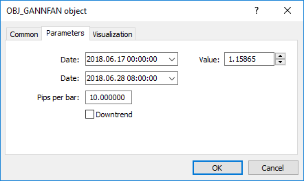

# Gann Objects

Gann Objects

For Gann Fan (OBJ\_GANNFAN) and Gann Grid (OBJ\_GANNGRID) objects you can specify two values of the ENUM\_GANN\_DIRECTION enumeration that sets the trend direction.

ENUM\_GANN\_DIRECTION

| ID | Description |
| --- | --- |
| GANN\_UP\_TREND | Line corresponding to the uptrend line |
| GANN\_DOWN\_TREND | Line corresponding to the downward trend |

To set the scale of the main line as 1x1, use function [ObjectSetDouble](../../../Object-Functions/ObjectSetDouble/ObjectSetDouble.md)(chart\_handle, gann\_object\_name, OBJPROP\_SCALE, scale), where:

- chart\_handle – chart window where the object is located;
- gann\_object\_name – object name;
- OBJPROP\_SCALE – identifier of the "Scale" property;
- scale – required scale in units of Pips/Bar.

Example of creating Gann Fan:

|  |
| --- |
| void OnStart()    {  //---     string my\_gann="OBJ\_GANNFAN object";     if(ObjectFind(0,my\_gann)<0)// Object not found       {        //--- Inform about the failure        Print("Object ",my\_gann," not found. Error code = ",GetLastError());        //--- Get the maximal price of the chart        double chart\_max\_price=ChartGetDouble(0,CHART\_PRICE\_MAX,0);        //--- Get the minimal price of the chart        double chart\_min\_price=ChartGetDouble(0,CHART\_PRICE\_MIN,0);        //--- How many bars are shown in the chart?        int bars\_on\_chart=ChartGetInteger(0,CHART\_VISIBLE\_BARS);        //--- Create an array, to write the opening time of each bar to        datetime Time[];        //--- Arrange access to the array as that of timeseries        ArraySetAsSeries(Time,true);        //--- Now copy data of bars visible in the chart into this array        int times=CopyTime(NULL,0,0,bars\_on\_chart,Time);        if(times<=0)          {           Print("Could not copy the array with the open time!");           return;          }        //--- Preliminary preparations completed           //--- Index of the central bar in the chart        int center\_bar=bars\_on\_chart/2;        //--- Chart equator - between the maximum and minimum        double mean=(chart\_max\_price+chart\_min\_price)/2.0;        //--- Set the coordinates of the first anchor point to the center        ObjectCreate(0,my\_gann,OBJ\_GANNFAN,0,Time[center\_bar],mean,                     //--- Second anchor point to the right                     Time[center\_bar/2],(mean+chart\_min\_price)/2.0);        Print("Time[center\_bar] = "+(string)Time[center\_bar]+"  Time[center\_bar/2] = "+(string)Time[center\_bar/2]);        //Print("Time[center\_bar]/="+Time[center\_bar]+"  Time[center\_bar/2]="+Time[center\_bar/2]);        //--- Set the scale in units of Pips / Bar        ObjectSetDouble(0,my\_gann,OBJPROP\_SCALE,10);        //--- Set the line trend        ObjectSetInteger(0,my\_gann,OBJPROP\_DIRECTION,GANN\_UP\_TREND);        //--- Set the line width        ObjectSetInteger(0,my\_gann,OBJPROP\_WIDTH,1);        //--- Define the line style        ObjectSetInteger(0,my\_gann,OBJPROP\_STYLE,STYLE\_DASHDOT);        //--- Set the line color        ObjectSetInteger(0,my\_gann,OBJPROP\_COLOR,clrYellowGreen);        //--- Allow the user to select an object        ObjectSetInteger(0,my\_gann,OBJPROP\_SELECTABLE,true);        //--- Select it yourself        ObjectSetInteger(0,my\_gann,OBJPROP\_SELECTED,true);        //--- Draw it on the chart        ChartRedraw(0);       }    } |
