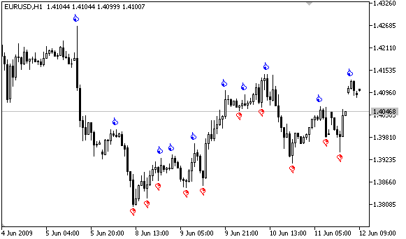

# Methods of Object Binding

Methods of Object Binding

Graphical objects Text, Label, Bitmap and Bitmap Label (OBJ\_TEXT, OBJ\_LABEL, OBJ\_BITMAP and OBJ\_BITMAP\_LABEL) can have one of the 9 different ways of coordinate binding defined by the OBJPROP\_ANCHOR property.

| Object | ID | X/Y | Width/Height | Date/Price | [OBJPROP\_CORNER](../Object-Properties/Object-Properties.md#enum_object_property_integer) | [OBJPROP\_ANCHOR](../Object-Properties/Object-Properties.md#enum_object_property_integer) | [OBJPROP\_ANGLE](../Object-Properties/Object-Properties.md#enum_object_property_double) |
| --- | --- | --- | --- | --- | --- | --- | --- |
| Text | [OBJ\_TEXT](../Object-Types/OBJ_TEXT/OBJ_TEXT.md) | — | — | Yes | — | Yes | Yes |
| Label | [OBJ\_LABEL](../Object-Types/OBJ_LABEL/OBJ_LABEL.md) | Yes | Yes (read only) | — | Yes | Yes | Yes |
| Button | [OBJ\_BUTTON](../Object-Types/OBJ_BUTTON/OBJ_BUTTON.md) | Yes | Yes | — | Yes | — | — |
| Bitmap | [OBJ\_BITMAP](../Object-Types/OBJ_BITMAP/OBJ_BITMAP.md) | — | Yes (read only) | Yes | — | Yes | — |
| Bitmap Label | [OBJ\_BITMAP\_LABEL](../Object-Types/OBJ_BITMAP_LABEL/OBJ_BITMAP_LABEL.md) | Yes | Yes (read only) | — | Yes | Yes | — |
| Edit | [OBJ\_EDIT](../Object-Types/OBJ_EDIT/OBJ_EDIT.md) | Yes | Yes | — | Yes | — | — |
| Rectangle Label | [OBJ\_RECTANGLE\_LABEL](../Object-Types/OBJ_RECTANGLE_LABEL/OBJ_RECTANGLE_LABEL.md) | Yes | Yes | — | Yes | — | — |

The following designations are used in the table:

- X/Y – coordinates of anchor points specified in pixels relative to a chart corner;
- Width/Height – objects have width and height. For "read only", the width and height values are calculated only once the object is rendered on chart;
- Date/Price – anchor point coordinates are specified using the date and price values;
- OBJPROP\_CORNER – defines the chart corner relative to which the anchor point coordinates are specified. Can be one of the 4 values of the [ENUM\_BASE\_CORNER](../Chart-Corner/Chart-Corner.md#enum_base_corner) enumeration;
- OBJPROP\_ANCHOR – defines the anchor point in object itself and can be one of the 9 values of the [ENUM\_ANCHOR\_POINT](Methods-of-Object-Binding.md#enum_anchor_point) enumeration. Coordinates in pixels are specified from this very point to selected chart corner;
- OBJPROP\_ANGLE – defines the object rotation angle counterclockwise.

The necessary variant can be specified using the function [ObjectSetInteger](../../../Object-Functions/ObjectSetInteger/ObjectSetInteger.md)(chart\_handle, object\_name, OBJPROP\_ANCHOR, anchor\_point\_mode),  where anchor\_point\_mode is one of the values of ENUM\_ANCHOR\_POINT.

ENUM\_ANCHOR\_POINT

| ID | Description |
| --- | --- |
| ANCHOR\_LEFT\_UPPER | Anchor point at the upper left corner |
| ANCHOR\_LEFT | Anchor point to the left in the center |
| ANCHOR\_LEFT\_LOWER | Anchor point at the lower left corner |
| ANCHOR\_LOWER | Anchor point below in the center |
| ANCHOR\_RIGHT\_LOWER | Anchor point at the lower right corner |
| ANCHOR\_RIGHT | Anchor point to the right in the center |
| ANCHOR\_RIGHT\_UPPER | Anchor point at the upper right corner |
| ANCHOR\_UPPER | Anchor point above in the center |
| ANCHOR\_CENTER | Anchor point strictly in the center of the object |

The [OBJ\_BUTTON](../Object-Types/OBJ_BUTTON/OBJ_BUTTON.md), [OBJ\_RECTANGLE\_LABEL](../Object-Types/OBJ_RECTANGLE_LABEL/OBJ_RECTANGLE_LABEL.md), [OBJ\_EDIT](../Object-Types/OBJ_EDIT/OBJ_EDIT.md) and [OBJ\_CHART](../Object-Types/OBJ_CHART/OBJ_CHART.md) objects have a fixed anchor point in the upper left corner (ANCHOR\_LEFT\_UPPER).

Example:

|  |
| --- |
| string text\_name="my\_OBJ\_TEXT\_object";     if(ObjectFind(0,text\_name)<0)       {        Print("Object ",text\_name," not found. Error code = ",GetLastError());        //--- Get the maximal price of the chart        double chart\_max\_price=ChartGetDouble(0,CHART\_PRICE\_MAX,0);        //--- Create object Label        ObjectCreate(0,text\_name,OBJ\_TEXT,0,TimeCurrent(),chart\_max\_price);        //--- Set color of the text        ObjectSetInteger(0,text\_name,OBJPROP\_COLOR,clrWhite);        //--- Set background color         ObjectSetInteger(0,text\_name,OBJPROP\_BGCOLOR,clrGreen);        //--- Set text for the Label object        ObjectSetString(0,text\_name,OBJPROP\_TEXT,TimeToString(TimeCurrent()));        //--- Set text font        ObjectSetString(0,text\_name,OBJPROP\_FONT,"Trebuchet MS");        //--- Set font size        ObjectSetInteger(0,text\_name,OBJPROP\_FONTSIZE,10);        //--- Bind to the upper right corner        ObjectSetInteger(0,text\_name,OBJPROP\_ANCHOR,ANCHOR\_RIGHT\_UPPER);        //--- Rotate 90 degrees counter-clockwise        ObjectSetDouble(0,text\_name,OBJPROP\_ANGLE,90);        //--- Forbid the selection of the object by mouse        ObjectSetInteger(0,text\_name,OBJPROP\_SELECTABLE,false);        //--- redraw object        ChartRedraw(0);       } |

Graphical objects Arrow (OBJ\_ARROW) have only 2 ways of linking their coordinates. Identifiers are listed in ENUM\_ARROW\_ANCHOR.

ENUM\_ARROW\_ANCHOR

| ID | Description |
| --- | --- |
| ANCHOR\_TOP | Anchor on the top side |
| ANCHOR\_BOTTOM | Anchor on the bottom side |

Example:

|  |
| --- |
| void OnStart()    {  //--- Auxiliary arrays     double Ups[],Downs[];     datetime Time[];  //--- Set the arrays as timeseries     ArraySetAsSeries(Ups,true);     ArraySetAsSeries(Downs,true);     ArraySetAsSeries(Time,true);  //--- Create handle of the Indicator Fractals     int FractalsHandle=iFractals(NULL,0);     Print("FractalsHandle = ",FractalsHandle);  //--- Set Last error value to Zero     ResetLastError();  //--- Try to copy the values of the indicator     int copied=CopyBuffer(FractalsHandle,0,0,1000,Ups);     if(copied<=0)       {        Print("Unable to copy the upper fractals. Error = ",GetLastError());        return;       }        ResetLastError();  //--- Try to copy the values of the indicator     copied=CopyBuffer(FractalsHandle,1,0,1000,Downs);     if(copied<=0)       {        Print("Unable to copy the bottom fractals. Error = ",GetLastError());        return;       }        ResetLastError();  //--- Copy timeseries containing the opening bars of the last 1000 ones     copied=CopyTime(NULL,0,0,1000,Time);     if(copied<=0)       {        Print("Unable to copy the Opening Time of the last 1000 bars");        return;       }        int upcounter=0,downcounter=0; // count there the number of arrows     bool created;// receive the result of attempts to create an object     for(int i=2;i<copied;i++)// Run through the values of the indicator iFractals       {        if(Ups[i]!=EMPTY\_VALUE)// Found the upper fractal          {           if(upcounter<10)// Create no more than 10 "Up" arrows             {              //--- Try to create an "Up" object              created=ObjectCreate(0,string(Time[i]),OBJ\_ARROW\_THUMB\_UP,0,Time[i],Ups[i]);              if(created)// If set up - let's make tuning for it                {                 //--- Point anchor is below in order not to cover bar                 ObjectSetInteger(0,string(Time[i]),OBJPROP\_ANCHOR,ANCHOR\_BOTTOM);                 //--- Final touch - painted                 ObjectSetInteger(0,string(Time[i]),OBJPROP\_COLOR,clrBlue);                 upcounter++;                }             }          }        if(Downs[i]!=EMPTY\_VALUE)// Found a lower fractal          {           if(downcounter<10)// Create no more than 10 arrows "Down"             {              //--- Try to create an object "Down"              created=ObjectCreate(0,string(Time[i]),OBJ\_ARROW\_THUMB\_DOWN,0,Time[i],Downs[i]);              if(created)// If set up - let's make tuning for it                {                 //--- Point anchor is above in order not to cover bar                 ObjectSetInteger(0,string(Time[i]),OBJPROP\_ANCHOR,ANCHOR\_TOP);                 //--- Final touch - painted                 ObjectSetInteger(0,string(Time[i]),OBJPROP\_COLOR,clrRed);                 downcounter++;                }             }          }       }    } |

After the script execution the chart will look like in this figure.

