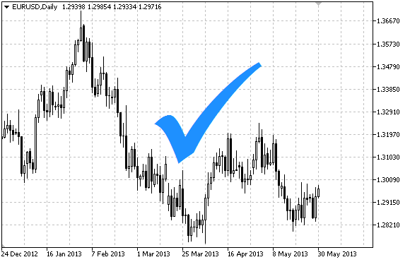

# OBJ_ARROW_CHECK

OBJ\_ARROW\_CHECK

Check sign.

Note

Anchor point position relative to the sign can be selected from [ENUM\_ARROW\_ANCHOR](../../Methods-of-Object-Binding/Methods-of-Object-Binding.md#enum_arrow_anchor) enumeration.

Large signs (more than 5) can only be created by setting the appropriate [OBJPROP\_WIDTH](../../Object-Properties/Object-Properties.md#enum_object_property_integer) property value when writing a code in MetaEditor.

Example

The following script creates and moves Check sign on the chart. Special functions have been developed to create and change graphical object's properties. You can use these functions "as is" in your own applications.

 

|  |
| --- |
| //--- description  #property description "Script draws \"Check\" sign."  #property description "Anchor point coordinate is set in"  #property description "percentage of the chart window size."  //--- display window of the input parameters during the script's launch  #property script\_show\_inputs  //--- input parameters of the script  input string            InpName="ArrowCheck"; // Sign name  input int               InpDate=10;           // Anchor point date in %  input int               InpPrice=50;          // Anchor point price in %  input ENUM\_ARROW\_ANCHOR InpAnchor=ANCHOR\_TOP; // Anchor type  input color             InpColor=clrRed;      // Sign color  input ENUM\_LINE\_STYLE   InpStyle=STYLE\_DOT;   // Border line style  input int               InpWidth=5;           // Sign size  input bool              InpBack=false;        // Background sign  input bool              InpSelection=false;   // Highlight to move  input bool              InpHidden=true;       // Hidden in the object list  input long              InpZOrder=0;          // Priority for mouse click  //+------------------------------------------------------------------+  //| Create Check sign                                                |  //+------------------------------------------------------------------+  bool ArrowCheckCreate(const long              chart\_ID=0,           // chart's ID                        const string            name="ArrowCheck",    // sign name                        const int               sub\_window=0,         // subwindow index                        datetime                time=0,               // anchor point time                        double                  price=0,              // anchor point price                        const ENUM\_ARROW\_ANCHOR anchor=ANCHOR\_BOTTOM, // anchor type                        const color             clr=clrRed,           // sign color                        const ENUM\_LINE\_STYLE   style=STYLE\_SOLID,    // border line style                        const int               width=3,              // sign size                        const bool              back=false,           // in the background                        const bool              selection=true,       // highlight to move                        const bool              hidden=true,          // hidden in the object list                        const long              z\_order=0)            // priority for mouse click    {  //--- set anchor point coordinates if they are not set     ChangeArrowEmptyPoint(time,price);  //--- reset the error value     ResetLastError();  //--- create the sign     if(!ObjectCreate(chart\_ID,name,OBJ\_ARROW\_CHECK,sub\_window,time,price))       {        Print(\_\_FUNCTION\_\_,              ": failed to create \"Check\" sign! Error code = ",GetLastError());        return(false);       }  //--- set anchor type     ObjectSetInteger(chart\_ID,name,OBJPROP\_ANCHOR,anchor);  //--- set a sign color     ObjectSetInteger(chart\_ID,name,OBJPROP\_COLOR,clr);  //--- set the border line style     ObjectSetInteger(chart\_ID,name,OBJPROP\_STYLE,style);  //--- set the sign size     ObjectSetInteger(chart\_ID,name,OBJPROP\_WIDTH,width);  //--- display in the foreground (false) or background (true)     ObjectSetInteger(chart\_ID,name,OBJPROP\_BACK,back);  //--- enable (true) or disable (false) the mode of moving the sign by mouse  //--- when creating a graphical object using ObjectCreate function, the object cannot be  //--- highlighted and moved by default. Inside this method, selection parameter  //--- is true by default making it possible to highlight and move the object     ObjectSetInteger(chart\_ID,name,OBJPROP\_SELECTABLE,selection);     ObjectSetInteger(chart\_ID,name,OBJPROP\_SELECTED,selection);  //--- hide (true) or display (false) graphical object name in the object list     ObjectSetInteger(chart\_ID,name,OBJPROP\_HIDDEN,hidden);  //--- set the priority for receiving the event of a mouse click in the chart     ObjectSetInteger(chart\_ID,name,OBJPROP\_ZORDER,z\_order);  //--- successful execution     return(true);    }  //+------------------------------------------------------------------+  //| Move the anchor point                                            |  //+------------------------------------------------------------------+  bool ArrowCheckMove(const long   chart\_ID=0,        // chart's ID                      const string name="ArrowCheck", // object name                      datetime     time=0,            // anchor point time coordinate                      double       price=0)           // anchor point price coordinate    {  //--- if point position is not set, move it to the current bar having Bid price     if(!time)        time=TimeCurrent();     if(!price)        price=SymbolInfoDouble(Symbol(),SYMBOL\_BID);  //--- reset the error value     ResetLastError();  //--- move the anchor point     if(!ObjectMove(chart\_ID,name,0,time,price))       {        Print(\_\_FUNCTION\_\_,              ": failed to move the anchor point! Error code = ",GetLastError());        return(false);       }  //--- successful execution     return(true);    }  //+------------------------------------------------------------------+  //| Change Check anchor type                                         |  //+------------------------------------------------------------------+  bool ArrowCheckAnchorChange(const long              chart\_ID=0,        // chart's ID                              const string            name="ArrowCheck", // object name                              const ENUM\_ARROW\_ANCHOR anchor=ANCHOR\_TOP) // anchor type    {  //--- reset the error value     ResetLastError();  //--- change anchor type     if(!ObjectSetInteger(chart\_ID,name,OBJPROP\_ANCHOR,anchor))       {        Print(\_\_FUNCTION\_\_,              ": failed to change anchor type! Error code = ",GetLastError());        return(false);       }  //--- successful execution     return(true);    }  //+------------------------------------------------------------------+  //| Delete Check sign                                                |  //+------------------------------------------------------------------+  bool ArrowCheckDelete(const long   chart\_ID=0,        // chart's ID                        const string name="ArrowCheck") // sign name    {  //--- reset the error value     ResetLastError();  //--- delete the sign     if(!ObjectDelete(chart\_ID,name))       {        Print(\_\_FUNCTION\_\_,              ": failed to delete \"Check\" sign! Error code = ",GetLastError());        return(false);       }  //--- successful execution     return(true);    }  //+------------------------------------------------------------------+  //| Check anchor point values and set default values                 |  //| for empty ones                                                   |  //+------------------------------------------------------------------+  void ChangeArrowEmptyPoint(datetime &time,double &price)    {  //--- if the point's time is not set, it will be on the current bar     if(!time)        time=TimeCurrent();  //--- if the point's price is not set, it will have Bid value     if(!price)        price=SymbolInfoDouble(Symbol(),SYMBOL\_BID);    }  //+------------------------------------------------------------------+  //| Script program start function                                    |  //+------------------------------------------------------------------+  void OnStart()    {  //--- check correctness of the input parameters     if(InpDate<0 || InpDate>100 || InpPrice<0 || InpPrice>100)       {        Print("Error! Incorrect values of input parameters!");        return;       }  //--- number of visible bars in the chart window     int bars=(int)ChartGetInteger(0,CHART\_VISIBLE\_BARS);  //--- price array size     int accuracy=1000;  //--- arrays for storing the date and price values to be used  //--- for setting and changing sign anchor point coordinates     datetime date[];     double   price[];  //--- memory allocation     ArrayResize(date,bars);     ArrayResize(price,accuracy);  //--- fill the array of dates     ResetLastError();     if(CopyTime(Symbol(),Period(),0,bars,date)==-1)       {        Print("Failed to copy time values! Error code = ",GetLastError());        return;       }  //--- fill the array of prices  //--- find the highest and lowest values of the chart     double max\_price=ChartGetDouble(0,CHART\_PRICE\_MAX);     double min\_price=ChartGetDouble(0,CHART\_PRICE\_MIN);  //--- define a change step of a price and fill the array     double step=(max\_price-min\_price)/accuracy;     for(int i=0;i<accuracy;i++)        price[i]=min\_price+i\*step;  //--- define points for drawing the sign     int d=InpDate\*(bars-1)/100;     int p=InpPrice\*(accuracy-1)/100;  //--- create Check sign on the chart     if(!ArrowCheckCreate(0,InpName,0,date[d],price[p],InpAnchor,InpColor,        InpStyle,InpWidth,InpBack,InpSelection,InpHidden,InpZOrder))       {        return;       }  //--- redraw the chart and wait for 1 second     ChartRedraw();     Sleep(1000);  //--- now, move the anchor point and change its position relative to the sign  //--- loop counter     int h\_steps=bars\*2/5;  //--- move the anchor point     for(int i=0;i<h\_steps;i++)       {        //--- use the following value        if(d<bars-1)           d+=1;        //--- move the point        if(!ArrowCheckMove(0,InpName,date[d],price[p]))           return;        //--- check if the script's operation has been forcefully disabled        if(IsStopped())           return;        //--- redraw the chart        ChartRedraw();        // 0.025 seconds of delay        Sleep(25);       }  //--- change anchor point location relative to the sign     ArrowCheckAnchorChange(0,InpName,ANCHOR\_BOTTOM);  //--- redraw the chart     ChartRedraw();  //--- loop counter     h\_steps=bars\*2/5;  //--- move the anchor point     for(int i=0;i<h\_steps;i++)       {        //--- use the following value        if(d<bars-1)           d+=1;        //--- move the point        if(!ArrowCheckMove(0,InpName,date[d],price[p]))           return;        //--- check if the script's operation has been forcefully disabled        if(IsStopped())           return;        //--- redraw the chart        ChartRedraw();        // 0.025 seconds of delay        Sleep(25);       }  //--- 1 second of delay     Sleep(1000);  //--- delete the sign from the chart     ArrowCheckDelete(0,InpName);     ChartRedraw();  //--- 1 second of delay     Sleep(1000);  //---    } |
