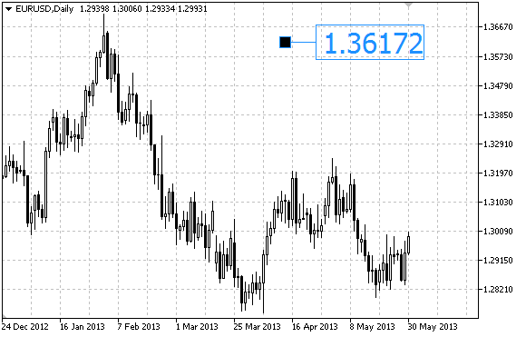

# OBJ_ARROW_RIGHT_PRICE

OBJ\_ARROW\_RIGHT\_PRICE

Right Price Label.

Example

The following script creates and moves right price label on the chart. Special functions have been developed to create and change graphical object's properties. You can use these functions "as is" in your own applications.

 

|  |
| --- |
| //--- description  #property description "Script creates the right price label on the chart."  #property description "Anchor point coordinate is set in"  #property description "percentage of the chart window size."  //--- display window of the input parameters during the script's launch  #property script\_show\_inputs  //--- input parameters of the script  input string            InpName="RightPrice"; // Price label name  input int               InpDate=0;            // Anchor point date in %  input int               InpPrice=90;          // Anchor point price in %  input color             InpColor=clrRed;      // Price label color  input ENUM\_LINE\_STYLE   InpStyle=STYLE\_SOLID; // Border line style  input int               InpWidth=2;           // Price label size  input bool              InpBack=false;        // Background label  input bool              InpSelection=true;    // Highlight to move  input bool              InpHidden=true;       // Hidden in the object list  input long              InpZOrder=0;          // Priority for mouse click  //+------------------------------------------------------------------+  //| Create the right price label                                     |  //+------------------------------------------------------------------+  bool ArrowRightPriceCreate(const long            chart\_ID=0,        // chart's ID                             const string          name="RightPrice", // price label name                             const int             sub\_window=0,      // subwindow index                             datetime              time=0,            // anchor point time                             double                price=0,           // anchor point price                             const color           clr=clrRed,        // price label color                             const ENUM\_LINE\_STYLE style=STYLE\_SOLID, // border line style                             const int             width=1,           // price label size                             const bool            back=false,        // in the background                             const bool            selection=true,    // highlight to move                             const bool            hidden=true,       // hidden in the object list                             const long            z\_order=0)         // priority for mouse click    {  //--- set anchor point coordinates if they are not set     ChangeArrowEmptyPoint(time,price);  //--- reset the error value     ResetLastError();  //--- create a price label     if(!ObjectCreate(chart\_ID,name,OBJ\_ARROW\_RIGHT\_PRICE,sub\_window,time,price))       {        Print(\_\_FUNCTION\_\_,              ": failed to create the right price label! Error code = ",GetLastError());        return(false);       }  //--- set the label color     ObjectSetInteger(chart\_ID,name,OBJPROP\_COLOR,clr);  //--- set the border line style     ObjectSetInteger(chart\_ID,name,OBJPROP\_STYLE,style);  //--- set the label size     ObjectSetInteger(chart\_ID,name,OBJPROP\_WIDTH,width);  //--- display in the foreground (false) or background (true)     ObjectSetInteger(chart\_ID,name,OBJPROP\_BACK,back);  //--- enable (true) or disable (false) the mode of moving the label by mouse  //--- when creating a graphical object using ObjectCreate function, the object cannot be  //--- highlighted and moved by default. Inside this method, selection parameter  //--- is true by default making it possible to highlight and move the object     ObjectSetInteger(chart\_ID,name,OBJPROP\_SELECTABLE,selection);     ObjectSetInteger(chart\_ID,name,OBJPROP\_SELECTED,selection);  //--- hide (true) or display (false) graphical object name in the object list     ObjectSetInteger(chart\_ID,name,OBJPROP\_HIDDEN,hidden);  //--- set the priority for receiving the event of a mouse click in the chart     ObjectSetInteger(chart\_ID,name,OBJPROP\_ZORDER,z\_order);  //--- successful execution     return(true);    }  //+------------------------------------------------------------------+  //| Move the anchor point                                            |  //+------------------------------------------------------------------+  bool ArrowRightPriceMove(const long   chart\_ID=0,        // chart's ID                           const string name="RightPrice", // label name                           datetime     time=0,            // anchor point time coordinate                           double       price=0)           // anchor point price coordinate    {  //--- if point position is not set, move it to the current bar having Bid price     if(!time)        time=TimeCurrent();     if(!price)        price=SymbolInfoDouble(Symbol(),SYMBOL\_BID);  //--- reset the error value     ResetLastError();  //--- move the anchor point     if(!ObjectMove(chart\_ID,name,0,time,price))       {        Print(\_\_FUNCTION\_\_,              ": failed to move the anchor point! Error code = ",GetLastError());        return(false);       }  //--- successful execution     return(true);    }  //+------------------------------------------------------------------+  //| Delete the right price label from the chart                      |  //+------------------------------------------------------------------+  bool ArrowRightPriceDelete(const long   chart\_ID=0,        // chart's ID                             const string name="RightPrice") // label name    {  //--- reset the error value     ResetLastError();  //--- delete the label     if(!ObjectDelete(chart\_ID,name))       {        Print(\_\_FUNCTION\_\_,              ": failed to delete the right price label! Error code = ",GetLastError());        return(false);       }  //--- successful execution     return(true);    }  //+------------------------------------------------------------------+  //| Check anchor point values and set default values                 |  //| for empty ones                                                   |  //+------------------------------------------------------------------+  void ChangeArrowEmptyPoint(datetime &time,double &price)    {  //--- if the point's time is not set, it will be on the current bar     if(!time)        time=TimeCurrent();  //--- if the point's price is not set, it will have Bid value     if(!price)        price=SymbolInfoDouble(Symbol(),SYMBOL\_BID);    }  //+------------------------------------------------------------------+  //| Script program start function                                    |  //+------------------------------------------------------------------+  void OnStart()    {  //--- check correctness of the input parameters     if(InpDate<0 || InpDate>100 || InpPrice<0 || InpPrice>100)       {        Print("Error! Incorrect values of input parameters!");        return;       }  //--- number of visible bars in the chart window     int bars=(int)ChartGetInteger(0,CHART\_VISIBLE\_BARS);  //--- price array size     int accuracy=1000;  //--- arrays for storing the date and price values to be used  //--- for setting and changing label anchor point coordinates     datetime date[];     double   price[];  //--- memory allocation     ArrayResize(date,bars);     ArrayResize(price,accuracy);  //--- fill the array of dates     ResetLastError();     if(CopyTime(Symbol(),Period(),0,bars,date)==-1)       {        Print("Failed to copy time values! Error code = ",GetLastError());        return;       }  //--- fill the array of prices  //--- find the highest and lowest values of the chart     double max\_price=ChartGetDouble(0,CHART\_PRICE\_MAX);     double min\_price=ChartGetDouble(0,CHART\_PRICE\_MIN);  //--- define a change step of a price and fill the array     double step=(max\_price-min\_price)/accuracy;     for(int i=0;i<accuracy;i++)        price[i]=min\_price+i\*step;  //--- define points for drawing the label     int d=InpDate\*(bars-1)/100;     int p=InpPrice\*(accuracy-1)/100;  //--- create the right price label on the chart     if(!ArrowRightPriceCreate(0,InpName,0,date[d],price[p],InpColor,        InpStyle,InpWidth,InpBack,InpSelection,InpHidden,InpZOrder))       {        return;       }  //--- redraw the chart and wait for 1 second     ChartRedraw();     Sleep(1000);  //--- now, move the anchor point  //--- loop counter     int v\_steps=accuracy\*4/5;  //--- move the anchor point     for(int i=0;i<v\_steps;i++)       {        //--- use the following value        if(p>1)           p-=1;        //--- move the point        if(!ArrowRightPriceMove(0,InpName,date[d],price[p]))           return;        //--- check if the script's operation has been forcefully disabled        if(IsStopped())           return;        //--- redraw the chart        ChartRedraw();       }  //--- 1 second of delay     Sleep(1000);  //--- delete the label from the chart     ArrowRightPriceDelete(0,InpName);     ChartRedraw();  //--- 1 second of delay     Sleep(1000);  //---    } |
