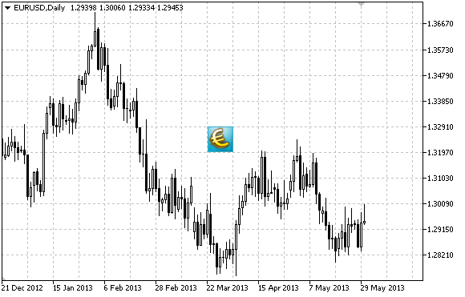

# OBJ_BITMAP_LABEL

OBJ\_BITMAP\_LABEL

Bitmap Label object.

Note

Anchor point position relative to the label can be selected from [ENUM\_ANCHOR\_POINT](../../Methods-of-Object-Binding/Methods-of-Object-Binding.md) enumeration. Anchor point coordinates are set in pixels.

You can also select bitmap anchoring corner from [ENUM\_BASE\_CORNER](../../Chart-Corner/Chart-Corner.md) enumeration.

For bitmap label, you can select [visibility scope](../../Object-Properties/Object-Properties.md#visual_rectangle) of an image.

Example

The following script creates several bitmaps on the chart. Special functions have been developed to create and change graphical object's properties. You can use these functions "as is" in your own applications.

|  |
| --- |
| //--- description  #property description "Script creates \"Bitmap Label\" object."  //--- display window of the input parameters during the script's launch  #property script\_show\_inputs  //--- input parameters of the script  input string            InpName="BmpLabel";               // Label name  input string            InpFileOn="\\Images\\dollar.bmp"; // File name for On mode  input string            InpFileOff="\\Images\\euro.bmp";  // File name for Off mode  input bool              InpState=false;                   // Label pressed/released  input ENUM\_BASE\_CORNER  InpCorner=CORNER\_LEFT\_UPPER;      // Chart corner for anchoring  input ENUM\_ANCHOR\_POINT InpAnchor=ANCHOR\_CENTER;          // Anchor type  input color             InpColor=clrRed;                  // Border color when highlighted  input ENUM\_LINE\_STYLE   InpStyle=STYLE\_SOLID;             // Line style when highlighted  input int               InpPointWidth=1;                  // Point size to move  input bool              InpBack=false;                    // Background object  input bool              InpSelection=false;               // Highlight to move  input bool              InpHidden=true;                   // Hidden in the object list  input long              InpZOrder=0;                      // Priority for mouse click  //+------------------------------------------------------------------+  //| Create Bitmap Label object                                       |  //+------------------------------------------------------------------+  bool BitmapLabelCreate(const long              chart\_ID=0,               // chart's ID                         const string            name="BmpLabel",          // label name                         const int               sub\_window=0,             // subwindow index                         const int               x=0,                      // X coordinate                         const int               y=0,                      // Y coordinate                         const string            file\_on="",               // image in On mode                         const string            file\_off="",              // image in Off mode                         const int               width=0,                  // visibility scope X coordinate                         const int               height=0,                 // visibility scope Y coordinate                         const int               x\_offset=10,              // visibility scope shift by X axis                         const int               y\_offset=10,              // visibility scope shift by Y axis                         const bool              state=false,              // pressed/released                         const ENUM\_BASE\_CORNER  corner=CORNER\_LEFT\_UPPER, // chart corner for anchoring                         const ENUM\_ANCHOR\_POINT anchor=ANCHOR\_LEFT\_UPPER, // anchor type                          const color             clr=clrRed,               // border color when highlighted                         const ENUM\_LINE\_STYLE   style=STYLE\_SOLID,        // line style when highlighted                         const int               point\_width=1,            // move point size                         const bool              back=false,               // in the background                         const bool              selection=false,          // highlight to move                         const bool              hidden=true,              // hidden in the object list                         const long              z\_order=0)                // priority for mouse click    {  //--- reset the error value     ResetLastError();  //--- create a bitmap label     if(!ObjectCreate(chart\_ID,name,OBJ\_BITMAP\_LABEL,sub\_window,0,0))       {        Print(\_\_FUNCTION\_\_,              ": failed to create \"Bitmap Label\" object! Error code = ",GetLastError());        return(false);       }  //--- set the images for On and Off modes     if(!ObjectSetString(chart\_ID,name,OBJPROP\_BMPFILE,0,file\_on))       {        Print(\_\_FUNCTION\_\_,              ": failed to load the image for On mode! Error code = ",GetLastError());        return(false);       }     if(!ObjectSetString(chart\_ID,name,OBJPROP\_BMPFILE,1,file\_off))       {        Print(\_\_FUNCTION\_\_,              ": failed to load the image for Off mode! Error code = ",GetLastError());        return(false);       }  //--- set label coordinates     ObjectSetInteger(chart\_ID,name,OBJPROP\_XDISTANCE,x);     ObjectSetInteger(chart\_ID,name,OBJPROP\_YDISTANCE,y);  //--- set visibility scope for the image; if width or height values  //--- exceed the width and height (respectively) of a source image,  //--- it is not drawn; in the opposite case,  //--- only the part corresponding to these values is drawn     ObjectSetInteger(chart\_ID,name,OBJPROP\_XSIZE,width);     ObjectSetInteger(chart\_ID,name,OBJPROP\_YSIZE,height);  //--- set the part of an image that is to be displayed in the visibility scope  //--- the default part is the upper left area of an image; the values allow  //--- performing a shift from this area displaying another part of the image     ObjectSetInteger(chart\_ID,name,OBJPROP\_XOFFSET,x\_offset);     ObjectSetInteger(chart\_ID,name,OBJPROP\_YOFFSET,y\_offset);  //--- define the label's status (pressed or released)     ObjectSetInteger(chart\_ID,name,OBJPROP\_STATE,state);  //--- set the chart's corner, relative to which point coordinates are defined     ObjectSetInteger(chart\_ID,name,OBJPROP\_CORNER,corner);  //--- set anchor type     ObjectSetInteger(chart\_ID,name,OBJPROP\_ANCHOR,anchor);  //--- set the border color when object highlighting mode is enabled     ObjectSetInteger(chart\_ID,name,OBJPROP\_COLOR,clr);  //--- set the border line style when object highlighting mode is enabled     ObjectSetInteger(chart\_ID,name,OBJPROP\_STYLE,style);  //--- set a size of the anchor point for moving an object     ObjectSetInteger(chart\_ID,name,OBJPROP\_WIDTH,point\_width);  //--- display in the foreground (false) or background (true)     ObjectSetInteger(chart\_ID,name,OBJPROP\_BACK,back);  //--- enable (true) or disable (false) the mode of moving the label by mouse     ObjectSetInteger(chart\_ID,name,OBJPROP\_SELECTABLE,selection);     ObjectSetInteger(chart\_ID,name,OBJPROP\_SELECTED,selection);  //--- hide (true) or display (false) graphical object name in the object list     ObjectSetInteger(chart\_ID,name,OBJPROP\_HIDDEN,hidden);  //--- set the priority for receiving the event of a mouse click in the chart     ObjectSetInteger(chart\_ID,name,OBJPROP\_ZORDER,z\_order);  //--- successful execution     return(true);    }  //+------------------------------------------------------------------+  //| Set a new image for Bitmap label object                          |  //+------------------------------------------------------------------+  bool BitmapLabelSetImage(const long   chart\_ID=0,      // chart's ID                           const string name="BmpLabel", // label name                           const int    on\_off=0,        // modifier (On or Off)                           const string file="")         // path to the file    {  //--- reset the error value     ResetLastError();  //--- set the path to the image file     if(!ObjectSetString(chart\_ID,name,OBJPROP\_BMPFILE,on\_off,file))       {        Print(\_\_FUNCTION\_\_,              ": failed to load the image! Error code = ",GetLastError());        return(false);       }  //--- successful execution     return(true);    }  //+------------------------------------------------------------------+  //| Move Bitmap Label object                                         |  //+------------------------------------------------------------------+  bool BitmapLabelMove(const long   chart\_ID=0,      // chart's ID                       const string name="BmpLabel", // label name                       const int    x=0,             // X coordinate                       const int    y=0)             // Y coordinate    {  //--- reset the error value     ResetLastError();  //--- move the object     if(!ObjectSetInteger(chart\_ID,name,OBJPROP\_XDISTANCE,x))       {        Print(\_\_FUNCTION\_\_,              ": failed to move X coordinate of the object! Error code = ",GetLastError());        return(false);       }     if(!ObjectSetInteger(chart\_ID,name,OBJPROP\_YDISTANCE,y))       {        Print(\_\_FUNCTION\_\_,              ": failed to move Y coordinate of the object! Error code = ",GetLastError());        return(false);       }  //--- successful execution     return(true);    }  //+------------------------------------------------------------------+  //| Change visibility scope (object) size                            |  //+------------------------------------------------------------------+  bool BitmapLabelChangeSize(const long   chart\_ID=0,      // chart's ID                             const string name="BmpLabel", // label name                             const int    width=0,         // label width                             const int    height=0)        // label height    {  //--- reset the error value     ResetLastError();  //--- change the object size     if(!ObjectSetInteger(chart\_ID,name,OBJPROP\_XSIZE,width))       {        Print(\_\_FUNCTION\_\_,              ": failed to change the object width! Error code = ",GetLastError());        return(false);       }     if(!ObjectSetInteger(chart\_ID,name,OBJPROP\_YSIZE,height))       {        Print(\_\_FUNCTION\_\_,              ": failed to change the object height! Error code = ",GetLastError());        return(false);       }  //--- successful execution     return(true);    }  //+--------------------------------------------------------------------+  //| Change coordinate of the upper left corner of the visibility scope |  //+--------------------------------------------------------------------+  bool BitmapLabelMoveVisibleArea(const long   chart\_ID=0,      // chart's ID                                  const string name="BmpLabel", // label name                                  const int    x\_offset=0,      // visibility scope X coordinate                                  const int    y\_offset=0)      // visibility scope Y coordinate    {  //--- reset the error value     ResetLastError();  //--- change the object's visibility scope coordinates     if(!ObjectSetInteger(chart\_ID,name,OBJPROP\_XOFFSET,x\_offset))       {        Print(\_\_FUNCTION\_\_,              ": failed to change X coordinate of the visibility scope! Error code = ",GetLastError());        return(false);       }     if(!ObjectSetInteger(chart\_ID,name,OBJPROP\_YOFFSET,y\_offset))       {        Print(\_\_FUNCTION\_\_,              ": failed to change Y coordinate of the visibility scope! Error code = ",GetLastError());        return(false);       }  //--- successful execution     return(true);    }  //+------------------------------------------------------------------+  //| Delete "Bitmap label" object                                     |  //+------------------------------------------------------------------+  bool BitmapLabelDelete(const long   chart\_ID=0,      // chart's ID                         const string name="BmpLabel") // label name    {  //--- reset the error value     ResetLastError();  //--- delete the label     if(!ObjectDelete(chart\_ID,name))       {        Print(\_\_FUNCTION\_\_,              ": failed to delete \"Bitmap label\" object! Error code = ",GetLastError());        return(false);       }  //--- successful execution     return(true);    }  //+------------------------------------------------------------------+  //| Script program start function                                    |  //+------------------------------------------------------------------+  void OnStart()    {  //--- chart window size     long x\_distance;     long y\_distance;  //--- set window size     if(!ChartGetInteger(0,CHART\_WIDTH\_IN\_PIXELS,0,x\_distance))       {        Print("Failed to get the chart width! Error code = ",GetLastError());        return;       }     if(!ChartGetInteger(0,CHART\_HEIGHT\_IN\_PIXELS,0,y\_distance))       {        Print("Failed to get the chart height! Error code = ",GetLastError());        return;       }  //--- define bitmap label coordinates     int x=(int)x\_distance/2;     int y=(int)y\_distance/2;  //--- set label size and visibility scope coordinates     int width=32;     int height=32;     int x\_offset=0;     int y\_offset=0;  //--- place bitmap label at the center of the window     if(!BitmapLabelCreate(0,InpName,0,x,y,InpFileOn,InpFileOff,width,height,x\_offset,y\_offset,InpState,        InpCorner,InpAnchor,InpColor,InpStyle,InpPointWidth,InpBack,InpSelection,InpHidden,InpZOrder))       {        return;       }  //--- redraw the chart and wait one second     ChartRedraw();     Sleep(1000);  //--- change label's visibility scope size in the loop     for(int i=0;i<6;i++)       {        //--- change visibility scope size        width--;        height--;        if(!BitmapLabelChangeSize(0,InpName,width,height))           return;        //--- check if the script's operation has been forcefully disabled        if(IsStopped())           return;        //--- redraw the chart        ChartRedraw();        // 0.3 seconds of delay        Sleep(300);       }  //--- 1 second of delay     Sleep(1000);  //--- change label's visibility scope coordinates in the loop     for(int i=0;i<2;i++)       {        //--- change visibility scope coordinates        x\_offset++;        y\_offset++;        if(!BitmapLabelMoveVisibleArea(0,InpName,x\_offset,y\_offset))           return;        //--- check if the script's operation has been forcefully disabled        if(IsStopped())           return;        //--- redraw the chart        ChartRedraw();        // 0.3 seconds of delay        Sleep(300);       }  //--- 1 second of delay     Sleep(1000);  //--- delete the label     BitmapLabelDelete(0,InpName);     ChartRedraw();  //--- 1 second of delay     Sleep(1000);  //---    } |
