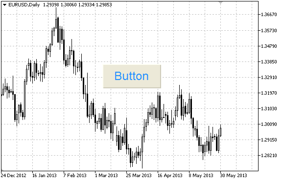

# OBJ_BUTTON

OBJ\_BUTTON

Button object.

Note

Anchor point coordinates are set in pixels. You can select button anchoring corner from [ENUM\_BASE\_CORNER](../../Chart-Corner/Chart-Corner.md).

Example

The following script creates and moves Button object on the chart. Special functions have been developed to create and change graphical object's properties. You can use these functions "as is" in your own applications.

|  |
| --- |
| //--- description  #property description "Script creates the button on the chart."  //--- display window of the input parameters during the script's launch  #property script\_show\_inputs  //--- input parameters of the script  input string           InpName="Button";            // Button name  input ENUM\_BASE\_CORNER InpCorner=CORNER\_LEFT\_UPPER; // Chart corner for anchoring  input string           InpFont="Arial";             // Font  input int              InpFontSize=14;              // Font size  input color            InpColor=clrBlack;           // Text color  input color            InpBackColor=C'236,233,216'; // Background color  input color            InpBorderColor=clrNONE;      // Border color  input bool             InpState=false;              // Pressed/Released  input bool             InpBack=false;               // Background object  input bool             InpSelection=false;          // Highlight to move  input bool             InpHidden=true;              // Hidden in the object list  input long             InpZOrder=0;                 // Priority for mouse click  //+------------------------------------------------------------------+  //| Create the button                                                |  //+------------------------------------------------------------------+  bool ButtonCreate(const long              chart\_ID=0,               // chart's ID                    const string            name="Button",            // button name                    const int               sub\_window=0,             // subwindow index                    const int               x=0,                      // X coordinate                    const int               y=0,                      // Y coordinate                    const int               width=50,                 // button width                    const int               height=18,                // button height                    const ENUM\_BASE\_CORNER  corner=CORNER\_LEFT\_UPPER, // chart corner for anchoring                    const string            text="Button",            // text                    const string            font="Arial",             // font                    const int               font\_size=10,             // font size                    const color             clr=clrBlack,             // text color                    const color             back\_clr=C'236,233,216',  // background color                    const color             border\_clr=clrNONE,       // border color                    const bool              state=false,              // pressed/released                    const bool              back=false,               // in the background                    const bool              selection=false,          // highlight to move                    const bool              hidden=true,              // hidden in the object list                    const long              z\_order=0)                // priority for mouse click    {  //--- reset the error value     ResetLastError();  //--- create the button     if(!ObjectCreate(chart\_ID,name,OBJ\_BUTTON,sub\_window,0,0))       {        Print(\_\_FUNCTION\_\_,              ": failed to create the button! Error code = ",GetLastError());        return(false);       }  //--- set button coordinates     ObjectSetInteger(chart\_ID,name,OBJPROP\_XDISTANCE,x);     ObjectSetInteger(chart\_ID,name,OBJPROP\_YDISTANCE,y);  //--- set button size     ObjectSetInteger(chart\_ID,name,OBJPROP\_XSIZE,width);     ObjectSetInteger(chart\_ID,name,OBJPROP\_YSIZE,height);  //--- set the chart's corner, relative to which point coordinates are defined     ObjectSetInteger(chart\_ID,name,OBJPROP\_CORNER,corner);  //--- set the text     ObjectSetString(chart\_ID,name,OBJPROP\_TEXT,text);  //--- set text font     ObjectSetString(chart\_ID,name,OBJPROP\_FONT,font);  //--- set font size     ObjectSetInteger(chart\_ID,name,OBJPROP\_FONTSIZE,font\_size);  //--- set text color     ObjectSetInteger(chart\_ID,name,OBJPROP\_COLOR,clr);  //--- set background color     ObjectSetInteger(chart\_ID,name,OBJPROP\_BGCOLOR,back\_clr);  //--- set border color     ObjectSetInteger(chart\_ID,name,OBJPROP\_BORDER\_COLOR,border\_clr);  //--- display in the foreground (false) or background (true)     ObjectSetInteger(chart\_ID,name,OBJPROP\_BACK,back);  //--- set button state     ObjectSetInteger(chart\_ID,name,OBJPROP\_STATE,state);  //--- enable (true) or disable (false) the mode of moving the button by mouse     ObjectSetInteger(chart\_ID,name,OBJPROP\_SELECTABLE,selection);     ObjectSetInteger(chart\_ID,name,OBJPROP\_SELECTED,selection);  //--- hide (true) or display (false) graphical object name in the object list     ObjectSetInteger(chart\_ID,name,OBJPROP\_HIDDEN,hidden);  //--- set the priority for receiving the event of a mouse click in the chart     ObjectSetInteger(chart\_ID,name,OBJPROP\_ZORDER,z\_order);  //--- successful execution     return(true);    }  //+------------------------------------------------------------------+  //| Move the button                                                  |  //+------------------------------------------------------------------+  bool ButtonMove(const long   chart\_ID=0,    // chart's ID                  const string name="Button", // button name                  const int    x=0,           // X coordinate                  const int    y=0)           // Y coordinate    {  //--- reset the error value     ResetLastError();  //--- move the button     if(!ObjectSetInteger(chart\_ID,name,OBJPROP\_XDISTANCE,x))       {        Print(\_\_FUNCTION\_\_,              ": failed to move X coordinate of the button! Error code = ",GetLastError());        return(false);       }     if(!ObjectSetInteger(chart\_ID,name,OBJPROP\_YDISTANCE,y))       {        Print(\_\_FUNCTION\_\_,              ": failed to move Y coordinate of the button! Error code = ",GetLastError());        return(false);       }  //--- successful execution     return(true);    }  //+------------------------------------------------------------------+  //| Change button size                                               |  //+------------------------------------------------------------------+  bool ButtonChangeSize(const long   chart\_ID=0,    // chart's ID                        const string name="Button", // button name                        const int    width=50,      // button width                        const int    height=18)     // button height    {  //--- reset the error value     ResetLastError();  //--- change the button size     if(!ObjectSetInteger(chart\_ID,name,OBJPROP\_XSIZE,width))       {        Print(\_\_FUNCTION\_\_,              ": failed to change the button width! Error code = ",GetLastError());        return(false);       }     if(!ObjectSetInteger(chart\_ID,name,OBJPROP\_YSIZE,height))       {        Print(\_\_FUNCTION\_\_,              ": failed to change the button height! Error code = ",GetLastError());        return(false);       }  //--- successful execution     return(true);    }  //+------------------------------------------------------------------+  //| Change corner of the chart for binding the button                |  //+------------------------------------------------------------------+  bool ButtonChangeCorner(const long             chart\_ID=0,               // chart's ID                          const string           name="Button",            // button name                          const ENUM\_BASE\_CORNER corner=CORNER\_LEFT\_UPPER) // chart corner for anchoring    {  //--- reset the error value     ResetLastError();  //--- change anchor corner     if(!ObjectSetInteger(chart\_ID,name,OBJPROP\_CORNER,corner))       {        Print(\_\_FUNCTION\_\_,              ": failed to change the anchor corner! Error code = ",GetLastError());        return(false);       }  //--- successful execution     return(true);    }  //+------------------------------------------------------------------+  //| Change button text                                               |  //+------------------------------------------------------------------+  bool ButtonTextChange(const long   chart\_ID=0,    // chart's ID                        const string name="Button", // button name                        const string text="Text")   // text    {  //--- reset the error value     ResetLastError();  //--- change object text     if(!ObjectSetString(chart\_ID,name,OBJPROP\_TEXT,text))       {        Print(\_\_FUNCTION\_\_,              ": failed to change the text! Error code = ",GetLastError());        return(false);       }  //--- successful execution     return(true);    }  //+------------------------------------------------------------------+  //| Delete the button                                                |  //+------------------------------------------------------------------+  bool ButtonDelete(const long   chart\_ID=0,    // chart's ID                    const string name="Button") // button name    {  //--- reset the error value     ResetLastError();  //--- delete the button     if(!ObjectDelete(chart\_ID,name))       {        Print(\_\_FUNCTION\_\_,              ": failed to delete the button! Error code = ",GetLastError());        return(false);       }  //--- successful execution     return(true);    }  //+------------------------------------------------------------------+  //| Script program start function                                    |  //+------------------------------------------------------------------+  void OnStart()    {  //--- chart window size     long x\_distance;     long y\_distance;  //--- set window size     if(!ChartGetInteger(0,CHART\_WIDTH\_IN\_PIXELS,0,x\_distance))       {        Print("Failed to get the chart width! Error code = ",GetLastError());        return;       }     if(!ChartGetInteger(0,CHART\_HEIGHT\_IN\_PIXELS,0,y\_distance))       {        Print("Failed to get the chart height! Error code = ",GetLastError());        return;       }  //--- define the step for changing the button size     int x\_step=(int)x\_distance/32;     int y\_step=(int)y\_distance/32;  //--- set the button coordinates and its size     int x=(int)x\_distance/32;     int y=(int)y\_distance/32;     int x\_size=(int)x\_distance\*15/16;     int y\_size=(int)y\_distance\*15/16;  //--- create the button     if(!ButtonCreate(0,InpName,0,x,y,x\_size,y\_size,InpCorner,"Press",InpFont,InpFontSize,        InpColor,InpBackColor,InpBorderColor,InpState,InpBack,InpSelection,InpHidden,InpZOrder))       {        return;       }  //--- redraw the chart     ChartRedraw();  //--- reduce the button in the loop     int i=0;     while(i<13)       {        //--- half a second of delay        Sleep(500);        //--- switch the button to the pressed state        ObjectSetInteger(0,InpName,OBJPROP\_STATE,true);        //--- redraw the chart and wait for 0.2 second        ChartRedraw();        Sleep(200);        //--- redefine coordinates and button size        x+=x\_step;        y+=y\_step;        x\_size-=x\_step\*2;        y\_size-=y\_step\*2;        //--- reduce the button        ButtonMove(0,InpName,x,y);        ButtonChangeSize(0,InpName,x\_size,y\_size);        //--- bring the button back to the released state        ObjectSetInteger(0,InpName,OBJPROP\_STATE,false);        //--- redraw the chart        ChartRedraw();        //--- check if the script's operation has been forcefully disabled        if(IsStopped())           return;        //--- increase the loop counter        i++;       }  //--- half a second of delay     Sleep(500);  //--- delete the button     ButtonDelete(0,InpName);     ChartRedraw();  //--- wait for 1 second     Sleep(1000);  //---    } |
