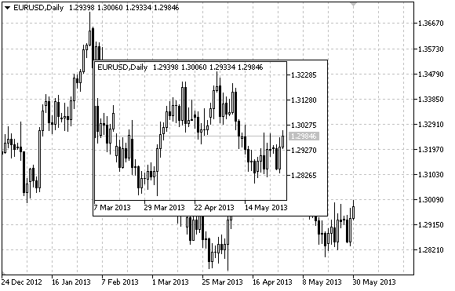

# OBJ_CHART

OBJ\_CHART

Chart object.

Note

" OBJ\_CHART" type object is not supported (not displayed) during a visual test.

Anchor point coordinates are set in pixels. You can select anchoring corner from [ENUM\_BASE\_CORNER](../../Chart-Corner/Chart-Corner.md) enumeration.

Symbol, period and scale can be selected for Chart object. Price scale and date display mode can also be enabled/disabled.

Example

The following script creates and moves Chart object on the chart. Special functions have been developed to create and change graphical object's properties. You can use these functions "as is" in your own applications.

 

|  |
| --- |
| //--- description  #property description "Script creates \"Chart\" object."  //--- display window of the input parameters during the script's launch  #property script\_show\_inputs  //--- input parameters of the script  input string           InpName="Chart";             // Object name  input string           InpSymbol="EURUSD";          // Symbol  input ENUM\_TIMEFRAMES  InpPeriod=PERIOD\_H1;         // Period  input ENUM\_BASE\_CORNER InpCorner=CORNER\_LEFT\_UPPER; // Anchoring corner  input int              InpScale=2;                  // Scale  input bool             InpDateScale=true;           // Time scale display  input bool             InpPriceScale=true;          // Price scale display  input color            InpColor=clrRed;             // Border color when highlighted  input ENUM\_LINE\_STYLE  InpStyle=STYLE\_DASHDOTDOT;   // Line style when highlighted  input int              InpPointWidth=1;             // Point size to move  input bool             InpBack=false;               // Background object  input bool             InpSelection=true;           // Highlight to move  input bool             InpHidden=true;              // Hidden in the object list  input long             InpZOrder=0;                 // Priority for mouse click  //+------------------------------------------------------------------+  //| Creating Chart object                                            |  //+------------------------------------------------------------------+  bool ObjectChartCreate(const long              chart\_ID=0,               // chart's ID                         const string            name="Chart",             // object name                         const int               sub\_window=0,             // subwindow index                         const string            symbol="EURUSD",          // symbol                         const ENUM\_TIMEFRAMES   period=PERIOD\_H1,         // period                         const int               x=0,                      // X coordinate                         const int               y=0,                      // Y coordinate                         const int               width=300,                // width                         const int               height=200,               // height                         const ENUM\_BASE\_CORNER  corner=CORNER\_LEFT\_UPPER, // anchoring corner                         const int               scale=2,                  // scale                         const bool              date\_scale=true,          // time scale display                         const bool              price\_scale=true,         // price scale display                         const color             clr=clrRed,               // border color when highlighted                         const ENUM\_LINE\_STYLE   style=STYLE\_SOLID,        // line style when highlighted                         const int               point\_width=1,            // move point size                         const bool              back=false,               // in the background                         const bool              selection=false,          // highlight to move                         const bool              hidden=true,              // hidden in the object list                         const long              z\_order=0)                // priority for mouse click    {  //--- reset the error value     ResetLastError();  //--- create Chart object     if(!ObjectCreate(chart\_ID,name,OBJ\_CHART,sub\_window,0,0))       {        Print(\_\_FUNCTION\_\_,              ": failed to create \"Chart\" object! Error code = ",GetLastError());        return(false);       }  //--- set object coordinates     ObjectSetInteger(chart\_ID,name,OBJPROP\_XDISTANCE,x);     ObjectSetInteger(chart\_ID,name,OBJPROP\_YDISTANCE,y);  //--- set object size     ObjectSetInteger(chart\_ID,name,OBJPROP\_XSIZE,width);     ObjectSetInteger(chart\_ID,name,OBJPROP\_YSIZE,height);  //--- set the chart's corner, relative to which point coordinates are defined     ObjectSetInteger(chart\_ID,name,OBJPROP\_CORNER,corner);  //--- set the symbol     ObjectSetString(chart\_ID,name,OBJPROP\_SYMBOL,symbol);  //--- set the period     ObjectSetInteger(chart\_ID,name,OBJPROP\_PERIOD,period);  //--- set the scale     ObjectSetInteger(chart\_ID,name,OBJPROP\_CHART\_SCALE,scale);  //--- display (true) or hide (false) the time scale     ObjectSetInteger(chart\_ID,name,OBJPROP\_DATE\_SCALE,date\_scale);  //--- display (true) or hide (false) the price scale     ObjectSetInteger(chart\_ID,name,OBJPROP\_PRICE\_SCALE,price\_scale);  //--- set the border color when object highlighting mode is enabled     ObjectSetInteger(chart\_ID,name,OBJPROP\_COLOR,clr);  //--- set the border line style when object highlighting mode is enabled     ObjectSetInteger(chart\_ID,name,OBJPROP\_STYLE,style);  //--- set a size of the anchor point for moving an object     ObjectSetInteger(chart\_ID,name,OBJPROP\_WIDTH,point\_width);  //--- display in the foreground (false) or background (true)     ObjectSetInteger(chart\_ID,name,OBJPROP\_BACK,back);  //--- enable (true) or disable (false) the mode of moving the label by mouse     ObjectSetInteger(chart\_ID,name,OBJPROP\_SELECTABLE,selection);     ObjectSetInteger(chart\_ID,name,OBJPROP\_SELECTED,selection);  //--- hide (true) or display (false) graphical object name in the object list     ObjectSetInteger(chart\_ID,name,OBJPROP\_HIDDEN,hidden);  //--- set the priority for receiving the event of a mouse click in the chart     ObjectSetInteger(chart\_ID,name,OBJPROP\_ZORDER,z\_order);  //--- successful execution     return(true);    }  //+------------------------------------------------------------------+  //| Sets the symbol and time frame of the Chart object               |  //+------------------------------------------------------------------+  bool ObjectChartSetSymbolAndPeriod(const long            chart\_ID=0,       // chart's ID (not Chart object's one)                                     const string          name="Chart",     // object name                                     const string          symbol="EURUSD",  // symbol                                     const ENUM\_TIMEFRAMES period=PERIOD\_H1) // time frame    {  //--- reset the error value     ResetLastError();  //--- set Chart object's symbol and time frame     if(!ObjectSetString(chart\_ID,name,OBJPROP\_SYMBOL,symbol))       {        Print(\_\_FUNCTION\_\_,              ": failed to set a symbol for \"Chart\" object! Error code = ",GetLastError());        return(false);       }     if(!ObjectSetInteger(chart\_ID,name,OBJPROP\_PERIOD,period))       {        Print(\_\_FUNCTION\_\_,              ": failed to set a period for \"Chart\" object! Error code = ",GetLastError());        return(false);       }  //--- successful execution     return(true);    }  //+------------------------------------------------------------------+  //| Move Chart object                                                |  //+------------------------------------------------------------------+  bool ObjectChartMove(const long   chart\_ID=0,   // chart's ID (not Chart object's one)                       const string name="Chart", // object name                       const int    x=0,          // X coordinate                       const int    y=0)          // Y coordinate    {  //--- reset the error value     ResetLastError();  //--- move the object     if(!ObjectSetInteger(chart\_ID,name,OBJPROP\_XDISTANCE,x))       {        Print(\_\_FUNCTION\_\_,              ": failed to move X coordinate of \"Chart\" object! Error code = ",GetLastError());        return(false);       }     if(!ObjectSetInteger(chart\_ID,name,OBJPROP\_YDISTANCE,y))       {        Print(\_\_FUNCTION\_\_,              ": failed to move Y coordinate of \"Chart\" object! Error code = ",GetLastError());        return(false);       }  //--- successful execution     return(true);    }  //+------------------------------------------------------------------+  //| Change Chart object size                                         |  //+------------------------------------------------------------------+  bool ObjectChartChangeSize(const long   chart\_ID=0,   // chart's ID (not Chart object's one)                             const string name="Chart", // object name                             const int    width=300,    // width                             const int    height=200)   // height    {  //--- reset the error value     ResetLastError();  //--- change the object size     if(!ObjectSetInteger(chart\_ID,name,OBJPROP\_XSIZE,width))       {        Print(\_\_FUNCTION\_\_,              ": failed to change the width of \"Chart\" object! Error code = ",GetLastError());        return(false);       }     if(!ObjectSetInteger(chart\_ID,name,OBJPROP\_YSIZE,height))       {        Print(\_\_FUNCTION\_\_,              ": failed to change the height of \"Chart\" object! Error code = ",GetLastError());        return(false);       }  //--- successful execution     return(true);    }  //+------------------------------------------------------------------+  //| Return Chart object's ID                                         |  //+------------------------------------------------------------------+  long ObjectChartGetID(const long   chart\_ID=0,   // chart's ID (not Chart object's one)                        const string name="Chart") // object name    {  //--- prepare the variable to get Chart object's ID     long id=-1;  //--- reset the error value     ResetLastError();  //--- get ID     if(!ObjectGetInteger(chart\_ID,name,OBJPROP\_CHART\_ID,0,id))       {        Print(\_\_FUNCTION\_\_,              ": failed to get \"Chart\" object's ID! Error code = ",GetLastError());       }  //--- return the result     return(id);    }  //+------------------------------------------------------------------+  //| Delete Chart object                                              |  //+------------------------------------------------------------------+  bool ObjectChartDelete(const long   chart\_ID=0,   // chart's ID (not Chart object's one)                         const string name="Chart") // object name    {  //--- reset the error value     ResetLastError();  //--- delete the button     if(!ObjectDelete(chart\_ID,name))       {        Print(\_\_FUNCTION\_\_,              ": failed to delete \"Chart\" object! Error code = ",GetLastError());        return(false);       }  //--- successful execution     return(true);    }  //+------------------------------------------------------------------+  //| Script program start function                                    |  //+------------------------------------------------------------------+  void OnStart()    {  //--- get the number of symbols in Market Watch     int  symbols=SymbolsTotal(true);  //--- check if the symbol with a specified name is present in the symbol list     bool exist=false;     for(int i=0;i<symbols;i++)        if(InpSymbol==SymbolName(i,true))          {           exist=true;           break;          }     if(!exist)       {        Print("Error! ",InpSymbol," symbol is not present in \"Market Watch\"!");        return;       }  //--- check validity of input parameters     if(InpScale<0 || InpScale>5)       {        Print("Error! Incorrect values of input parameters!");        return;       }     //--- chart window size     long x\_distance;     long y\_distance;  //--- set window size     if(!ChartGetInteger(0,CHART\_WIDTH\_IN\_PIXELS,0,x\_distance))       {        Print("Failed to get the chart width! Error code = ",GetLastError());        return;       }     if(!ChartGetInteger(0,CHART\_HEIGHT\_IN\_PIXELS,0,y\_distance))       {        Print("Failed to get the chart height! Error code = ",GetLastError());        return;       }  //--- set Chart object coordinates and its size     int x=(int)x\_distance/16;     int y=(int)y\_distance/16;     int x\_size=(int)x\_distance\*7/16;     int y\_size=(int)y\_distance\*7/16;  //--- create Chart object     if(!ObjectChartCreate(0,InpName,0,InpSymbol,InpPeriod,x,y,x\_size,y\_size,InpCorner,InpScale,InpDateScale,        InpPriceScale,InpColor,InpStyle,InpPointWidth,InpBack,InpSelection,InpHidden,InpZOrder))       {        return;       }  //--- redraw the chart and wait for 1 second     ChartRedraw();     Sleep(1000);  //--- stretch Chart object     int steps=(int)MathMin(x\_distance\*7/16,y\_distance\*7/16);     for(int i=0;i<steps;i++)       {        //--- resize        x\_size+=1;        y\_size+=1;        if(!ObjectChartChangeSize(0,InpName,x\_size,y\_size))           return;        //--- check if the script's operation has been forcefully disabled        if(IsStopped())           return;        //--- redraw the chart and wait for 0.01 seconds        ChartRedraw();        Sleep(10);       }  //--- half a second of delay     Sleep(500);  //--- change chart's time frame     if(!ObjectChartSetSymbolAndPeriod(0,InpName,InpSymbol,PERIOD\_M1))        return;     ChartRedraw();  //--- three seconds of delay     Sleep(3000);  //--- delete the object     ObjectChartDelete(0,InpName);     ChartRedraw();  //--- wait for 1 second     Sleep(1000);  //---    } |
