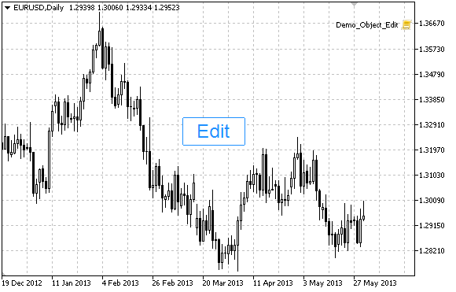

# OBJ_EDIT

OBJ\_EDIT

Edit object.

Note

Anchor point coordinates are set in pixels. You can select Edit anchoring corner from [ENUM\_BASE\_CORNER](../../Chart-Corner/Chart-Corner.md) enumeration.

You can also select one of the text alignment types inside Edit from [ENUM\_ALIGN\_MODE](../../Object-Properties/Object-Properties.md#enum_align_mode) enumeration.

Example

The following script creates and moves Edit object on the chart. Special functions have been developed to create and change graphical object's properties. You can use these functions "as is" in your own applications.

|  |
| --- |
| //--- description  #property description "Script creates \"Edit\" object."  //--- display window of the input parameters during the script's launch  #property script\_show\_inputs  //--- input parameters of the script  input string           InpName="Edit";              // Object name  input string           InpText="Text";              // Object text  input string           InpFont="Arial";             // Font  input int              InpFontSize=14;              // Font size  input ENUM\_ALIGN\_MODE  InpAlign=ALIGN\_CENTER;       // Text alignment type  input bool             InpReadOnly=false;           // Permission to edit  input ENUM\_BASE\_CORNER InpCorner=CORNER\_LEFT\_UPPER; // Chart corner for anchoring  input color            InpColor=clrBlack;           // Text color  input color            InpBackColor=clrWhite;       // Background color  input color            InpBorderColor=clrBlack;     // Border color  input bool             InpBack=false;               // Background object  input bool             InpSelection=false;          // Highlight to move  input bool             InpHidden=true;              // Hidden in the object list  input long             InpZOrder=0;                 // Priority for mouse click  //+------------------------------------------------------------------+  //| Create Edit object                                               |  //+------------------------------------------------------------------+  bool EditCreate(const long             chart\_ID=0,               // chart's ID                  const string           name="Edit",              // object name                  const int              sub\_window=0,             // subwindow index                  const int              x=0,                      // X coordinate                  const int              y=0,                      // Y coordinate                  const int              width=50,                 // width                  const int              height=18,                // height                  const string           text="Text",              // text                  const string           font="Arial",             // font                  const int              font\_size=10,             // font size                  const ENUM\_ALIGN\_MODE  align=ALIGN\_CENTER,       // alignment type                  const bool             read\_only=false,          // ability to edit                  const ENUM\_BASE\_CORNER corner=CORNER\_LEFT\_UPPER, // chart corner for anchoring                  const color            clr=clrBlack,             // text color                  const color            back\_clr=clrWhite,        // background color                  const color            border\_clr=clrNONE,       // border color                  const bool             back=false,               // in the background                  const bool             selection=false,          // highlight to move                  const bool             hidden=true,              // hidden in the object list                  const long             z\_order=0)                // priority for mouse click    {  //--- reset the error value     ResetLastError();  //--- create edit field     if(!ObjectCreate(chart\_ID,name,OBJ\_EDIT,sub\_window,0,0))       {        Print(\_\_FUNCTION\_\_,              ": failed to create \"Edit\" object! Error code = ",GetLastError());        return(false);       }  //--- set object coordinates     ObjectSetInteger(chart\_ID,name,OBJPROP\_XDISTANCE,x);     ObjectSetInteger(chart\_ID,name,OBJPROP\_YDISTANCE,y);  //--- set object size     ObjectSetInteger(chart\_ID,name,OBJPROP\_XSIZE,width);     ObjectSetInteger(chart\_ID,name,OBJPROP\_YSIZE,height);  //--- set the text     ObjectSetString(chart\_ID,name,OBJPROP\_TEXT,text);  //--- set text font     ObjectSetString(chart\_ID,name,OBJPROP\_FONT,font);  //--- set font size     ObjectSetInteger(chart\_ID,name,OBJPROP\_FONTSIZE,font\_size);  //--- set the type of text alignment in the object     ObjectSetInteger(chart\_ID,name,OBJPROP\_ALIGN,align);  //--- enable (true) or cancel (false) read-only mode     ObjectSetInteger(chart\_ID,name,OBJPROP\_READONLY,read\_only);  //--- set the chart's corner, relative to which object coordinates are defined     ObjectSetInteger(chart\_ID,name,OBJPROP\_CORNER,corner);  //--- set text color     ObjectSetInteger(chart\_ID,name,OBJPROP\_COLOR,clr);  //--- set background color     ObjectSetInteger(chart\_ID,name,OBJPROP\_BGCOLOR,back\_clr);  //--- set border color     ObjectSetInteger(chart\_ID,name,OBJPROP\_BORDER\_COLOR,border\_clr);  //--- display in the foreground (false) or background (true)     ObjectSetInteger(chart\_ID,name,OBJPROP\_BACK,back);  //--- enable (true) or disable (false) the mode of moving the label by mouse     ObjectSetInteger(chart\_ID,name,OBJPROP\_SELECTABLE,selection);     ObjectSetInteger(chart\_ID,name,OBJPROP\_SELECTED,selection);  //--- hide (true) or display (false) graphical object name in the object list     ObjectSetInteger(chart\_ID,name,OBJPROP\_HIDDEN,hidden);  //--- set the priority for receiving the event of a mouse click in the chart     ObjectSetInteger(chart\_ID,name,OBJPROP\_ZORDER,z\_order);  //--- successful execution     return(true);    }  //+------------------------------------------------------------------+  //| Move Edit object                                                 |  //+------------------------------------------------------------------+  bool EditMove(const long   chart\_ID=0,  // chart's ID                const string name="Edit", // object name                const int    x=0,         // X coordinate                const int    y=0)         // Y coordinate    {  //--- reset the error value     ResetLastError();  //--- move the object     if(!ObjectSetInteger(chart\_ID,name,OBJPROP\_XDISTANCE,x))       {        Print(\_\_FUNCTION\_\_,              ": failed to move X coordinate of the object! Error code = ",GetLastError());        return(false);       }     if(!ObjectSetInteger(chart\_ID,name,OBJPROP\_YDISTANCE,y))       {        Print(\_\_FUNCTION\_\_,              ": failed to move Y coordinate of the object! Error code = ",GetLastError());        return(false);       }  //--- successful execution     return(true);    }  //+------------------------------------------------------------------+  //| Resize Edit object                                               |  //+------------------------------------------------------------------+  bool EditChangeSize(const long   chart\_ID=0,  // chart's ID                      const string name="Edit", // object name                      const int    width=0,     // width                      const int    height=0)    // height    {  //--- reset the error value     ResetLastError();  //--- change the object size     if(!ObjectSetInteger(chart\_ID,name,OBJPROP\_XSIZE,width))       {        Print(\_\_FUNCTION\_\_,              ": failed to change the object width! Error code = ",GetLastError());        return(false);       }     if(!ObjectSetInteger(chart\_ID,name,OBJPROP\_YSIZE,height))       {        Print(\_\_FUNCTION\_\_,              ": failed to change the object height! Error code = ",GetLastError());        return(false);       }  //--- successful execution     return(true);    }  //+------------------------------------------------------------------+  //| Change Edit object's text                                        |  //+------------------------------------------------------------------+  bool EditTextChange(const long   chart\_ID=0,  // chart's ID                      const string name="Edit", // object name                      const string text="Text") // text    {  //--- reset the error value     ResetLastError();  //--- change object text     if(!ObjectSetString(chart\_ID,name,OBJPROP\_TEXT,text))       {        Print(\_\_FUNCTION\_\_,              ": failed to change the text! Error code = ",GetLastError());        return(false);       }  //--- successful execution     return(true);    }  //+------------------------------------------------------------------+  //| Return Edit object text                                          |  //+------------------------------------------------------------------+  bool EditTextGet(string      &text,        // text                   const long   chart\_ID=0,  // chart's ID                   const string name="Edit") // object name    {  //--- reset the error value     ResetLastError();  //--- get object text     if(!ObjectGetString(chart\_ID,name,OBJPROP\_TEXT,0,text))       {        Print(\_\_FUNCTION\_\_,              ": failed to get the text! Error code = ",GetLastError());        return(false);       }  //--- successful execution     return(true);    }  //+------------------------------------------------------------------+  //| Delete Edit object                                               |  //+------------------------------------------------------------------+  bool EditDelete(const long   chart\_ID=0,  // chart's ID                  const string name="Edit") // object name    {  //--- reset the error value     ResetLastError();  //--- delete the label     if(!ObjectDelete(chart\_ID,name))       {        Print(\_\_FUNCTION\_\_,              ": failed to delete \"Edit\" object! Error code = ",GetLastError());        return(false);       }  //--- successful execution     return(true);    }  //+------------------------------------------------------------------+  //| Script program start function                                    |  //+------------------------------------------------------------------+  void OnStart()    {  //--- chart window size     long x\_distance;     long y\_distance;  //--- set window size     if(!ChartGetInteger(0,CHART\_WIDTH\_IN\_PIXELS,0,x\_distance))       {        Print("Failed to get the chart width! Error code = ",GetLastError());        return;       }     if(!ChartGetInteger(0,CHART\_HEIGHT\_IN\_PIXELS,0,y\_distance))       {        Print("Failed to get the chart height! Error code = ",GetLastError());        return;       }  //--- define the step for changing the edit field     int x\_step=(int)x\_distance/64;  //--- set edit field coordinates and its size     int x=(int)x\_distance/8;     int y=(int)y\_distance/2;     int x\_size=(int)x\_distance/8;     int y\_size=InpFontSize\*2;  //--- store the text in the local variable     string text=InpText;  //--- create edit field     if(!EditCreate(0,InpName,0,x,y,x\_size,y\_size,InpText,InpFont,InpFontSize,InpAlign,InpReadOnly,        InpCorner,InpColor,InpBackColor,InpBorderColor,InpBack,InpSelection,InpHidden,InpZOrder))       {        return;       }  //--- redraw the chart and wait for 1 second     ChartRedraw();     Sleep(1000);  //--- stretch the edit field     while(x\_size-x<x\_distance\*5/8)       {        //--- increase edit field's width        x\_size+=x\_step;        if(!EditChangeSize(0,InpName,x\_size,y\_size))           return;        //--- check if the script's operation has been forcefully disabled        if(IsStopped())           return;        //--- redraw the chart and wait for 0.05 seconds        ChartRedraw();        Sleep(50);       }  //--- half a second of delay     Sleep(500);  //--- change the text     for(int i=0;i<20;i++)       {        //--- add "+" at the beginning and at the end        text="+"+text+"+";        if(!EditTextChange(0,InpName,text))           return;        //--- check if the script's operation has been forcefully disabled        if(IsStopped())           return;        //--- redraw the chart and wait for 0.1 seconds        ChartRedraw();        Sleep(100);       }  //--- half a second of delay     Sleep(500);  //--- delete edit field     EditDelete(0,InpName);     ChartRedraw();  //--- wait for 1 second     Sleep(1000);  //---    } |
