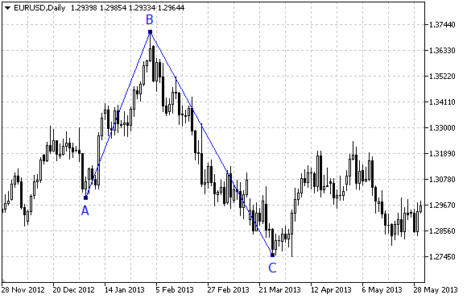

# OBJ_ELLIOTWAVE3

OBJ\_ELLIOTWAVE3

Elliott Correction Wave.

Note

For "Elliott Correction Wave", it is possible to enable/disable the mode of connecting points by lines ([OBJPROP\_DRAWLINES](../../Object-Properties/Object-Properties.md#enum_object_property_integer) property), as well as set the level of wave positioning (from [ENUM\_ELLIOT\_WAVE\_DEGREE](../../Levels-of-Elliott-Wave/Levels-of-Elliott-Wave.md) enumeration).

Example

The following script creates and moves Elliott correction wave on the chart. Special functions have been developed to create and change graphical object's properties. You can use these functions "as is" in your own applications.

 

|  |
| --- |
| //--- description  #property description "Script draws \"Elliott Correction Wave\" graphical object."  #property description "Anchor point coordinates are set in percentage of the chart's window"  #property description "size."  //--- display window of the input parameters during the script's launch  #property script\_show\_inputs  //--- input parameters of the script  input string                  InpName="ElliotWave3";   // Object name  input int                     InpDate1=10;             // 1 st point's date, %  input int                     InpPrice1=90;            // 1 st point's price, %  input int                     InpDate2=30;             // 2 nd point's date, %  input int                     InpPrice2=10;            // 2 nd point's price, %  input int                     InpDate3=50;             // 3 rd point's date, %  input int                     InpPrice3=40;            // 3 rd point's price, %  input ENUM\_ELLIOT\_WAVE\_DEGREE InpDegree=ELLIOTT\_MINOR; // Level  input bool                    InpDrawLines=true;       // Displaying the lines  input color                   InpColor=clrRed;         // Color of the lines  input ENUM\_LINE\_STYLE         InpStyle=STYLE\_DASH;     // Style of the lines  input int                     InpWidth=2;              // Width of the lines  input bool                    InpBack=false;           // Background object  input bool                    InpSelection=true;       // Highlight to move  input bool                    InpHidden=true;          // Hidden in the object list  input long                    InpZOrder=0;             // Priority for mouse click  //+------------------------------------------------------------------+  //| Create "Elliott Correction Wave" by the given coordinates        |  //+------------------------------------------------------------------+  bool ElliotWave3Create(const long                    chart\_ID=0,              // chart's ID                         const string                  name="ElliotWave3",      // wave name                         const int                     sub\_window=0,            // subwindow index                          datetime                      time1=0,                 // first point time                         double                        price1=0,                // first point price                         datetime                      time2=0,                 // second point time                         double                        price2=0,                // second point price                         datetime                      time3=0,                 // third point time                         double                        price3=0,                // third point price                         const ENUM\_ELLIOT\_WAVE\_DEGREE degree=ELLIOTT\_MINUETTE, // degree                         const bool                    draw\_lines=true,         // displaying the lines                         const color                   clr=clrRed,              // object color                         const ENUM\_LINE\_STYLE         style=STYLE\_SOLID,       // style of the lines                         const int                     width=1,                 // width of the lines                         const bool                    back=false,              // in the background                         const bool                    selection=true,          // highlight to move                         const bool                    hidden=true,             // hidden in the object list                         const long                    z\_order=0)               // priority for mouse click    {  //--- set anchor points' coordinates if they are not set     ChangeElliotWave3EmptyPoints(time1,price1,time2,price2,time3,price3);  //--- reset the error value     ResetLastError();  //--- Create "Elliott Correction Wave" by the given coordinates     if(!ObjectCreate(chart\_ID,name,OBJ\_ELLIOTWAVE3,sub\_window,time1,price1,time2,price2,time3,price3))       {        Print(\_\_FUNCTION\_\_,              ": failed to create \"Elliott Correction Wave\"! Error code = ",GetLastError());        return(false);       }  //--- set degree (wave size)     ObjectSetInteger(chart\_ID,name,OBJPROP\_DEGREE,degree);  //--- enable (true) or disable (false) the mode of displaying the lines     ObjectSetInteger(chart\_ID,name,OBJPROP\_DRAWLINES,draw\_lines);  //--- set the object's color     ObjectSetInteger(chart\_ID,name,OBJPROP\_COLOR,clr);  //--- set the line style     ObjectSetInteger(chart\_ID,name,OBJPROP\_STYLE,style);  //--- set width of the lines     ObjectSetInteger(chart\_ID,name,OBJPROP\_WIDTH,width);  //--- display in the foreground (false) or background (true)     ObjectSetInteger(chart\_ID,name,OBJPROP\_BACK,back);  //--- enable (true) or disable (false) the mode of highlighting the channel for moving  //--- when creating a graphical object using ObjectCreate function, the object cannot be  //--- highlighted and moved by default. Inside this method, selection parameter  //--- is true by default making it possible to highlight and move the object     ObjectSetInteger(chart\_ID,name,OBJPROP\_SELECTABLE,selection);     ObjectSetInteger(chart\_ID,name,OBJPROP\_SELECTED,selection);  //--- hide (true) or display (false) graphical object name in the object list     ObjectSetInteger(chart\_ID,name,OBJPROP\_HIDDEN,hidden);  //--- set the priority for receiving the event of a mouse click in the chart     ObjectSetInteger(chart\_ID,name,OBJPROP\_ZORDER,z\_order);  //--- successful execution     return(true);    }  //+------------------------------------------------------------------+  //| Move anchor point of Elliott Correction Wave                     |  //+------------------------------------------------------------------+  bool ElliotWave3PointChange(const long   chart\_ID=0,         // chart's ID                              const string name="ElliotWave3", // object name                              const int    point\_index=0,      // anchor point index                              datetime     time=0,             // anchor point time coordinate                              double       price=0)            // anchor point price coordinate    {  //--- if point position is not set, move it to the current bar having Bid price     if(!time)        time=TimeCurrent();     if(!price)        price=SymbolInfoDouble(Symbol(),SYMBOL\_BID);  //--- reset the error value     ResetLastError();  //--- move the anchor point     if(!ObjectMove(chart\_ID,name,point\_index,time,price))       {        Print(\_\_FUNCTION\_\_,              ": failed to move the anchor point! Error code = ",GetLastError());        return(false);       }  //--- successful execution     return(true);    }  //+------------------------------------------------------------------+  //| Delete Elliott Correction Wave                                   |  //+------------------------------------------------------------------+  bool ElliotWave3Delete(const long   chart\_ID=0,         // chart's ID                         const string name="ElliotWave3") // object name    {  //--- reset the error value     ResetLastError();  //--- delete the object     if(!ObjectDelete(chart\_ID,name))       {        Print(\_\_FUNCTION\_\_,              ": failed to delete \"Elliott Correction Wave\"! Error code = ",GetLastError());        return(false);       }  //--- successful execution     return(true);    }  //+------------------------------------------------------------------+  //| Check the values of Elliott Correction Wave's anchor points      |  //| and set default values for empty ones                            |  //+------------------------------------------------------------------+  void ChangeElliotWave3EmptyPoints(datetime &time1,double &price1,                                    datetime &time2,double &price2,                                    datetime &time3,double &price3)    {  //--- array for receiving the open time of the last 10 bars     datetime temp[];     ArrayResize(temp,10);  //--- receive data     CopyTime(Symbol(),Period(),TimeCurrent(),10,temp);  //--- receive the value of one point on the current chart     double point=SymbolInfoDouble(Symbol(),SYMBOL\_POINT);  //--- if the first point's time is not set, it will be 9 bars left from the last bar     if(!time1)        time1=temp[0];  //--- if the first point's price is not set, it will have Bid value     if(!price1)        price1=SymbolInfoDouble(Symbol(),SYMBOL\_BID);  //--- if the second point's time is not set, it will be 5 bars left from the last bar     if(!time2)        time2=temp[4];  //--- if the second point's price is not set, move it 300 points lower than the first one     if(!price2)        price2=price1-300\*point;  //--- if the third point's time is not set, it will be 1 bar left from the last bar     if(!time3)        time3=temp[8];  //--- if the third point's price is not set, move it 200 points lower than the first one     if(!price3)        price3=price1-200\*point;    }  //+------------------------------------------------------------------+  //| Script program start function                                    |  //+------------------------------------------------------------------+  void OnStart()    {  //--- check correctness of the input parameters     if(InpDate1<0 || InpDate1>100 || InpPrice1<0 || InpPrice1>100 ||         InpDate2<0 || InpDate2>100 || InpPrice2<0 || InpPrice2>100 ||         InpDate3<0 || InpDate3>100 || InpPrice3<0 || InpPrice3>100)       {        Print("Error! Incorrect values of input parameters!");        return;       }  //--- number of visible bars in the chart window     int bars=(int)ChartGetInteger(0,CHART\_VISIBLE\_BARS);  //--- price array size     int accuracy=1000;  //--- arrays for storing the date and price values to be used  //--- for setting and changing object anchor points' coordinates     datetime date[];     double   price[];  //--- memory allocation     ArrayResize(date,bars);     ArrayResize(price,accuracy);  //--- fill the array of dates     ResetLastError();     if(CopyTime(Symbol(),Period(),0,bars,date)==-1)       {        Print("Failed to copy time values! Error code = ",GetLastError());        return;       }  //--- fill the array of prices  //--- find the highest and lowest values of the chart     double max\_price=ChartGetDouble(0,CHART\_PRICE\_MAX);     double min\_price=ChartGetDouble(0,CHART\_PRICE\_MIN);  //--- define a change step of a price and fill the array     double step=(max\_price-min\_price)/accuracy;     for(int i=0;i<accuracy;i++)        price[i]=min\_price+i\*step;  //--- define points for drawing Elliott Correction Wave     int d1=InpDate1\*(bars-1)/100;     int d2=InpDate2\*(bars-1)/100;     int d3=InpDate3\*(bars-1)/100;     int p1=InpPrice1\*(accuracy-1)/100;     int p2=InpPrice2\*(accuracy-1)/100;     int p3=InpPrice3\*(accuracy-1)/100;  //--- Create Elliott Correction Wave     if(!ElliotWave3Create(0,InpName,0,date[d1],price[p1],date[d2],price[p2],date[d3],price[p3],        InpDegree,InpDrawLines,InpColor,InpStyle,InpWidth,InpBack,InpSelection,InpHidden,InpZOrder))       {        return;       }  //--- redraw the chart and wait for 1 second     ChartRedraw();     Sleep(1000);  //--- now, move the anchor points  //--- loop counter     int v\_steps=accuracy/5;  //--- move the third anchor point     for(int i=0;i<v\_steps;i++)       {        //--- use the following value        if(p3<accuracy-1)           p3+=1;        //--- move the point        if(!ElliotWave3PointChange(0,InpName,2,date[d3],price[p3]))           return;        //--- check if the script's operation has been forcefully disabled        if(IsStopped())           return;        //--- redraw the chart        ChartRedraw();       }  //--- 1 second of delay     Sleep(1000);  //--- loop counter     v\_steps=accuracy\*4/5;  //--- move the first and second anchor points     for(int i=0;i<v\_steps;i++)       {        //--- use the following values        if(p1>1)           p1-=1;        if(p2<accuracy-1)           p2+=1;        //--- shift the points        if(!ElliotWave3PointChange(0,InpName,0,date[d1],price[p1]))           return;        if(!ElliotWave3PointChange(0,InpName,1,date[d2],price[p2]))           return;        //--- check if the script's operation has been forcefully disabled        if(IsStopped())           return;        //--- redraw the chart        ChartRedraw();       }  //--- 1 second of delay     Sleep(1000);  //--- delete the object from the chart     ElliotWave3Delete(0,InpName);     ChartRedraw();  //--- 1 second of delay     Sleep(1000);  //---    } |
