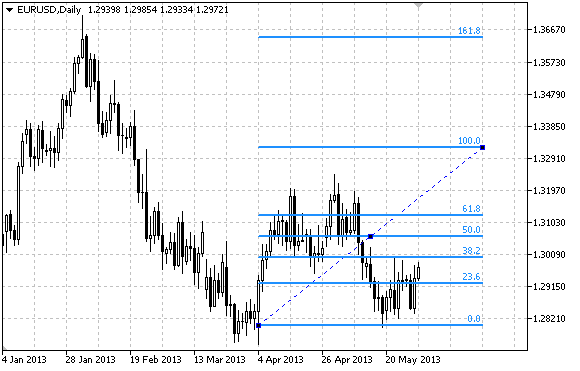

# OBJ_FIBO

OBJ\_FIBO

Fibonacci Retracement.

Note

For Fibonacci Retracement, it is possible to specify the mode of continuation of its display to the right and/or left ([OBJPROP\_RAY\_RIGHT](../../Object-Properties/Object-Properties.md#enum_object_property_integer) and [OBJPROP\_RAY\_LEFT](../../Object-Properties/Object-Properties.md#enum_object_property_integer) properties accordingly).

You can also specify the number of line-levels, their values and color.

Example

The following script creates and moves Fibonacci Retracement on the chart. Special functions have been developed to create and change graphical object's properties. You can use these functions "as is" in your own applications.

 

|  |
| --- |
| //--- description  #property description "Script draws \"Fibonacci Retracement\" graphical object."  #property description "Anchor point coordinates are set in percentage of"  #property description "the chart window size."  //--- display window of the input parameters during the script's launch  #property script\_show\_inputs  //--- input parameters of the script  input string          InpName="FiboLevels";      // Object name  input int             InpDate1=10;               // 1 st point's date, %  input int             InpPrice1=65;              // 1 st point's price, %  input int             InpDate2=90;               // 2 nd point's date, %  input int             InpPrice2=85;              // 2 nd point's price, %  input color           InpColor=clrRed;           // Object color  input ENUM\_LINE\_STYLE InpStyle=STYLE\_DASHDOTDOT; // Line style  input int             InpWidth=2;                // Line width  input bool            InpBack=false;             // Background object  input bool            InpSelection=true;         // Highlight to move  input bool            InpRayLeft=false;          // Object's continuation to the left  input bool            InpRayRight=false;         // Object's continuation to the right  input bool            InpHidden=true;            // Hidden in the object list  input long            InpZOrder=0;               // Priority for mouse click  //+------------------------------------------------------------------+  //| Create Fibonacci Retracement by the given coordinates            |  //+------------------------------------------------------------------+  bool FiboLevelsCreate(const long            chart\_ID=0,        // chart's ID                        const string          name="FiboLevels", // object name                        const int             sub\_window=0,      // subwindow index                         datetime              time1=0,           // first point time                        double                price1=0,          // first point price                        datetime              time2=0,           // second point time                        double                price2=0,          // second point price                        const color           clr=clrRed,        // object color                        const ENUM\_LINE\_STYLE style=STYLE\_SOLID, // object line style                        const int             width=1,           // object line width                        const bool            back=false,        // in the background                        const bool            selection=true,    // highlight to move                        const bool            ray\_left=false,    // object's continuation to the left                        const bool            ray\_right=false,   // object's continuation to the right                        const bool            hidden=true,       // hidden in the object list                        const long            z\_order=0)         // priority for mouse click    {  //--- set anchor points' coordinates if they are not set     ChangeFiboLevelsEmptyPoints(time1,price1,time2,price2);  //--- reset the error value     ResetLastError();  //--- Create Fibonacci Retracement by the given coordinates     if(!ObjectCreate(chart\_ID,name,OBJ\_FIBO,sub\_window,time1,price1,time2,price2))       {        Print(\_\_FUNCTION\_\_,              ": failed to create \"Fibonacci Retracement\"! Error code = ",GetLastError());        return(false);       }  //--- set color     ObjectSetInteger(chart\_ID,name,OBJPROP\_COLOR,clr);  //--- set line style     ObjectSetInteger(chart\_ID,name,OBJPROP\_STYLE,style);  //--- set line width     ObjectSetInteger(chart\_ID,name,OBJPROP\_WIDTH,width);  //--- display in the foreground (false) or background (true)     ObjectSetInteger(chart\_ID,name,OBJPROP\_BACK,back);  //--- enable (true) or disable (false) the mode of highlighting the channel for moving  //--- when creating a graphical object using ObjectCreate function, the object cannot be  //--- highlighted and moved by default. Inside this method, selection parameter  //--- is true by default making it possible to highlight and move the object     ObjectSetInteger(chart\_ID,name,OBJPROP\_SELECTABLE,selection);     ObjectSetInteger(chart\_ID,name,OBJPROP\_SELECTED,selection);  //--- enable (true) or disable (false) the mode of continuation of the object's display to the left     ObjectSetInteger(chart\_ID,name,OBJPROP\_RAY\_LEFT,ray\_left);  //--- enable (true) or disable (false) the mode of continuation of the object's display to the right     ObjectSetInteger(chart\_ID,name,OBJPROP\_RAY\_RIGHT,ray\_right);  //--- hide (true) or display (false) graphical object name in the object list     ObjectSetInteger(chart\_ID,name,OBJPROP\_HIDDEN,hidden);  //--- set the priority for receiving the event of a mouse click in the chart     ObjectSetInteger(chart\_ID,name,OBJPROP\_ZORDER,z\_order);  //--- successful execution     return(true);    }  //+------------------------------------------------------------------+  //| Set number of levels and their parameters                        |  //+------------------------------------------------------------------+  bool FiboLevelsSet(int             levels,            // number of level lines                     double          &values[],         // values of level lines                     color           &colors[],         // color of level lines                     ENUM\_LINE\_STYLE &styles[],         // style of level lines                     int             &widths[],         // width of level lines                     const long      chart\_ID=0,        // chart's ID                     const string    name="FiboLevels") // object name    {  //--- check array sizes     if(levels!=ArraySize(colors) || levels!=ArraySize(styles) || levels!=ArraySize(widths))       {        Print(\_\_FUNCTION\_\_,": array length does not correspond to the number of levels, error!");        return(false);       }  //--- set the number of levels     ObjectSetInteger(chart\_ID,name,OBJPROP\_LEVELS,levels);  //--- set the properties of levels in the loop     for(int i=0;i<levels;i++)       {        //--- level value        ObjectSetDouble(chart\_ID,name,OBJPROP\_LEVELVALUE,i,values[i]);        //--- level color        ObjectSetInteger(chart\_ID,name,OBJPROP\_LEVELCOLOR,i,colors[i]);        //--- level style        ObjectSetInteger(chart\_ID,name,OBJPROP\_LEVELSTYLE,i,styles[i]);        //--- level width        ObjectSetInteger(chart\_ID,name,OBJPROP\_LEVELWIDTH,i,widths[i]);        //--- level description        ObjectSetString(chart\_ID,name,OBJPROP\_LEVELTEXT,i,DoubleToString(100\*values[i],1));       }  //--- successful execution     return(true);    }  //+------------------------------------------------------------------+  //| Move Fibonacci Retracement anchor point                          |  //+------------------------------------------------------------------+  bool FiboLevelsPointChange(const long   chart\_ID=0,        // chart's ID                             const string name="FiboLevels", // object name                             const int    point\_index=0,     // anchor point index                             datetime     time=0,            // anchor point time coordinate                             double       price=0)           // anchor point price coordinate    {  //--- if point position is not set, move it to the current bar having Bid price     if(!time)        time=TimeCurrent();     if(!price)        price=SymbolInfoDouble(Symbol(),SYMBOL\_BID);  //--- reset the error value     ResetLastError();  //--- move the anchor point     if(!ObjectMove(chart\_ID,name,point\_index,time,price))       {        Print(\_\_FUNCTION\_\_,              ": failed to move the anchor point! Error code = ",GetLastError());        return(false);       }  //--- successful execution     return(true);    }  //+------------------------------------------------------------------+  //| Delete Fibonacci Retracement                                     |  //+------------------------------------------------------------------+  bool FiboLevelsDelete(const long   chart\_ID=0,        // chart's ID                        const string name="FiboLevels") // object name    {  //--- reset the error value     ResetLastError();  //--- delete the object     if(!ObjectDelete(chart\_ID,name))       {        Print(\_\_FUNCTION\_\_,              ": failed to delete \"Fibonacci Retracement\"! Error code = ",GetLastError());        return(false);       }  //--- successful execution     return(true);    }  //+------------------------------------------------------------------+  //| Check the values of Fibonacci Retracement anchor points and set  |  //| default values for empty ones                                    |  //+------------------------------------------------------------------+  void ChangeFiboLevelsEmptyPoints(datetime &time1,double &price1,                                   datetime &time2,double &price2)    {  //--- if the second point's time is not set, it will be on the current bar     if(!time2)        time2=TimeCurrent();  //--- if the second point's price is not set, it will have Bid value     if(!price2)        price2=SymbolInfoDouble(Symbol(),SYMBOL\_BID);  //--- if the first point's time is not set, it is located 9 bars left from the second one     if(!time1)       {        //--- array for receiving the open time of the last 10 bars        datetime temp[10];        CopyTime(Symbol(),Period(),time2,10,temp);        //--- set the first point 9 bars left from the second one        time1=temp[0];       }  //--- if the first point's price is not set, move it 200 points below the second one     if(!price1)        price1=price2-200\*SymbolInfoDouble(Symbol(),SYMBOL\_POINT);    }  //+------------------------------------------------------------------+  //| Script program start function                                    |  //+------------------------------------------------------------------+  void OnStart()    {  //--- check correctness of the input parameters     if(InpDate1<0 || InpDate1>100 || InpPrice1<0 || InpPrice1>100 ||         InpDate2<0 || InpDate2>100 || InpPrice2<0 || InpPrice2>100)       {        Print("Error! Incorrect values of input parameters!");        return;       }  //--- number of visible bars in the chart window     int bars=(int)ChartGetInteger(0,CHART\_VISIBLE\_BARS);  //--- price array size     int accuracy=1000;  //--- arrays for storing the date and price values to be used  //--- for setting and changing the coordinates of Fibonacci Retracement anchor points     datetime date[];     double   price[];  //--- memory allocation     ArrayResize(date,bars);     ArrayResize(price,accuracy);  //--- fill the array of dates     ResetLastError();     if(CopyTime(Symbol(),Period(),0,bars,date)==-1)       {        Print("Failed to copy time values! Error code = ",GetLastError());        return;       }  //--- fill the array of prices  //--- find the highest and lowest values of the chart     double max\_price=ChartGetDouble(0,CHART\_PRICE\_MAX);     double min\_price=ChartGetDouble(0,CHART\_PRICE\_MIN);  //--- define a change step of a price and fill the array     double step=(max\_price-min\_price)/accuracy;     for(int i=0;i<accuracy;i++)        price[i]=min\_price+i\*step;  //--- define points for drawing Fibonacci Retracement     int d1=InpDate1\*(bars-1)/100;     int d2=InpDate2\*(bars-1)/100;     int p1=InpPrice1\*(accuracy-1)/100;     int p2=InpPrice2\*(accuracy-1)/100;  //--- create an object     if(!FiboLevelsCreate(0,InpName,0,date[d1],price[p1],date[d2],price[p2],InpColor,        InpStyle,InpWidth,InpBack,InpSelection,InpRayLeft,InpRayRight,InpHidden,InpZOrder))       {        return;       }  //--- redraw the chart and wait for 1 second     ChartRedraw();     Sleep(1000);  //--- now, move the anchor points  //--- loop counter     int v\_steps=accuracy\*2/5;  //--- move the first anchor point     for(int i=0;i<v\_steps;i++)       {        //--- use the following value        if(p1>1)           p1-=1;        //--- move the point        if(!FiboLevelsPointChange(0,InpName,0,date[d1],price[p1]))           return;        //--- check if the script's operation has been forcefully disabled        if(IsStopped())           return;        //--- redraw the chart        ChartRedraw();       }  //--- 1 second of delay     Sleep(1000);  //--- loop counter     v\_steps=accuracy\*4/5;  //--- move the second anchor point     for(int i=0;i<v\_steps;i++)       {        //--- use the following value        if(p2>1)           p2-=1;        //--- move the point        if(!FiboLevelsPointChange(0,InpName,1,date[d2],price[p2]))           return;        //--- check if the script's operation has been forcefully disabled        if(IsStopped())           return;        //--- redraw the chart        ChartRedraw();       }  //--- 1 second of delay     Sleep(1000);  //--- delete the object from the chart     FiboLevelsDelete(0,InpName);     ChartRedraw();  //--- 1 second of delay     Sleep(1000);  //---    } |
