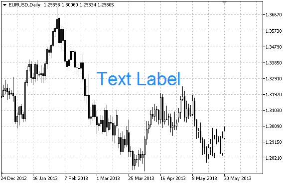

# OBJ_LABEL

OBJ\_LABEL

Label object.

Note

Anchor point position relative to the label can be selected from [ENUM\_ANCHOR\_POINT](../../Methods-of-Object-Binding/Methods-of-Object-Binding.md) enumeration. Anchor point coordinates are set in pixels.

You can also select text label anchoring corner from [ENUM\_BASE\_CORNER](../../Chart-Corner/Chart-Corner.md) enumeration.

Example

The following script creates and moves Edit object on the chart. Special functions have been developed to create and change graphical object's properties. You can use these functions "as is" in your own applications.

 

|  |
| --- |
| //--- description  #property description "Script creates \"Label\" graphical object."  //--- display window of the input parameters during the script's launch  #property script\_show\_inputs  //--- input parameters of the script  input string            InpName="Label";         // Label name  input int               InpX=150;                // X-axis distance  input int               InpY=150;                // Y-axis distance  input string            InpFont="Arial";         // Font  input int               InpFontSize=14;          // Font size  input color             InpColor=clrRed;         // Color  input double            InpAngle=0.0;            // Slope angle in degrees  input ENUM\_ANCHOR\_POINT InpAnchor=ANCHOR\_CENTER; // Anchor type  input bool              InpBack=false;           // Background object  input bool              InpSelection=true;       // Highlight to move  input bool              InpHidden=true;          // Hidden in the object list  input long              InpZOrder=0;             // Priority for mouse click  //+------------------------------------------------------------------+  //| Create a text label                                              |  //+------------------------------------------------------------------+  bool LabelCreate(const long              chart\_ID=0,               // chart's ID                   const string            name="Label",             // label name                   const int               sub\_window=0,             // subwindow index                   const int               x=0,                      // X coordinate                   const int               y=0,                      // Y coordinate                   const ENUM\_BASE\_CORNER  corner=CORNER\_LEFT\_UPPER, // chart corner for anchoring                   const string            text="Label",             // text                   const string            font="Arial",             // font                   const int               font\_size=10,             // font size                   const color             clr=clrRed,               // color                   const double            angle=0.0,                // text slope                   const ENUM\_ANCHOR\_POINT anchor=ANCHOR\_LEFT\_UPPER, // anchor type                   const bool              back=false,               // in the background                   const bool              selection=false,          // highlight to move                   const bool              hidden=true,              // hidden in the object list                   const long              z\_order=0)                // priority for mouse click    {  //--- reset the error value     ResetLastError();  //--- create a text label     if(!ObjectCreate(chart\_ID,name,OBJ\_LABEL,sub\_window,0,0))       {        Print(\_\_FUNCTION\_\_,              ": failed to create text label! Error code = ",GetLastError());        return(false);       }  //--- set label coordinates     ObjectSetInteger(chart\_ID,name,OBJPROP\_XDISTANCE,x);     ObjectSetInteger(chart\_ID,name,OBJPROP\_YDISTANCE,y);  //--- set the chart's corner, relative to which point coordinates are defined     ObjectSetInteger(chart\_ID,name,OBJPROP\_CORNER,corner);  //--- set the text     ObjectSetString(chart\_ID,name,OBJPROP\_TEXT,text);  //--- set text font     ObjectSetString(chart\_ID,name,OBJPROP\_FONT,font);  //--- set font size     ObjectSetInteger(chart\_ID,name,OBJPROP\_FONTSIZE,font\_size);  //--- set the slope angle of the text     ObjectSetDouble(chart\_ID,name,OBJPROP\_ANGLE,angle);  //--- set anchor type     ObjectSetInteger(chart\_ID,name,OBJPROP\_ANCHOR,anchor);  //--- set color     ObjectSetInteger(chart\_ID,name,OBJPROP\_COLOR,clr);  //--- display in the foreground (false) or background (true)     ObjectSetInteger(chart\_ID,name,OBJPROP\_BACK,back);  //--- enable (true) or disable (false) the mode of moving the label by mouse     ObjectSetInteger(chart\_ID,name,OBJPROP\_SELECTABLE,selection);     ObjectSetInteger(chart\_ID,name,OBJPROP\_SELECTED,selection);  //--- hide (true) or display (false) graphical object name in the object list     ObjectSetInteger(chart\_ID,name,OBJPROP\_HIDDEN,hidden);  //--- set the priority for receiving the event of a mouse click in the chart     ObjectSetInteger(chart\_ID,name,OBJPROP\_ZORDER,z\_order);  //--- successful execution     return(true);    }  //+------------------------------------------------------------------+  //| Move the text label                                              |  //+------------------------------------------------------------------+  bool LabelMove(const long   chart\_ID=0,   // chart's ID                 const string name="Label", // label name                 const int    x=0,          // X coordinate                 const int    y=0)          // Y coordinate    {  //--- reset the error value     ResetLastError();  //--- move the text label     if(!ObjectSetInteger(chart\_ID,name,OBJPROP\_XDISTANCE,x))       {        Print(\_\_FUNCTION\_\_,              ": failed to move X coordinate of the label! Error code = ",GetLastError());        return(false);       }     if(!ObjectSetInteger(chart\_ID,name,OBJPROP\_YDISTANCE,y))       {        Print(\_\_FUNCTION\_\_,              ": failed to move Y coordinate of the label! Error code = ",GetLastError());        return(false);       }  //--- successful execution     return(true);    }  //+------------------------------------------------------------------+  //| Change corner of the chart for binding the label                 |  //+------------------------------------------------------------------+  bool LabelChangeCorner(const long             chart\_ID=0,               // chart's ID                         const string           name="Label",             // label name                         const ENUM\_BASE\_CORNER corner=CORNER\_LEFT\_UPPER) // chart corner for anchoring    {  //--- reset the error value     ResetLastError();  //--- change anchor corner     if(!ObjectSetInteger(chart\_ID,name,OBJPROP\_CORNER,corner))       {        Print(\_\_FUNCTION\_\_,              ": failed to change the anchor corner! Error code = ",GetLastError());        return(false);       }  //--- successful execution     return(true);    }  //+------------------------------------------------------------------+  //| Change the label text                                            |  //+------------------------------------------------------------------+  bool LabelTextChange(const long   chart\_ID=0,   // chart's ID                       const string name="Label", // object name                       const string text="Text")  // text    {  //--- reset the error value     ResetLastError();  //--- change object text     if(!ObjectSetString(chart\_ID,name,OBJPROP\_TEXT,text))       {        Print(\_\_FUNCTION\_\_,              ": failed to change the text! Error code = ",GetLastError());        return(false);       }  //--- successful execution     return(true);    }  //+------------------------------------------------------------------+  //| Delete a text label                                              |  //+------------------------------------------------------------------+  bool LabelDelete(const long   chart\_ID=0,   // chart's ID                   const string name="Label") // label name    {  //--- reset the error value     ResetLastError();  //--- delete the label     if(!ObjectDelete(chart\_ID,name))       {        Print(\_\_FUNCTION\_\_,              ": failed to delete a text label! Error code = ",GetLastError());        return(false);       }  //--- successful execution     return(true);    }  //+------------------------------------------------------------------+  //| Script program start function                                    |  //+------------------------------------------------------------------+  void OnStart()    {  //--- store the label's coordinates in the local variables     int x=InpX;     int y=InpY;  //--- chart window size     long x\_distance;     long y\_distance;  //--- set window size     if(!ChartGetInteger(0,CHART\_WIDTH\_IN\_PIXELS,0,x\_distance))       {        Print("Failed to get the chart width! Error code = ",GetLastError());        return;       }     if(!ChartGetInteger(0,CHART\_HEIGHT\_IN\_PIXELS,0,y\_distance))       {        Print("Failed to get the chart height! Error code = ",GetLastError());        return;       }  //--- check correctness of the input parameters     if(InpX<0 || InpX>x\_distance-1 || InpY<0 || InpY>y\_distance-1)       {        Print("Error! Incorrect values of input parameters!");        return;       }  //--- prepare initial text for the label     string text;     StringConcatenate(text,"Upper left corner: ",x,",",y);  //--- create a text label on the chart     if(!LabelCreate(0,InpName,0,InpX,InpY,CORNER\_LEFT\_UPPER,text,InpFont,InpFontSize,        InpColor,InpAngle,InpAnchor,InpBack,InpSelection,InpHidden,InpZOrder))       {        return;       }  //--- redraw the chart and wait for half a second     ChartRedraw();     Sleep(500);  //--- move the label and change its text simultaneously  //--- number of iterations by axes     int h\_steps=(int)(x\_distance/2-InpX);     int v\_steps=(int)(y\_distance/2-InpY);  //--- move the label down     for(int i=0;i<v\_steps;i++)       {        //--- change the coordinate        y+=2;        //--- move the label and change its text        MoveAndTextChange(x,y,"Upper left corner: ");       }  //--- half a second of delay     Sleep(500);  //--- move the label to the right     for(int i=0;i<h\_steps;i++)       {        //--- change the coordinate        x+=2;        //--- move the label and change its text        MoveAndTextChange(x,y,"Upper left corner: ");       }  //--- half a second of delay     Sleep(500);  //--- move the label up     for(int i=0;i<v\_steps;i++)       {        //--- change the coordinate        y-=2;        //--- move the label and change its text        MoveAndTextChange(x,y,"Upper left corner: ");       }  //--- half a second of delay     Sleep(500);  //--- move the label to the left     for(int i=0;i<h\_steps;i++)       {        //--- change the coordinate        x-=2;        //--- move the label and change its text        MoveAndTextChange(x,y,"Upper left corner: ");       }  //--- half a second of delay     Sleep(500);  //--- now, move the point by changing the anchor corner  //--- move to the lower left corner     if(!LabelChangeCorner(0,InpName,CORNER\_LEFT\_LOWER))        return;  //--- change the label text     StringConcatenate(text,"Lower left corner: ",x,",",y);     if(!LabelTextChange(0,InpName,text))        return;  //--- redraw the chart and wait for two seconds     ChartRedraw();     Sleep(2000);  //--- move to the lower right corner     if(!LabelChangeCorner(0,InpName,CORNER\_RIGHT\_LOWER))        return;  //--- change the label text     StringConcatenate(text,"Lower right corner: ",x,",",y);     if(!LabelTextChange(0,InpName,text))        return;  //--- redraw the chart and wait for two seconds     ChartRedraw();     Sleep(2000);  //--- move to the upper right corner     if(!LabelChangeCorner(0,InpName,CORNER\_RIGHT\_UPPER))        return;  //--- change the label text     StringConcatenate(text,"Upper right corner: ",x,",",y);     if(!LabelTextChange(0,InpName,text))        return;  //--- redraw the chart and wait for two seconds     ChartRedraw();     Sleep(2000);  //--- move to the upper left corner     if(!LabelChangeCorner(0,InpName,CORNER\_LEFT\_UPPER))        return;  //--- change the label text     StringConcatenate(text,"Upper left corner: ",x,",",y);     if(!LabelTextChange(0,InpName,text))        return;  //--- redraw the chart and wait for two seconds     ChartRedraw();     Sleep(2000);  //--- delete the label     LabelDelete(0,InpName);  //--- redraw the chart and wait for half a second     ChartRedraw();     Sleep(500);  //---    }  //+------------------------------------------------------------------+  //| The function moves the object and changes its text               |  //+------------------------------------------------------------------+  bool MoveAndTextChange(const int x,const int y,string text)    {  //--- move the label     if(!LabelMove(0,InpName,x,y))        return(false);  //--- change the label text     StringConcatenate(text,text,x,",",y);     if(!LabelTextChange(0,InpName,text))        return(false);  //--- check if the script's operation has been forcefully disabled     if(IsStopped())        return(false);  //--- redraw the chart     ChartRedraw();  // 0.01 seconds of delay     Sleep(10);  //--- exit the function     return(true);    } |
