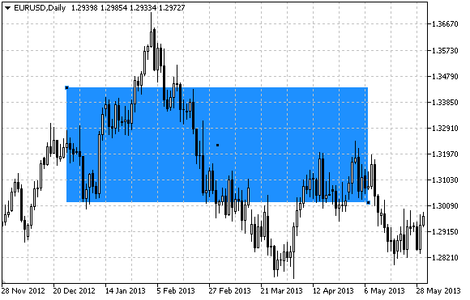

# OBJ_RECTANGLE

OBJ\_RECTANGLE

Rectangle.

Note

For rectangle, the mode of filling with color can be set using [OBJPROP\_FILL](../../Object-Properties/Object-Properties.md#enum_object_property_integer) property.

Example

The following script creates and moves the rectangle on the chart. Special functions have been developed to create and change graphical object's properties. You can use these functions "as is" in your own applications.

 

|  |
| --- |
| //--- description  #property description "Script creates rectangle on the chart."  #property description "Anchor point coordinates are set in"  #property description "percentage of the chart window size."  //--- display window of the input parameters during the script's launch  #property script\_show\_inputs  //--- input parameters of the script  input string          InpName="Rectangle"; // Rectangle name  input int             InpDate1=40;         // 1 st point's date, %  input int             InpPrice1=40;        // 1 st point's price, %  input int             InpDate2=60;         // 2 nd point's date, %  input int             InpPrice2=60;        // 2 nd point's price, %  input color           InpColor=clrRed;     // Rectangle color  input ENUM\_LINE\_STYLE InpStyle=STYLE\_DASH; // Style of rectangle lines  input int             InpWidth=2;          // Width of rectangle lines  input bool            InpFill=true;        // Filling the rectangle with color  input bool            InpBack=false;       // Background rectangle  input bool            InpSelection=true;   // Highlight to move  input bool            InpHidden=true;      // Hidden in the object list  input long            InpZOrder=0;         // Priority for mouse click  //+------------------------------------------------------------------+  //| Create rectangle by the given coordinates                        |  //+------------------------------------------------------------------+  bool RectangleCreate(const long            chart\_ID=0,        // chart's ID                       const string          name="Rectangle",  // rectangle name                       const int             sub\_window=0,      // subwindow index                        datetime              time1=0,           // first point time                       double                price1=0,          // first point price                       datetime              time2=0,           // second point time                       double                price2=0,          // second point price                       const color           clr=clrRed,        // rectangle color                       const ENUM\_LINE\_STYLE style=STYLE\_SOLID, // style of rectangle lines                       const int             width=1,           // width of rectangle lines                       const bool            fill=false,        // filling rectangle with color                       const bool            back=false,        // in the background                       const bool            selection=true,    // highlight to move                       const bool            hidden=true,       // hidden in the object list                       const long            z\_order=0)         // priority for mouse click    {  //--- set anchor points' coordinates if they are not set     ChangeRectangleEmptyPoints(time1,price1,time2,price2);  //--- reset the error value     ResetLastError();  //--- create a rectangle by the given coordinates     if(!ObjectCreate(chart\_ID,name,OBJ\_RECTANGLE,sub\_window,time1,price1,time2,price2))       {        Print(\_\_FUNCTION\_\_,              ": failed to create a rectangle! Error code = ",GetLastError());        return(false);       }  //--- set rectangle color     ObjectSetInteger(chart\_ID,name,OBJPROP\_COLOR,clr);  //--- set the style of rectangle lines     ObjectSetInteger(chart\_ID,name,OBJPROP\_STYLE,style);  //--- set width of the rectangle lines     ObjectSetInteger(chart\_ID,name,OBJPROP\_WIDTH,width);  //--- enable (true) or disable (false) the mode of filling the rectangle     ObjectSetInteger(chart\_ID,name,OBJPROP\_FILL,fill);  //--- display in the foreground (false) or background (true)     ObjectSetInteger(chart\_ID,name,OBJPROP\_BACK,back);  //--- enable (true) or disable (false) the mode of highlighting the rectangle for moving  //--- when creating a graphical object using ObjectCreate function, the object cannot be  //--- highlighted and moved by default. Inside this method, selection parameter  //--- is true by default making it possible to highlight and move the object     ObjectSetInteger(chart\_ID,name,OBJPROP\_SELECTABLE,selection);     ObjectSetInteger(chart\_ID,name,OBJPROP\_SELECTED,selection);  //--- hide (true) or display (false) graphical object name in the object list     ObjectSetInteger(chart\_ID,name,OBJPROP\_HIDDEN,hidden);  //--- set the priority for receiving the event of a mouse click in the chart     ObjectSetInteger(chart\_ID,name,OBJPROP\_ZORDER,z\_order);  //--- successful execution     return(true);    }  //+------------------------------------------------------------------+  //| Move the rectangle anchor point                                  |  //+------------------------------------------------------------------+  bool RectanglePointChange(const long   chart\_ID=0,       // chart's ID                            const string name="Rectangle", // rectangle name                            const int    point\_index=0,    // anchor point index                            datetime     time=0,           // anchor point time coordinate                            double       price=0)          // anchor point price coordinate    {  //--- if point position is not set, move it to the current bar having Bid price     if(!time)        time=TimeCurrent();     if(!price)        price=SymbolInfoDouble(Symbol(),SYMBOL\_BID);  //--- reset the error value     ResetLastError();  //--- move the anchor point     if(!ObjectMove(chart\_ID,name,point\_index,time,price))       {        Print(\_\_FUNCTION\_\_,              ": failed to move the anchor point! Error code = ",GetLastError());        return(false);       }  //--- successful execution     return(true);    }  //+------------------------------------------------------------------+  //| Delete the rectangle                                             |  //+------------------------------------------------------------------+  bool RectangleDelete(const long   chart\_ID=0,       // chart's ID                       const string name="Rectangle") // rectangle name    {  //--- reset the error value     ResetLastError();  //--- delete rectangle     if(!ObjectDelete(chart\_ID,name))       {        Print(\_\_FUNCTION\_\_,              ": failed to delete rectangle! Error code = ",GetLastError());        return(false);       }  //--- successful execution     return(true);    }  //+------------------------------------------------------------------+  //| Check the values of rectangle's anchor points and set default    |  //| values for empty ones                                            |  //+------------------------------------------------------------------+  void ChangeRectangleEmptyPoints(datetime &time1,double &price1,                                  datetime &time2,double &price2)    {  //--- if the first point's time is not set, it will be on the current bar     if(!time1)        time1=TimeCurrent();  //--- if the first point's price is not set, it will have Bid value     if(!price1)        price1=SymbolInfoDouble(Symbol(),SYMBOL\_BID);  //--- if the second point's time is not set, it is located 9 bars left from the second one     if(!time2)       {        //--- array for receiving the open time of the last 10 bars        datetime temp[10];        CopyTime(Symbol(),Period(),time1,10,temp);        //--- set the second point 9 bars left from the first one        time2=temp[0];       }  //--- if the second point's price is not set, move it 300 points lower than the first one     if(!price2)        price2=price1-300\*SymbolInfoDouble(Symbol(),SYMBOL\_POINT);    }  //+------------------------------------------------------------------+  //| Script program start function                                    |  //+------------------------------------------------------------------+  void OnStart()    {  //--- check correctness of the input parameters     if(InpDate1<0 || InpDate1>100 || InpPrice1<0 || InpPrice1>100 ||         InpDate2<0 || InpDate2>100 || InpPrice2<0 || InpPrice2>100)       {        Print("Error! Incorrect values of input parameters!");        return;       }  //--- number of visible bars in the chart window     int bars=(int)ChartGetInteger(0,CHART\_VISIBLE\_BARS);  //--- price array size     int accuracy=1000;  //--- arrays for storing the date and price values to be used  //--- for setting and changing rectangle anchor points' coordinates     datetime date[];     double   price[];  //--- memory allocation     ArrayResize(date,bars);     ArrayResize(price,accuracy);  //--- fill the array of dates     ResetLastError();     if(CopyTime(Symbol(),Period(),0,bars,date)==-1)       {        Print("Failed to copy time values! Error code = ",GetLastError());        return;       }  //--- fill the array of prices  //--- find the highest and lowest values of the chart     double max\_price=ChartGetDouble(0,CHART\_PRICE\_MAX);     double min\_price=ChartGetDouble(0,CHART\_PRICE\_MIN);  //--- define a change step of a price and fill the array     double step=(max\_price-min\_price)/accuracy;     for(int i=0;i<accuracy;i++)        price[i]=min\_price+i\*step;  //--- define points for drawing the rectangle     int d1=InpDate1\*(bars-1)/100;     int d2=InpDate2\*(bars-1)/100;     int p1=InpPrice1\*(accuracy-1)/100;     int p2=InpPrice2\*(accuracy-1)/100;  //--- create a rectangle     if(!RectangleCreate(0,InpName,0,date[d1],price[p1],date[d2],price[p2],InpColor,        InpStyle,InpWidth,InpFill,InpBack,InpSelection,InpHidden,InpZOrder))       {        return;       }  //--- redraw the chart and wait for 1 second     ChartRedraw();     Sleep(1000);  //--- now, move the rectangle's anchor points  //--- loop counter     int h\_steps=bars/2;  //--- move the anchor points     for(int i=0;i<h\_steps;i++)       {        //--- use the following values        if(d1<bars-1)           d1+=1;        if(d2>1)           d2-=1;        //--- shift the points        if(!RectanglePointChange(0,InpName,0,date[d1],price[p1]))           return;        if(!RectanglePointChange(0,InpName,1,date[d2],price[p2]))           return;        //--- check if the script's operation has been forcefully disabled        if(IsStopped())           return;        //--- redraw the chart        ChartRedraw();        // 0.05 seconds of delay        Sleep(50);       }  //--- 1 second of delay     Sleep(1000);  //--- loop counter     int v\_steps=accuracy/2;  //--- move the anchor points     for(int i=0;i<v\_steps;i++)       {        //--- use the following values        if(p1<accuracy-1)           p1+=1;        if(p2>1)           p2-=1;        //--- shift the points        if(!RectanglePointChange(0,InpName,0,date[d1],price[p1]))           return;        if(!RectanglePointChange(0,InpName,1,date[d2],price[p2]))           return;        //--- check if the script's operation has been forcefully disabled        if(IsStopped())           return;        //--- redraw the chart        ChartRedraw();       }  //--- 1 second of delay     Sleep(1000);  //--- delete the rectangle from the chart     RectangleDelete(0,InpName);     ChartRedraw();  //--- 1 second of delay     Sleep(1000);  //---    } |
