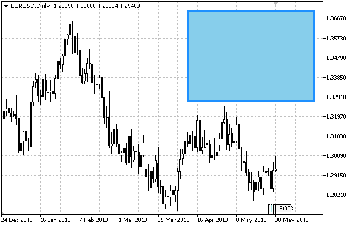

# OBJ_RECTANGLE_LABEL

OBJ\_RECTANGLE\_LABEL

Rectangle Label object.

Note

Anchor point coordinates are set in pixels. You can select rectangle label's anchoring corner from [ENUM\_BASE\_CORNER](../../Chart-Corner/Chart-Corner.md) enumeration. Rectangle label's border type can be selected from [ENUM\_BORDER\_TYPE](../../Object-Properties/Object-Properties.md#enum_border_type) enumeration.

The object is used to create and design the custom graphical interface.

Example

The following script creates and moves Rectangle Label object on the chart. Special functions have been developed to create and change graphical object's properties. You can use these functions "as is" in your own applications.

 

|  |
| --- |
| //--- description  #property description "Script creates \"Rectangle Label\" graphical object."  //--- display window of the input parameters during the script's launch  #property script\_show\_inputs  //--- input parameters of the script  input string           InpName="RectLabel";         // Label name  input color            InpBackColor=clrSkyBlue;     // Background color  input ENUM\_BORDER\_TYPE InpBorder=BORDER\_FLAT;       // Border type  input ENUM\_BASE\_CORNER InpCorner=CORNER\_LEFT\_UPPER; // Chart corner for anchoring  input color            InpColor=clrDarkBlue;        // Flat border color (Flat)  input ENUM\_LINE\_STYLE  InpStyle=STYLE\_SOLID;        // Flat border style (Flat)  input int              InpLineWidth=3;              // Flat border width (Flat)  input bool             InpBack=false;               // Background object  input bool             InpSelection=true;           // Highlight to move  input bool             InpHidden=true;              // Hidden in the object list  input long             InpZOrder=0;                 // Priority for mouse click  //+------------------------------------------------------------------+  //| Create rectangle label                                           |  //+------------------------------------------------------------------+  bool RectLabelCreate(const long             chart\_ID=0,               // chart's ID                       const string           name="RectLabel",         // label name                       const int              sub\_window=0,             // subwindow index                       const int              x=0,                      // X coordinate                       const int              y=0,                      // Y coordinate                       const int              width=50,                 // width                       const int              height=18,                // height                       const color            back\_clr=C'236,233,216',  // background color                       const ENUM\_BORDER\_TYPE border=BORDER\_SUNKEN,     // border type                       const ENUM\_BASE\_CORNER corner=CORNER\_LEFT\_UPPER, // chart corner for anchoring                       const color            clr=clrRed,               // flat border color (Flat)                       const ENUM\_LINE\_STYLE  style=STYLE\_SOLID,        // flat border style                       const int              line\_width=1,             // flat border width                       const bool             back=false,               // in the background                       const bool             selection=false,          // highlight to move                       const bool             hidden=true,              // hidden in the object list                       const long             z\_order=0)                // priority for mouse click    {  //--- reset the error value     ResetLastError();  //--- create a rectangle label     if(!ObjectCreate(chart\_ID,name,OBJ\_RECTANGLE\_LABEL,sub\_window,0,0))       {        Print(\_\_FUNCTION\_\_,              ": failed to create a rectangle label! Error code = ",GetLastError());        return(false);       }  //--- set label coordinates     ObjectSetInteger(chart\_ID,name,OBJPROP\_XDISTANCE,x);     ObjectSetInteger(chart\_ID,name,OBJPROP\_YDISTANCE,y);  //--- set label size     ObjectSetInteger(chart\_ID,name,OBJPROP\_XSIZE,width);     ObjectSetInteger(chart\_ID,name,OBJPROP\_YSIZE,height);  //--- set background color     ObjectSetInteger(chart\_ID,name,OBJPROP\_BGCOLOR,back\_clr);  //--- set border type     ObjectSetInteger(chart\_ID,name,OBJPROP\_BORDER\_TYPE,border);  //--- set the chart's corner, relative to which point coordinates are defined     ObjectSetInteger(chart\_ID,name,OBJPROP\_CORNER,corner);  //--- set flat border color (in Flat mode)     ObjectSetInteger(chart\_ID,name,OBJPROP\_COLOR,clr);  //--- set flat border line style     ObjectSetInteger(chart\_ID,name,OBJPROP\_STYLE,style);  //--- set flat border width     ObjectSetInteger(chart\_ID,name,OBJPROP\_WIDTH,line\_width);  //--- display in the foreground (false) or background (true)     ObjectSetInteger(chart\_ID,name,OBJPROP\_BACK,back);  //--- enable (true) or disable (false) the mode of moving the label by mouse     ObjectSetInteger(chart\_ID,name,OBJPROP\_SELECTABLE,selection);     ObjectSetInteger(chart\_ID,name,OBJPROP\_SELECTED,selection);  //--- hide (true) or display (false) graphical object name in the object list     ObjectSetInteger(chart\_ID,name,OBJPROP\_HIDDEN,hidden);  //--- set the priority for receiving the event of a mouse click in the chart     ObjectSetInteger(chart\_ID,name,OBJPROP\_ZORDER,z\_order);  //--- successful execution     return(true);    }  //+------------------------------------------------------------------+  //| Move rectangle label                                             |  //+------------------------------------------------------------------+  bool RectLabelMove(const long   chart\_ID=0,       // chart's ID                     const string name="RectLabel", // label name                     const int    x=0,              // X coordinate                     const int    y=0)              // Y coordinate    {  //--- reset the error value     ResetLastError();  //--- move the rectangle label     if(!ObjectSetInteger(chart\_ID,name,OBJPROP\_XDISTANCE,x))       {        Print(\_\_FUNCTION\_\_,              ": failed to move X coordinate of the label! Error code = ",GetLastError());        return(false);       }     if(!ObjectSetInteger(chart\_ID,name,OBJPROP\_YDISTANCE,y))       {        Print(\_\_FUNCTION\_\_,              ": failed to move Y coordinate of the label! Error code = ",GetLastError());        return(false);       }  //--- successful execution     return(true);    }  //+------------------------------------------------------------------+  //| Change the size of the rectangle label                           |  //+------------------------------------------------------------------+  bool RectLabelChangeSize(const long   chart\_ID=0,       // chart's ID                           const string name="RectLabel", // label name                           const int    width=50,         // label width                           const int    height=18)        // label height    {  //--- reset the error value     ResetLastError();  //--- change label size     if(!ObjectSetInteger(chart\_ID,name,OBJPROP\_XSIZE,width))       {        Print(\_\_FUNCTION\_\_,              ": failed to change the label's width! Error code = ",GetLastError());        return(false);       }     if(!ObjectSetInteger(chart\_ID,name,OBJPROP\_YSIZE,height))       {        Print(\_\_FUNCTION\_\_,              ": failed to change the label's height! Error code = ",GetLastError());        return(false);       }  //--- successful execution     return(true);    }  //+------------------------------------------------------------------+  //| Change rectangle label border type                               |  //+------------------------------------------------------------------+  bool RectLabelChangeBorderType(const long             chart\_ID=0,           // chart's ID                                 const string           name="RectLabel",     // label name                                 const ENUM\_BORDER\_TYPE border=BORDER\_SUNKEN) // border type    {  //--- reset the error value     ResetLastError();  //--- change border type     if(!ObjectSetInteger(chart\_ID,name,OBJPROP\_BORDER\_TYPE,border))       {        Print(\_\_FUNCTION\_\_,              ": failed to change the border type! Error code = ",GetLastError());        return(false);       }  //--- successful execution     return(true);    }  //+------------------------------------------------------------------+  //| Delete the rectangle label                                       |  //+------------------------------------------------------------------+  bool RectLabelDelete(const long   chart\_ID=0,       // chart's ID                       const string name="RectLabel") // label name    {  //--- reset the error value     ResetLastError();  //--- delete the label     if(!ObjectDelete(chart\_ID,name))       {        Print(\_\_FUNCTION\_\_,              ": failed to delete a rectangle label! Error code = ",GetLastError());        return(false);       }  //--- successful execution     return(true);    }  //+------------------------------------------------------------------+  //| Script program start function                                    |  //+------------------------------------------------------------------+  void OnStart()    {  //--- chart window size     long x\_distance;     long y\_distance;  //--- set window size     if(!ChartGetInteger(0,CHART\_WIDTH\_IN\_PIXELS,0,x\_distance))       {        Print("Failed to get the chart width! Error code = ",GetLastError());        return;       }     if(!ChartGetInteger(0,CHART\_HEIGHT\_IN\_PIXELS,0,y\_distance))       {        Print("Failed to get the chart height! Error code = ",GetLastError());        return;       }  //--- define rectangle label coordinates     int x=(int)x\_distance/4;     int y=(int)y\_distance/4;  //--- set label size     int width=(int)x\_distance/4;     int height=(int)y\_distance/4;  //--- create a rectangle label     if(!RectLabelCreate(0,InpName,0,x,y,width,height,InpBackColor,InpBorder,InpCorner,        InpColor,InpStyle,InpLineWidth,InpBack,InpSelection,InpHidden,InpZOrder))       {        return;       }  //--- redraw the chart and wait one second     ChartRedraw();     Sleep(1000);  //--- change the size of the rectangle label     int steps=(int)MathMin(x\_distance/4,y\_distance/4);     for(int i=0;i<steps;i++)       {        //--- resize        width+=1;        height+=1;        if(!RectLabelChangeSize(0,InpName,width,height))           return;        //--- check if the script's operation has been forcefully disabled        if(IsStopped())           return;        //--- redraw the chart and wait for 0.01 seconds        ChartRedraw();        Sleep(10);       }  //--- 1 second of delay     Sleep(1000);  //--- change border type     if(!RectLabelChangeBorderType(0,InpName,BORDER\_RAISED))        return;  //--- redraw the chart and wait for 1 second     ChartRedraw();     Sleep(1000);  //--- change border type     if(!RectLabelChangeBorderType(0,InpName,BORDER\_SUNKEN))        return;  //--- redraw the chart and wait for 1 second     ChartRedraw();     Sleep(1000);  //--- delete the label     RectLabelDelete(0,InpName);     ChartRedraw();  //--- wait for 1 second     Sleep(1000);  //---    } |
