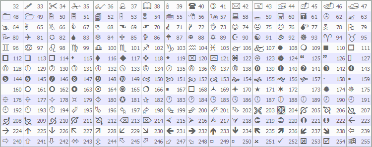

# Wingdings

Wingdings

Characters of Wingdings used with the [OBJ\_ARROW](../Object-Types/Object-Types.md) object:

A necessary character can be set using the [ObjectSetInteger()](../../../Object-Functions/ObjectSetInteger/ObjectSetInteger.md) function.

Example:

|  |
| --- |
| void OnStart()    {  //---     string up\_arrow="up\_arrow";     datetime time=TimeCurrent();     double lastClose[1];     int close=CopyClose(Symbol(),Period(),0,1,lastClose);     // Get the Close price  //--- If the price was obtained     if(close>0)       {        ObjectCreate(0,up\_arrow,OBJ\_ARROW,0,0,0,0,0);          // Create an arrow        ObjectSetInteger(0,up\_arrow,OBJPROP\_ARROWCODE,241);    // Set the arrow code        ObjectSetInteger(0,up\_arrow,OBJPROP\_TIME,time);        // Set time        ObjectSetDouble(0,up\_arrow,OBJPROP\_PRICE,lastClose[0]);// Set price        ChartRedraw(0);                                        // Draw arrow now       }     else        Print("Unable to get the latest Close price!");    } |
