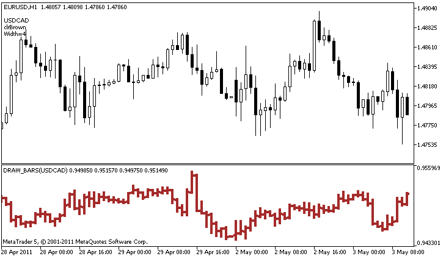

# DRAW_BARS

DRAW\_BARS

The DRAW\_BARS style draws bars on the values of four indicator buffers, which contain the Open, High, Low and Close prices. It is used for creating custom indicators as bars, including those in a separate subwindow of a chart and on other financial instruments.

The color of bars can be set using the [compiler directives](../../../Language-Basics/Preprocessor/Program-Properties-(#property)/Program-Properties-(#property).md) or dynamically using the [PlotIndexSetInteger()](../../PlotIndexSetInteger/PlotIndexSetInteger.md) function. Dynamic changes of the plotting properties allows "to enliven" indicators, so that their appearance changes depending on the current situation.

The indicator is drawn only to those bars, for which non-empty values of all four indicator buffers are set. To specify what value should be considered as "empty", set this value in the [PLOT\_EMPTY\_VALUE](../../../Constants,-Enumerations-and-Structures/Indicator-Constants/Custom-Indicator-Properties/Custom-Indicator-Properties.md#enum_customind_property_double) property:

|  |
| --- |
| //--- The 0 (empty) value will mot participate in drawing     PlotIndexSetDouble(index\_of\_plot\_DRAW\_BARS,PLOT\_EMPTY\_VALUE,0); |

Always explicitly fill in the values of the indicator buffers, set an empty value in a buffer to skip bars.

The number of required buffers for plotting DRAW\_BARS is 4. All buffers for the plotting should go one after the other in the given order: Open, High, Low and Close. None of the buffers can contain only empty values, since in this case nothing is plotted.

An example of the indicator that draws bars on a selected financial instrument in a separate window. The color of bars changes randomly every N ticks. The N parameter is set in [external parameters](../../../Language-Basics/Variables/Input-Variables/Input-Variables.md) of the indicator for the possibility of manual configuration (the Parameters tab in the indicator's Properties window).

Please note that for plot1 with the DRAW\_BARS style, the color is set using the compiler directive [#property](../../../Language-Basics/Preprocessor/Program-Properties-(#property)/Program-Properties-(#property).md), and then in the [OnCalculate()](../../../Event-Handling/OnCalculate/OnCalculate.md) function the color is set randomly from an earlier prepared list.

|  |
| --- |
| //+------------------------------------------------------------------+  //|                                                    DRAW\_BARS.mq5 |  //|                        Copyright 2011, MetaQuotes Software Corp. |  //|                                              https://www.mql5.com |  //+------------------------------------------------------------------+  #property copyright "Copyright 2000-2024, MetaQuotes Ltd."  #property link      "https://www.mql5.com"  #property version   "1.00"     #property description "An indicator to demonstrate DRAW\_BARS"  #property description "It draws bars of a selected symbol in a separate window"  #property description "The color and width of bars, as well as the symbol are changed randomly"  #property description "every N ticks"     #property indicator\_separate\_window  #property indicator\_buffers 4  #property indicator\_plots   1  //--- plot Bars  #property indicator\_label1  "Bars"  #property indicator\_type1   DRAW\_BARS  #property indicator\_color1  clrGreen  #property indicator\_style1  STYLE\_SOLID  #property indicator\_width1  1  //--- input parameters  input int      N=5;              // The number of ticks to change the type  input int      bars=500;         // The number of bars to show  input bool     messages=false;   // Show messages in the "Expert Advisors" log  //--- Indicator buffers  double         BarsBuffer1[];  double         BarsBuffer2[];  double         BarsBuffer3[];  double         BarsBuffer4[];  //--- Symbol name  string symbol;  //--- An array to store colors  color colors[]={clrRed,clrBlue,clrGreen,clrPurple,clrBrown,clrIndianRed};  //+------------------------------------------------------------------+  //| Custom indicator initialization function                         |  //+------------------------------------------------------------------+  int OnInit()    {  //--- If bars is very small - complete the work ahead of time     if(bars<50)       {        Comment("Please specify a larger number of bars! The operation of the indicator has been terminated");        return(INIT\_PARAMETERS\_INCORRECT);       }  //--- indicator buffers mapping     SetIndexBuffer(0,BarsBuffer1,INDICATOR\_DATA);     SetIndexBuffer(1,BarsBuffer2,INDICATOR\_DATA);     SetIndexBuffer(2,BarsBuffer3,INDICATOR\_DATA);     SetIndexBuffer(3,BarsBuffer4,INDICATOR\_DATA);  //--- The name of the symbol, for which the bars are drawn     symbol=\_Symbol;  //--- Set the display of the symbol     PlotIndexSetString(0,PLOT\_LABEL,symbol+" Open;"+symbol+" High;"+symbol+" Low;"+symbol+" Close");     IndicatorSetString(INDICATOR\_SHORTNAME,"DRAW\_BARS("+symbol+")");  //--- An empty value     PlotIndexSetDouble(0,PLOT\_EMPTY\_VALUE,0.0);  //---     return(INIT\_SUCCEEDED);    }  //+------------------------------------------------------------------+  //| Custom indicator iteration function                              |  //+------------------------------------------------------------------+  int OnCalculate(const int rates\_total,                  const int prev\_calculated,                  const datetime &time[],                  const double &open[],                  const double &high[],                  const double &low[],                  const double &close[],                  const long &tick\_volume[],                  const long &volume[],                  const int &spread[])    {     static int ticks=0;  //--- Calculate ticks to change the style, color and width of the line     ticks++;  //--- If a sufficient number of ticks has been accumulated     if(ticks>=N)       {        //--- Select a new symbol from the Market watch window        symbol=GetRandomSymbolName();        //--- Change the line properties        ChangeLineAppearance();           int tries=0;        //--- Make 5 attempts to fill in the buffers with the prices from symbol        while(!CopyFromSymbolToBuffers(symbol,rates\_total) && tries<5)          {           //--- A counter of calls of the CopyFromSymbolToBuffers() function           tries++;          }        //--- Reset the counter of ticks to zero        ticks=0;       }  //--- return value of prev\_calculated for next call     return(rates\_total);    }  //+------------------------------------------------------------------+  //| Fill in the indicator buffers with prices                        |  //+------------------------------------------------------------------+  bool CopyFromSymbolToBuffers(string name,int total)    {  //--- In the rates[] array, we will copy Open, High, Low and Close     MqlRates rates[];  //--- The counter of attempts     int attempts=0;  //--- How much has been copied     int copied=0;  //--- Make 25 attempts to get a timeseries on the desired symbol     while(attempts<25 && (copied=CopyRates(name,\_Period,0,bars,rates))<0)       {        Sleep(100);        attempts++;        if(messages) PrintFormat("%s CopyRates(%s) attempts=%d",\_\_FUNCTION\_\_,name,attempts);       }  //--- If failed to copy a sufficient number of bars     if(copied!=bars)       {        //--- Form a message string        string comm=StringFormat("For the symbol %s, managed to receive only %d bars of %d requested ones",                                 name,                                 copied,                                 bars                                 );        //--- Show a message in a comment in the main chart window        Comment(comm);        //--- Show the message        if(messages) Print(comm);        return(false);       }     else       {        //--- Set the display of the symbol         PlotIndexSetString(0,PLOT\_LABEL,name+" Open;"+name+" High;"+name+" Low;"+name+" Close");        IndicatorSetString(INDICATOR\_SHORTNAME,"DRAW\_BARS("+name+")");       }  //--- Initialize buffers with empty values     ArrayInitialize(BarsBuffer1,0.0);        ArrayInitialize(BarsBuffer2,0.0);        ArrayInitialize(BarsBuffer3,0.0);        ArrayInitialize(BarsBuffer4,0.0);     //--- Copy prices to the buffers     for(int i=0;i<copied;i++)       {        //--- Calculate the appropriate index for the buffers        int buffer\_index=total-copied+i;        //--- Write the prices to the buffers        BarsBuffer1[buffer\_index]=rates[i].open;        BarsBuffer2[buffer\_index]=rates[i].high;        BarsBuffer3[buffer\_index]=rates[i].low;        BarsBuffer4[buffer\_index]=rates[i].close;       }     return(true);    }  //+------------------------------------------------------------------+  //| Randomly returns a symbol from the Market Watch                  |  //+------------------------------------------------------------------+  string GetRandomSymbolName()    {  //--- The number of symbols shown in the Market watch window     int symbols=SymbolsTotal(true);  //--- The position of a symbol in the list - a random number from 0 to symbols     int number=MathRand()%symbols;  //--- Return the name of a symbol at the specified position     return SymbolName(number,true);    }  //+------------------------------------------------------------------+  //| Changes the appearance of bars                                   |  //+------------------------------------------------------------------+  void ChangeLineAppearance()    {  //--- A string for the formation of information about the bar properties     string comm="";  //--- A block for changing the color of bars     int number=MathRand(); // Get a random number  //--- The divisor is equal to the size of the colors[] array     int size=ArraySize(colors);  //--- Get the index to select a new color as the remainder of integer division     int color\_index=number%size;  //--- Set the color as the PLOT\_LINE\_COLOR property     PlotIndexSetInteger(0,PLOT\_LINE\_COLOR,colors[color\_index]);  //--- Write the line color     comm=comm+"\r\n"+(string)colors[color\_index];     //--- A block for changing the width of bars     number=MathRand();  //--- Get the width of the remainder of integer division     int width=number%5;   // The width is set from 0 to 4  //--- Set the color as the PLOT\_LINE\_WIDTH property     PlotIndexSetInteger(0,PLOT\_LINE\_WIDTH,width);  //--- Write the line width     comm=comm+"\r\nWidth="+IntegerToString(width);     //--- Write the symbol name     comm="\r\n"+symbol+comm;     //--- Show the information on the chart using a comment     Comment(comm);    } |
