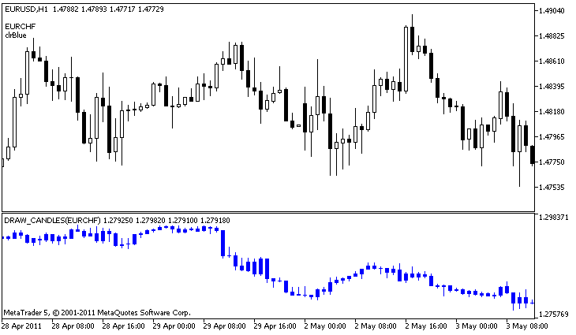

# DRAW_CANDLES

DRAW\_CANDLES

The DRAW\_CANDLES style draws candlesticks on the values of four indicator buffers, which contain the Open, High, Low and Close prices. It is used for creating custom indicators as a sequence of candlesticks, including those in a separate subwindow of a chart and on other financial instruments.

The color of candlesticks can be set using the [compiler directives](../../../Language-Basics/Preprocessor/Program-Properties-(#property)/Program-Properties-(#property).md) or dynamically using the [PlotIndexSetInteger()](../../PlotIndexSetInteger/PlotIndexSetInteger.md) function. Dynamic changes of the plotting properties allows "to enliven" indicators, so that their appearance changes depending on the current situation.

The indicator is drawn only to those bars, for which non-empty values of all four indicator buffers are set. To specify what value should be considered as "empty", set this value in the [PLOT\_EMPTY\_VALUE](../../../Constants,-Enumerations-and-Structures/Indicator-Constants/Custom-Indicator-Properties/Custom-Indicator-Properties.md#enum_customind_property_double) property:

|  |
| --- |
| //--- The 0 (empty) value will mot participate in drawing     PlotIndexSetDouble(index\_of\_plot\_DRAW\_CANDLES,PLOT\_EMPTY\_VALUE,0); |

Always explicitly fill in the values ​​of the indicator buffers, set an empty value in a buffer to skip bars.

The number of required buffers for plotting DRAW\_CANDLES is 4. All buffers for the plotting should go one after the other in the given order: Open, High, Low and Close. None of the buffers can contain only empty values, since in this case nothing is plotted.

You can set up to three colors for the DRAW\_CANDLES style affecting the candle look. If only one color is set, it is applied to all candles on a chart.

|  |
| --- |
| //--- identical candles with a single color applied to them  #property indicator\_label1  "One color candles"  #property indicator\_type1   DRAW\_CANDLES  //--- only one color is specified, therefore all candles are of the same color  #property indicator\_color1  clrGreen |

If two comma-separated colors are specified, the first one is applied to candle outlines, while the second one is applied to the body.

|  |
| --- |
| //--- different colors for candles and wicks  #property indicator\_label1  "Two color candles"  #property indicator\_type1   DRAW\_CANDLES  //--- green is applied to wicks and outlines, while white is applied to the body  #property indicator\_color1  clrGreen,clrWhite |

Specify three comma-separated colors so that rising and falling candles are displayed differently. In that case, the first color is applied to the candle outlines, while the second and third ones – to bullish and bearish candles.

|  |
| --- |
| //--- different colors for candles and wicks  #property indicator\_label1  "One color candles"  #property indicator\_type1   DRAW\_CANDLES  //--- wicks and outlines are green, bullish candle body is white, while bearish candle body is red  #property indicator\_color1  clrGreen,clrWhite,clrRed |

Thus, the DRAW\_CANDLES style allows you to create custom candle coloring options. Besides, all colors can be changed dynamically during the indicator operation using the PlotIndexSetInteger function (composition\_index\_DRAW\_CANDLES, PLOT\_LINE\_COLOR, modifier\_index, color), where modifier\_index may have the following values:

- 0 – colors of outlines and wicks
- 1– bullish candle body color
- 2 – bearish candle body color

|  |
| --- |
| //--- set the color of outlines and wicks  PlotIndexSetInteger(0,PLOT\_LINE\_COLOR,0,clrBlue);  //--- set the bullish body color  PlotIndexSetInteger(0,PLOT\_LINE\_COLOR,1,clrGreen);  //--- set the bearish body color  PlotIndexSetInteger(0,PLOT\_LINE\_COLOR,2,clrRed); |

An example of the indicator that draws candlesticks for a selected financial instrument in a separate window. The color of candlesticks changes randomly every N ticks. The N parameter is set in [external parameters](../../../Language-Basics/Variables/Input-Variables/Input-Variables.md) of the indicator for the possibility of manual configuration (the Parameters tab in the indicator's Properties window).

Please note that for plot1, the color is set using the compiler directive [#property](../../../Language-Basics/Preprocessor/Program-Properties-(#property)/Program-Properties-(#property).md), and then in the [OnCalculate()](../../../Event-Handling/OnCalculate/OnCalculate.md) function the color is set randomly from an earlier prepared list.

|  |
| --- |
| //+------------------------------------------------------------------+  //|                                                 DRAW\_CANDLES.mq5 |  //|                         Copyright 2000-2024, MetaQuotes Ltd. |  //|                                              https://www.mql5.com |  //+------------------------------------------------------------------+  #property copyright "Copyright 2000-2024, MetaQuotes Ltd."  #property link      "https://www.mql5.com"  #property version   "1.00"     #property description "An indicator to demonstrate DRAW\_CANDLES."  #property description "It draws candlesticks of a selected symbol in a separate window"  #property description " "  #property description "The color and width of candlesticks, as well as the symbol are changed"  #property description "randomly every N ticks"     #property indicator\_separate\_window  #property indicator\_buffers 4  #property indicator\_plots   1  //--- plot Bars  #property indicator\_label1  "DRAW\_CANDLES1"  #property indicator\_type1   DRAW\_CANDLES  #property indicator\_color1  clrGreen  #property indicator\_style1  STYLE\_SOLID  #property indicator\_width1  1     //--- input parameters  input int      N=5;              // The number of ticks to change the type  input int      bars=500;         // The number of bars to show  input bool     messages=false;   // Show messages in the "Expert Advisors" log  //--- Indicator buffers  double         Candle1Buffer1[];  double         Candle1Buffer2[];  double         Candle1Buffer3[];  double         Candle1Buffer4[];  //--- Symbol name  string symbol;  //--- An array to store colors  color colors[]={clrRed,clrBlue,clrGreen,clrPurple,clrBrown,clrIndianRed};  //+------------------------------------------------------------------+  //| Custom indicator initialization function                         |  //+------------------------------------------------------------------+  int OnInit()    {  //--- If bars is very small - complete the work ahead of time     if(bars<50)       {        Comment("Please specify a larger number of bars! The operation of the indicator has been terminated");        return(INIT\_PARAMETERS\_INCORRECT);       }  //--- indicator buffers mapping     SetIndexBuffer(0,Candle1Buffer1,INDICATOR\_DATA);     SetIndexBuffer(1,Candle1Buffer2,INDICATOR\_DATA);     SetIndexBuffer(2,Candle1Buffer3,INDICATOR\_DATA);     SetIndexBuffer(3,Candle1Buffer4,INDICATOR\_DATA);  //--- An empty value     PlotIndexSetDouble(0,PLOT\_EMPTY\_VALUE,0);  //--- The name of the symbol, for which the bars are drawn     symbol=\_Symbol;  //--- Set the display of the symbol     PlotIndexSetString(0,PLOT\_LABEL,symbol+" Open;"+symbol+" High;"+symbol+" Low;"+symbol+" Close");     IndicatorSetString(INDICATOR\_SHORTNAME,"DRAW\_CANDLES("+symbol+")");  //---     return(INIT\_SUCCEEDED);    }  //+------------------------------------------------------------------+  //| Custom indicator iteration function                              |  //+------------------------------------------------------------------+  int OnCalculate(const int rates\_total,                  const int prev\_calculated,                  const datetime &time[],                  const double &open[],                  const double &high[],                  const double &low[],                  const double &close[],                  const long &tick\_volume[],                  const long &volume[],                  const int &spread[])    {     static int ticks=INT\_MAX-100;  //--- Calculate ticks to change the style, color and width of the line     ticks++;  //--- If a sufficient number of ticks has been accumulated     if(ticks>=N)       {        //--- Select a new symbol from the Market watch window        symbol=GetRandomSymbolName();        //--- Change the form        ChangeLineAppearance();        //--- Select a new symbol from the Market watch window        int tries=0;        //--- Make 5 attempts to fill in the buffers of plot1 with the prices from symbol        while(!CopyFromSymbolToBuffers(symbol,rates\_total,0,              Candle1Buffer1,Candle1Buffer2,Candle1Buffer3,Candle1Buffer4)              && tries<5)          {           //--- A counter of calls of the CopyFromSymbolToBuffers() function           tries++;          }        //--- Reset the counter of ticks to zero        ticks=0;       }  //--- return value of prev\_calculated for next call     return(rates\_total);    }  //+------------------------------------------------------------------+  //| Fills in the specified candlestick                               |  //+------------------------------------------------------------------+  bool CopyFromSymbolToBuffers(string name,                               int total,                               int plot\_index,                               double &buff1[],                               double &buff2[],                               double &buff3[],                               double &buff4[]                               )    {  //--- In the rates[] array, we will copy Open, High, Low and Close     MqlRates rates[];  //--- The counter of attempts     int attempts=0;  //--- How much has been copied     int copied=0;  //--- Make 25 attempts to get a timeseries on the desired symbol     while(attempts<25 && (copied=CopyRates(name,\_Period,0,bars,rates))<0)       {        Sleep(100);        attempts++;        if(messages) PrintFormat("%s CopyRates(%s) attempts=%d",\_\_FUNCTION\_\_,name,attempts);       }  //--- If failed to copy a sufficient number of bars     if(copied!=bars)       {        //--- Form a message string        string comm=StringFormat("For the symbol %s, managed to receive only %d bars of %d requested ones",                                 name,                                 copied,                                 bars                                 );        //--- Show a message in a comment in the main chart window        Comment(comm);        //--- Show the message        if(messages) Print(comm);        return(false);       }     else       {        //--- Set the display of the symbol         PlotIndexSetString(plot\_index,PLOT\_LABEL,name+" Open;"+name+" High;"+name+" Low;"+name+" Close");       }  //--- Initialize buffers with empty values     ArrayInitialize(buff1,0.0);     ArrayInitialize(buff2,0.0);     ArrayInitialize(buff3,0.0);     ArrayInitialize(buff4,0.0);  //--- On each tick copy prices to buffers     for(int i=0;i<copied;i++)       {        //--- Calculate the appropriate index for the buffers        int buffer\_index=total-copied+i;        //--- Write the prices to the buffers        buff1[buffer\_index]=rates[i].open;        buff2[buffer\_index]=rates[i].high;        buff3[buffer\_index]=rates[i].low;        buff4[buffer\_index]=rates[i].close;       }     return(true);    }  //+------------------------------------------------------------------+  //| Randomly returns a symbol from the Market Watch                  |  //+------------------------------------------------------------------+  string GetRandomSymbolName()    {  //--- The number of symbols shown in the Market watch window     int symbols=SymbolsTotal(true);  //--- The position of a symbol in the list - a random number from 0 to symbols     int number=MathRand()%symbols;  //--- Return the name of a symbol at the specified position     return SymbolName(number,true);    }  //+------------------------------------------------------------------+  //| Changes the appearance of bars                                   |  //+------------------------------------------------------------------+  void ChangeLineAppearance()    {  //--- A string for the formation of information about the bar properties     string comm="";  //--- A block for changing the color of bars     int number=MathRand(); // Get a random number  //--- The divisor is equal to the size of the colors[] array     int size=ArraySize(colors);  //--- Get the index to select a new color as the remainder of integer division     int color\_index=number%size;  //--- Set the color as the PLOT\_LINE\_COLOR property     PlotIndexSetInteger(0,PLOT\_LINE\_COLOR,colors[color\_index]);  //--- Write the color     comm=comm+"\r\n"+(string)colors[color\_index];  //--- Write the symbol name     comm="\r\n"+symbol+comm;  //--- Show the information on the chart using a comment     Comment(comm);    } |
