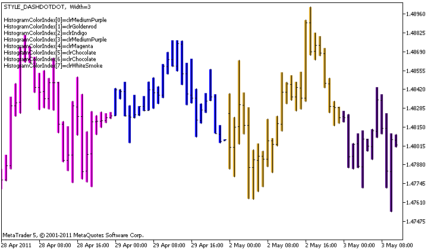

# DRAW_COLOR_HISTOGRAM2

DRAW\_COLOR\_HISTOGRAM2

The DRAW\_COLOR\_HISTOGRAM2 style draws a histogram of a specified color – vertical segments using the values of two indicator buffers. But unlike the one-color DRAW\_HISTOGRAM2, in this style each column of the histogram can have its own color from a predefined set. The values of all the segments are taken from the indicator buffer.

The width, style and color of the histogram can be specified like for the[DRAW\_HISTOGRAM2](../DRAW_HISTOGRAM2/DRAW_HISTOGRAM2.md) style – using [compiler directives](../../../Language-Basics/Preprocessor/Program-Properties-(#property)/Program-Properties-(#property).md) or dynamically using the [PlotIndexSetInteger()](../../PlotIndexSetInteger/PlotIndexSetInteger.md) function. Dynamic changes of the plotting properties allows changing the look of the histogram based on the current situation.

The DRAW\_COLOR\_HISTOGRAM2 style can be used in a separate subwindow of a chart and in its main window. For empty values nothing is drawn, all the values in the indicator buffers need to be set explicitly. Buffers are not initialized with empty values.

The number of buffers required for plotting DRAW\_COLOR\_HISTOGRAM2 is 3:

- two buffers to store the upper and lower end of the vertical segment on each bar;
- one buffer to store the color index, which is used to draw the segment (it makes sense to set only non-empty values).

An example of the indicator that draws a histogram of a specified color between the High and Low prices. For each day of week, the histogram lines have a different color. The color of the day, width and style of the histogram change randomly each N ticks.

Please note that for plot1 with the DRAW\_COLOR\_HISTOGRAM2 style, 5 colors are set using the compiler directive [#property](../../../Language-Basics/Preprocessor/Program-Properties-(#property)/Program-Properties-(#property).md), and then in the [OnCalculate()](../../../Event-Handling/OnCalculate/OnCalculate.md) function the colors are selected randomly from the 14 colors stored in the colors[] array.

The N parameter is set in [external parameters](../../../Language-Basics/Variables/Input-Variables/Input-Variables.md) of the indicator for the possibility of manual configuration (the Parameters tab in the indicator's Properties window).

|  |
| --- |
| //+------------------------------------------------------------------+  //|                                        DRAW\_COLOR\_HISTOGRAM2.mq5 |  //|                        Copyright 2011, MetaQuotes Software Corp. |  //|                                              https://www.mql5.com |  //+------------------------------------------------------------------+  #property copyright "Copyright 2000-2024, MetaQuotes Ltd."  #property link      "https://www.mql5.com"  #property version   "1.00"     #property description "An indicator to demonstrate DRAW\_COLOR\_HISTOGRAM2"  #property description "It draws a segment between Open and Close on each bar"  #property description "The color, width and style are changed randomly"  #property description "after every N ticks"     #property indicator\_chart\_window  #property indicator\_buffers 3  #property indicator\_plots   1  //--- plot ColorHistogram\_2  #property indicator\_label1  "ColorHistogram\_2"  #property indicator\_type1   DRAW\_COLOR\_HISTOGRAM2  //--- Define 5 colors for coloring the histogram based on the days of week (they are stored in the special array)  #property indicator\_color1  clrRed,clrBlue,clrGreen,clrYellow,clrMagenta  #property indicator\_style1  STYLE\_SOLID  #property indicator\_width1  1     //--- input parameter  input int      N=5;              // The number of ticks to change the histogram  int            color\_sections;  //--- Value buffers  double         ColorHistogram\_2Buffer1[];  double         ColorHistogram\_2Buffer2[];  //--- A buffer of color indexes  double         ColorHistogram\_2Colors[];  //--- An array for storing colors contains 14 elements  color colors[]=    {     clrRed,clrBlue,clrGreen,clrChocolate,clrMagenta,clrDodgerBlue,clrGoldenrod,     clrIndigo,clrLightBlue,clrAliceBlue,clrMoccasin,clrWhiteSmoke,clrCyan,clrMediumPurple    };  //--- An array to store the line styles  ENUM\_LINE\_STYLE styles[]={STYLE\_SOLID,STYLE\_DASH,STYLE\_DOT,STYLE\_DASHDOT,STYLE\_DASHDOTDOT};  //+------------------------------------------------------------------+  //| Custom indicator initialization function                         |  //+------------------------------------------------------------------+  int OnInit()    {  //--- indicator buffers mapping     SetIndexBuffer(0,ColorHistogram\_2Buffer1,INDICATOR\_DATA);     SetIndexBuffer(1,ColorHistogram\_2Buffer2,INDICATOR\_DATA);     SetIndexBuffer(2,ColorHistogram\_2Colors,INDICATOR\_COLOR\_INDEX);  //--- Set an empty value     PlotIndexSetDouble(0,PLOT\_EMPTY\_VALUE,0);  //---- The number of colors to color the sinusoid     color\_sections=8;   //  See a comment to #property indicator\_color1        //---     return(INIT\_SUCCEEDED);    }  //+------------------------------------------------------------------+  //| Custom indicator iteration function                              |  //+------------------------------------------------------------------+  int OnCalculate(const int rates\_total,                  const int prev\_calculated,                  const datetime &time[],                  const double &open[],                  const double &high[],                  const double &low[],                  const double &close[],                  const long &tick\_volume[],                  const long &volume[],                  const int &spread[])    {     static int ticks=0;  //--- Calculate ticks to change the style, color and width of the line     ticks++;  //--- If a critical number of ticks has been accumulated     if(ticks>=N)       {        //--- Change the line properties        ChangeLineAppearance();        //--- Change the colors used to draw the histogram        ChangeColors(colors,color\_sections);              //--- Reset the counter of ticks to zero        ticks=0;       }     //--- Calculate the indicator values     int start=0;  //--- To get the day of week by the open price of each bar     MqlDateTime dt;  //--- If already calculated during the previous starts of OnCalculate     if(prev\_calculated>0) start=prev\_calculated-1; // set the beginning of the calculation with the last but one bar  //--- Fill in the indicator buffer with values     for(int i=start;i<rates\_total;i++)       {        TimeToStruct(time[i],dt);        //--- value        ColorHistogram\_2Buffer1[i]=high[i];        ColorHistogram\_2Buffer2[i]=low[i];        //--- Set the color index according to the day of week        int day=dt.day\_of\_week;        ColorHistogram\_2Colors[i]=day;       }  //--- Return the prev\_calculated value for the next call of the function     return(rates\_total);    }  //+------------------------------------------------------------------+  //| Changes the color of line segments                               |  //+------------------------------------------------------------------+  void  ChangeColors(color  &cols[],int plot\_colors)    {  //--- The number of colors     int size=ArraySize(cols);  //---      string comm=ChartGetString(0,CHART\_COMMENT)+"\r\n\r\n";     //--- For each color index define a new color randomly     for(int plot\_color\_ind=0;plot\_color\_ind<plot\_colors;plot\_color\_ind++)       {        //--- Get a random value        int number=MathRand();        //--- Get an index in the col[] array as a remainder of the integer division        int i=number%size;        //--- Set the color for each index as the property PLOT\_LINE\_COLOR        PlotIndexSetInteger(0,                    //  The number of a graphical style                            PLOT\_LINE\_COLOR,      //  Property identifier                            plot\_color\_ind,       //  The index of the color, where we write the color                            cols[i]);             //  A new color        //--- Write the colors        comm=comm+StringFormat("HistogramColorIndex[%d]=%s \r\n",plot\_color\_ind,ColorToString(cols[i],true));        ChartSetString(0,CHART\_COMMENT,comm);       }  //---    }  //+------------------------------------------------------------------+  //| Changes the appearance of a displayed line in the indicator      |  //+------------------------------------------------------------------+  void ChangeLineAppearance()    {  //--- A string for the formation of information about the line properties     string comm="";  //--- A block for changing the width of the line     int number=MathRand();  //--- Get the width of the remainder of integer division     int width=number%5; // The width is set from 0 to 4  //--- Set the color as the PLOT\_LINE\_WIDTH property     PlotIndexSetInteger(0,PLOT\_LINE\_WIDTH,width);  //--- Write the line width     comm=comm+" Width="+IntegerToString(width);     //--- A block for changing the style of the line     number=MathRand();  //--- The divisor is equal to the size of the styles array     int size=ArraySize(styles);  //--- Get the index to select a new style as the remainder of integer division     int style\_index=number%size;  //--- Set the color as the PLOT\_LINE\_COLOR property     PlotIndexSetInteger(0,PLOT\_LINE\_STYLE,styles[style\_index]);  //--- Write the line style     comm=EnumToString(styles[style\_index])+", "+comm;  //--- Show the information on the chart using a comment     Comment(comm);    } |
