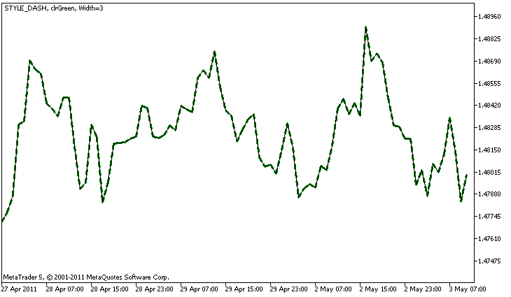

# DRAW_LINE

DRAW\_LINE

DRAW\_LINE draws a line of the specified color by the values of the indicator buffer. The width, style and color of the line can be set using the [compiler directives](../../../Language-Basics/Preprocessor/Program-Properties-(#property)/Program-Properties-(#property).md) and dynamically using the [PlotIndexSetInteger()](../../PlotIndexSetInteger/PlotIndexSetInteger.md) function. Dynamic changes of the plotting properties allows "to enliven" indicators, so that their appearance changes depending on the current situation.

The number of buffers required for plotting DRAW\_LINE is 1.

An example of the indicator that draws a line using Close prices of bars. The line color, width and style change randomly every N=5 ticks.

Note that initially for plot1 with DRAW\_LINE the properties are set using the compiler directive [#property](../../../Language-Basics/Preprocessor/Program-Properties-(#property)/Program-Properties-(#property).md), and then in the [OnCalculate()](../../../Event-Handling/OnCalculate/OnCalculate.md) function these three properties are set randomly. The N parameter is set in [external parameters](../../../Language-Basics/Variables/Input-Variables/Input-Variables.md) of the indicator for the possibility of manual configuration (the Parameters tab in the indicator's Properties window).

|  |
| --- |
| //+------------------------------------------------------------------+  //|                                                    DRAW\_LINE.mq5 |  //|                        Copyright 2011, MetaQuotes Software Corp. |  //|                                              https://www.mql5.com |  //+------------------------------------------------------------------+  #property copyright "Copyright 2000-2024, MetaQuotes Ltd."  #property link      "https://www.mql5.com"  #property version   "1.00"     #property description "An indicator to demonstrate DRAW\_LINE"  #property description "It draws a line of a specified color at Close prices"  #property description "Color, width and style of lines is changed randomly"  #property description "after every N ticks"     #property indicator\_chart\_window  #property indicator\_buffers 1  #property indicator\_plots   1  //--- Line properties are set using the compiler directives  #property indicator\_label1  "Line"      // Name of a plot for the Data Window  #property indicator\_type1   DRAW\_LINE   // Type of plotting is line  #property indicator\_color1  clrRed      // Line color  #property indicator\_style1  STYLE\_SOLID // Line style  #property indicator\_width1  1           // Line Width  //--- input parameter  input int      N=5;         // Number of ticks to change   //--- An indicator buffer for the plot  double         LineBuffer[];  //--- An array to store colors  color colors[]={clrRed,clrBlue,clrGreen};  //--- An array to store the line styles  ENUM\_LINE\_STYLE styles[]={STYLE\_SOLID,STYLE\_DASH,STYLE\_DOT,STYLE\_DASHDOT,STYLE\_DASHDOTDOT};  //+------------------------------------------------------------------+  //| Custom indicator initialization function                         |  //+------------------------------------------------------------------+  int OnInit()    {  //--- Binding an array and an indicator buffer     SetIndexBuffer(0,LineBuffer,INDICATOR\_DATA);  //--- Initializing the generator of pseudo-random numbers     MathSrand(GetTickCount());  //---     return(INIT\_SUCCEEDED);    }  //+------------------------------------------------------------------+  //| Custom indicator iteration function                              |  //+------------------------------------------------------------------+  int OnCalculate(const int rates\_total,                  const int prev\_calculated,                  const datetime &time[],                  const double &open[],                  const double &high[],                  const double &low[],                  const double &close[],                  const long &tick\_volume[],                  const long &volume[],                  const int &spread[])    {     static int ticks=0;  //--- Calculate ticks to change the style, color and width of the line     ticks++;  //--- If a critical number of ticks has been accumulated     if(ticks>=N)       {        //--- Change the line properties        ChangeLineAppearance();        //--- Reset the counter of ticks to zero        ticks=0;       }     //--- Block for calculating indicator values     for(int i=0;i<rates\_total;i++)       {        LineBuffer[i]=close[i];       }     //--- Return the prev\_calculated value for the next call of the function     return(rates\_total);    }  //+------------------------------------------------------------------+  //| Changes the appearance of the drawn line in the indicator        |  //+------------------------------------------------------------------+  void ChangeLineAppearance()    {  //--- A string for the formation of information about the line properties     string comm="";  //--- A block for changing the color of the line  //--- Get a random number     int number=MathRand();  //--- The divisor is equal to the size of the colors[] array     int size=ArraySize(colors);  //--- Get the index to select a new color as the remainder of integer division     int color\_index=number%size;  //--- Set the color as the PLOT\_LINE\_COLOR property     PlotIndexSetInteger(0,PLOT\_LINE\_COLOR,colors[color\_index]);  //--- Write the line color     comm=comm+(string)colors[color\_index];     //--- A block for changing the width of the line     number=MathRand();  //--- Get the width of the remainder of integer division     int width=number%5; // The width is set from 0 to 4  //--- Set the color as the PLOT\_LINE\_WIDTH property     PlotIndexSetInteger(0,PLOT\_LINE\_WIDTH,width);  //--- Write the line width     comm=comm+", Width="+IntegerToString(width);     //--- A block for changing the style of the line     number=MathRand();  //--- The divisor is equal to the size of the styles array     size=ArraySize(styles);  //--- Get the index to select a new style as the remainder of integer division     int style\_index=number%size;  //--- Set the color as the PLOT\_LINE\_COLOR property     PlotIndexSetInteger(0,PLOT\_LINE\_STYLE,styles[style\_index]);  //--- Write the line style     comm=EnumToString(styles[style\_index])+", "+comm;  //--- Show the information on the chart using a comment     Comment(comm);    } |
