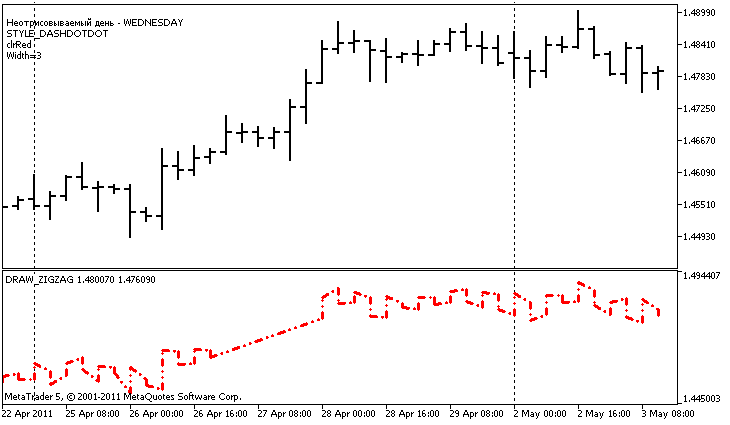

# DRAW_ZIGZAG

DRAW\_ZIGZAG

The DRAW\_ZIGZAG style draws segments of a specified color based on the values of two indicator buffers. This style is very similar to [DRAW\_SECTION](../DRAW_SECTION/DRAW_SECTION.md), but unlike the latter, it allows drawing vertical segments within one bar, if values ​​of both indicator buffers are set for this bar. The segments are plotted from a value in the first buffer to a value in the second indicator buffer. None of the buffers can contain only empty values, since in this case nothing is plotted.

The width, color and style of the line can be specified like for the [DRAW\_SECTION](../../../Language-Basics/Preprocessor/Program-Properties-(#property)/Program-Properties-(#property).md) style - using [compiler directives](../../PlotIndexSetInteger/PlotIndexSetInteger.md) or dynamically using the [PlotIndexSetInteger()](../../PlotIndexSetInteger/PlotIndexSetInteger.md) function. Dynamic changes of the plotting properties allows "to enliven" indicators, so that their appearance changes depending on the current situation.

Sections are drawn from a non-empty value of one buffer to a non-empty value of another indicator buffer. To specify what value should be considered as "empty", set this value in the [PLOT\_EMPTY\_VALUE](../../../Constants,-Enumerations-and-Structures/Indicator-Constants/Custom-Indicator-Properties/Custom-Indicator-Properties.md#enum_customind_property_double) property:

|  |
| --- |
| //--- The 0 (empty) value will mot participate in drawing     PlotIndexSetDouble(index\_of\_plot\_DRAW\_ZIGZAG,PLOT\_EMPTY\_VALUE,0); |

Always explicitly fill in the values of the indicator buffers, set an empty value in a buffer to skip bars.

The number of buffers required for plotting DRAW\_ZIGZAG is 2.

An example of the indicator that plots a saw based on the High and Low prices. The color, width and style of the zigzag lines change randomly every N ticks.

Note that initially for plot1 with DRAW\_ZIGZAG the properties are set using the compiler directive [#property](../../../Language-Basics/Preprocessor/Program-Properties-(#property)/Program-Properties-(#property).md), and then in the [OnCalculate()](../../../Event-Handling/OnCalculate/OnCalculate.md) function these properties are set randomly. The N parameter is set in [external parameters](../../../Language-Basics/Variables/Input-Variables/Input-Variables.md) of the indicator for the possibility of manual configuration (the Parameters tab in the indicator's Properties window).

|  |
| --- |
| //+------------------------------------------------------------------+  //|                                                  DRAW\_ZIGZAG.mq5 |  //|                        Copyright 2011, MetaQuotes Software Corp. |  //|                                              https://www.mql5.com |  //+------------------------------------------------------------------+  #property copyright "Copyright 2000-2024, MetaQuotes Ltd."  #property link      "https://www.mql5.com"  #property version   "1.00"     #property description "An indicator to demonstrate DRAW\_ZIGZAG"  #property description "It draws a \"saw\" as straight segments, skipping the bars of one day"  #property description "The day to skip is selected randomly during indicator start"  #property description "The color, width and style of segments are changed randomly"  #property description " every N ticks"     #property indicator\_separate\_window  #property indicator\_buffers 2  #property indicator\_plots   1  //--- plot ZigZag  #property indicator\_label1  "ZigZag"  #property indicator\_type1   DRAW\_ZIGZAG  #property indicator\_color1  clrBlue  #property indicator\_style1  STYLE\_SOLID  #property indicator\_width1  1  //--- input parameters  input int      N=5;              // Number of ticks to change   //--- indicator buffers  double         ZigZagBuffer1[];  double         ZigZagBuffer2[];  //--- The day of the week for which the indicator is not plotted  int invisible\_day;  //--- An array to store colors  color colors[]={clrRed,clrBlue,clrGreen};  //--- An array to store the line styles  ENUM\_LINE\_STYLE styles[]={STYLE\_SOLID,STYLE\_DASH,STYLE\_DOT,STYLE\_DASHDOT,STYLE\_DASHDOTDOT};  //+------------------------------------------------------------------+  //| Custom indicator initialization function                         |  //+------------------------------------------------------------------+  int OnInit()    {  //--- Binding arrays and indicator buffers     SetIndexBuffer(0,ZigZagBuffer1,INDICATOR\_DATA);     SetIndexBuffer(1,ZigZagBuffer2,INDICATOR\_DATA);  //--- Get a random value from 0 to 6, for this day the indicator is not plotted     invisible\_day=MathRand()%6;  //--- The 0 (empty) value will mot participate in drawing     PlotIndexSetDouble(0,PLOT\_EMPTY\_VALUE,0);  //--- The 0 (empty) value will mot participate in drawing     PlotIndexSetString(0,PLOT\_LABEL,"ZigZag1;ZigZag2");  //---     return(INIT\_SUCCEEDED);    }  //+------------------------------------------------------------------+  //| Custom indicator iteration function                              |  //+------------------------------------------------------------------+  int OnCalculate(const int rates\_total,                  const int prev\_calculated,                  const datetime &time[],                  const double &open[],                  const double &high[],                  const double &low[],                  const double &close[],                  const long &tick\_volume[],                  const long &volume[],                  const int &spread[])    {     static int ticks=0;  //--- Calculate ticks to change the style, color and width of the line     ticks++;  //--- If a sufficient number of ticks has been accumulated     if(ticks>=N)       {        //--- Change the line properties        ChangeLineAppearance();        //--- Reset the counter of ticks to zero        ticks=0;       }     //--- The structure of time is required to get the day of week of each bar     MqlDateTime dt;     //--- The start position of calculations     int start=0;  //--- If the indicator was calculated on the previous tick, then start the calculation with the last but one tick     if(prev\_calculated!=0) start=prev\_calculated-1;  //--- Calculation loop     for(int i=start;i<rates\_total;i++)       {        //--- Write the bar open time in the structure        TimeToStruct(time[i],dt);        //--- If the day of the week of this bar is equal to invisible\_day        if(dt.day\_of\_week==invisible\_day)          {           //--- Write empty values to buffers for this bar           ZigZagBuffer1[i]=0;           ZigZagBuffer2[i]=0;          }        //--- If the day of the week is ok, fill in the buffers        else          {           //--- If the bar number if even           if(i%2==0)             {              //---  Write High in the 1st buffer and Low in the 2nd one              ZigZagBuffer1[i]=high[i];              ZigZagBuffer2[i]=low[i];             }           //--- The bar number is odd           else             {              //--- Fill in the bar in a reverse order              ZigZagBuffer1[i]=low[i];              ZigZagBuffer2[i]=high[i];             }          }       }  //--- return value of prev\_calculated for next call     return(rates\_total);    }  //+------------------------------------------------------------------+  //| Changes the appearance of the zigzag segments                    |  //+------------------------------------------------------------------+  void ChangeLineAppearance()    {  //--- A string for the formation of information about the ZigZag properties     string comm="";  //--- A block for changing the color of the ZigZag     int number=MathRand(); // Get a random number  //--- The divisor is equal to the size of the colors[] array     int size=ArraySize(colors);  //--- Get the index to select a new color as the remainder of integer division     int color\_index=number%size;  //--- Set the color as the PLOT\_LINE\_COLOR property     PlotIndexSetInteger(0,PLOT\_LINE\_COLOR,colors[color\_index]);  //--- Write the line color     comm=comm+"\r\n"+(string)colors[color\_index];     //--- A block for changing the width of the line     number=MathRand();  //--- Get the width of the remainder of integer division     int width=number%5;   // The width is set from 0 to 4  //--- Set the color as the PLOT\_LINE\_WIDTH property     PlotIndexSetInteger(0,PLOT\_LINE\_WIDTH,width);  //--- Write the line width     comm=comm+"\r\nWidth="+IntegerToString(width);     //--- A block for changing the style of the line     number=MathRand();  //--- The divisor is equal to the size of the styles array     size=ArraySize(styles);  //--- Get the index to select a new style as the remainder of integer division     int style\_index=number%size;  //--- Set the color as the PLOT\_LINE\_COLOR property     PlotIndexSetInteger(0,PLOT\_LINE\_STYLE,styles[style\_index]);  //--- Write the line style     comm="\r\n"+EnumToString(styles[style\_index])+""+comm;  //--- Add information about the day that is omitted in calculations     comm="\r\nNot plotted day - "+EnumToString((ENUM\_DAY\_OF\_WEEK)invisible\_day)+comm;  //--- Show the information on the chart using a comment     Comment(comm);    } |
