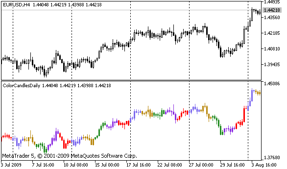

# PlotIndexGetInteger

PlotIndexGetInteger

The function sets the value of the corresponding property of the corresponding indicator line. The indicator property must be of the int, color, bool or char type. There are 2 variants of the function.

Call indicating identifier of the property.

|  |
| --- |
| int  PlotIndexGetInteger(     int  plot\_index,        // plotting style index     int  prop\_id,           // property identifier     ); |

Call indicating the identifier and modifier of the property.

|  |
| --- |
| int  PlotIndexGetInteger(     int  plot\_index,        // plotting index     int  prop\_id,           // property identifier     int  prop\_modifier      // property modifier     ) |

Parameters

plot\_index

[in]  Index of the [graphical plotting](../../Constants,-Enumerations-and-Structures/Indicator-Constants/Drawing-Styles/Drawing-Styles.md#enum_draw_type)

prop\_id

[in] The value can be one of the values of the [ENUM\_PLOT\_PROPERTY\_INTEGER](../../Constants,-Enumerations-and-Structures/Indicator-Constants/Drawing-Styles/Drawing-Styles.md#enum_plot_property_integer) enumeration.

prop\_modifier

[in]  Modifier of the specified property. Only color index properties require a modifier.

Note

Function is designed to extract the settings of drawing of the appropriate indicator line. The function works in tandem with the function [PlotIndexSetInteger](../PlotIndexSetInteger/PlotIndexSetInteger.md) to copy the drawing properties of one line to another.

Example: an indicator that colors candles depending on the day of the week. Colors for each day are set in a programmatically.

 

|  |
| --- |
| #property indicator\_separate\_window  #property indicator\_buffers 5  #property indicator\_plots   1  //---- plot ColorCandles  #property indicator\_label1  "ColorCandles"  #property indicator\_type1   DRAW\_COLOR\_CANDLES  #property indicator\_style1  STYLE\_SOLID  #property indicator\_width1  1  //--- indicator buffers  double         OpenBuffer[];  double         HighBuffer[];  double         LowBuffer[];  double         CloseBuffer[];  double         ColorCandlesColors[];  color          ColorOfDay[6]={CLR\_NONE,clrMediumSlateBlue,                                clrDarkGoldenrod,clrForestGreen,clrBlueViolet,clrRed};  //+------------------------------------------------------------------+  //| Custom indicator initialization function                         |  //+------------------------------------------------------------------+  void OnInit()    {  //--- indicator buffers mapping     SetIndexBuffer(0,OpenBuffer,INDICATOR\_DATA);     SetIndexBuffer(1,HighBuffer,INDICATOR\_DATA);     SetIndexBuffer(2,LowBuffer,INDICATOR\_DATA);     SetIndexBuffer(3,CloseBuffer,INDICATOR\_DATA);     SetIndexBuffer(4,ColorCandlesColors,INDICATOR\_COLOR\_INDEX);  //--- set number of colors in color buffer     PlotIndexSetInteger(0,PLOT\_COLOR\_INDEXES,6);  //--- set colors for color buffer     for(int i=1;i<6;i++)        PlotIndexSetInteger(0,PLOT\_LINE\_COLOR,i,ColorOfDay[i]);  //--- set accuracy     IndicatorSetInteger(INDICATOR\_DIGITS,\_Digits);     printf("We have %u colors of days",PlotIndexGetInteger(0,PLOT\_COLOR\_INDEXES));  //---    }  //+------------------------------------------------------------------+  //| Custom indicator iteration function                              |  //+------------------------------------------------------------------+  int OnCalculate(const int rates\_total,                  const int prev\_calculated,                  const datetime &time[],                  const double &open[],                  const double &high[],                  const double &low[],                  const double &close[],                  const long &tick\_volume[],                  const long &volume[],                  const int &spread[])    {  //---     int i;     MqlDateTime t;  //----     if(prev\_calculated==0) i=0;     else i=prev\_calculated-1;  //----     while(i<rates\_total)       {        OpenBuffer[i]=open[i];        HighBuffer[i]=high[i];        LowBuffer[i]=low[i];        CloseBuffer[i]=close[i];        //--- set color for every candle        TimeToStruct(time[i],t);        ColorCandlesColors[i]=t.day\_of\_week;        //---        i++;       }  //--- return value of prev\_calculated for next call     return(rates\_total);    }  //+------------------------------------------------------------------+ |
