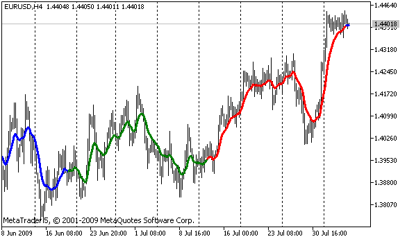

# PlotIndexSetInteger

PlotIndexSetInteger

The function sets the value of the corresponding property of the corresponding indicator line. The indicator property must be of the int, char, bool or color type. There are 2 variants of the function.

Call indicating identifier of the property.

|  |
| --- |
| bool  PlotIndexSetInteger(     int  plot\_index,        // plotting style index     int  prop\_id,           // property identifier     int  prop\_value         // value to be set     ); |

Call indicating the identifier and modifier of the property.

|  |
| --- |
| bool  PlotIndexSetInteger(     int  plot\_index,        // plotting style index     int  prop\_id,           // property identifier     int  prop\_modifier,     // property modifier     int  prop\_value         // value to be set     ) |

Parameters

plot\_index

[in]  Index of the [graphical plotting](../../Constants,-Enumerations-and-Structures/Indicator-Constants/Drawing-Styles/Drawing-Styles.md#enum_draw_type)

prop\_id

[in] The value can be one of the values of the [ENUM\_PLOT\_PROPERTY\_INTEGER](../../Constants,-Enumerations-and-Structures/Indicator-Constants/Drawing-Styles/Drawing-Styles.md#enum_plot_property_integer) enumeration.

prop\_modifier

[in]  Modifier of the specified property. Only color index properties require a modifier.

prop\_value

[in]  The value of the property.

Return Value

If successful, returns [true](../../Language-Basics/Data-Types/Integer-Types/Bool-Type/Bool-Type.md), otherwise [false](../../Language-Basics/Data-Types/Integer-Types/Bool-Type/Bool-Type.md).

Example: an indicator that draws a three-color line. The color scheme changes every 5 ticks.

 

|  |
| --- |
| #property indicator\_chart\_window  #property indicator\_buffers 2  #property indicator\_plots   1  //---- plot ColorLine  #property indicator\_label1  "ColorLine"  #property indicator\_type1   DRAW\_COLOR\_LINE  #property indicator\_color1  clrRed,clrGreen,clrBlue  #property indicator\_style1  STYLE\_SOLID  #property indicator\_width1  3  //--- indicator buffers  double         ColorLineBuffer[];  double         ColorBuffer[];  int            MA\_handle;  //+------------------------------------------------------------------+  //| Custom indicator initialization function                         |  //+------------------------------------------------------------------+  void OnInit()    {  //--- indicator buffers mapping     SetIndexBuffer(0,ColorLineBuffer,INDICATOR\_DATA);     SetIndexBuffer(1,ColorBuffer,INDICATOR\_COLOR\_INDEX);  //--- get MA handle     MA\_handle=iMA(Symbol(),0,10,0,MODE\_EMA,PRICE\_CLOSE);  //---    }  //+------------------------------------------------------------------+  //| get color index                                               |  //+------------------------------------------------------------------+  int getIndexOfColor(int i)    {     int j=i%300;     if(j<100) return(0);// first index     if(j<200) return(1);// second index     return(2); // third index    }  //+------------------------------------------------------------------+  //| Custom indicator iteration function                              |  //+------------------------------------------------------------------+  int OnCalculate(const int rates\_total,                  const int prev\_calculated,                  const datetime &time[],                  const double &open[],                  const double &high[],                  const double &low[],                  const double &close[],                  const long &tick\_volume[],                  const long &volume[],                  const int &spread[])    {  //---     static int ticks=0,modified=0;     int limit;  //--- first calculation or number of bars was changed     if(prev\_calculated==0)       {        //--- copy values of MA into indicator buffer ColorLineBuffer        int copied=CopyBuffer(MA\_handle,0,0,rates\_total,ColorLineBuffer);        if(copied<=0) return(0);// copying failed - throw away        //--- now set line color for every bar        for(int i=0;i<rates\_total;i++)           ColorBuffer[i]=getIndexOfColor(i);       }     else       {        //--- copy values of MA into indicator buffer ColorLineBuffer        int copied=CopyBuffer(MA\_handle,0,0,rates\_total,ColorLineBuffer);        if(copied<=0) return(0);           ticks++;// ticks counting        if(ticks>=5)//it's time to change color scheme          {           ticks=0; // reset counter           modified++; // counter of color changes           if(modified>=3)modified=0;// reset counter            ResetLastError();           switch(modified)             {              case 0:// first color scheme                 PlotIndexSetInteger(0,PLOT\_LINE\_COLOR,0,clrRed);                 PlotIndexSetInteger(0,PLOT\_LINE\_COLOR,1,clrBlue);                 PlotIndexSetInteger(0,PLOT\_LINE\_COLOR,2,clrGreen);                 Print("Color scheme "+modified);                 break;              case 1:// second color scheme                 PlotIndexSetInteger(0,PLOT\_LINE\_COLOR,0,clrYellow);                 PlotIndexSetInteger(0,PLOT\_LINE\_COLOR,1,clrPink);                 PlotIndexSetInteger(0,PLOT\_LINE\_COLOR,2,clrLightSlateGray);                 Print("Color scheme "+modified);                 break;              default:// third color scheme                 PlotIndexSetInteger(0,PLOT\_LINE\_COLOR,0,clrLightGoldenrod);                 PlotIndexSetInteger(0,PLOT\_LINE\_COLOR,1,clrOrchid);                 PlotIndexSetInteger(0,PLOT\_LINE\_COLOR,2,clrLimeGreen);                 Print("Color scheme "+modified);             }          }        else          {           //--- set start position           limit=prev\_calculated-1;           //--- now we set line color for every bar           for(int i=limit;i<rates\_total;i++)              ColorBuffer[i]=getIndexOfColor(i);          }       }  //--- return value of prev\_calculated for next call     return(rates\_total);    }  //+------------------------------------------------------------------+ |
