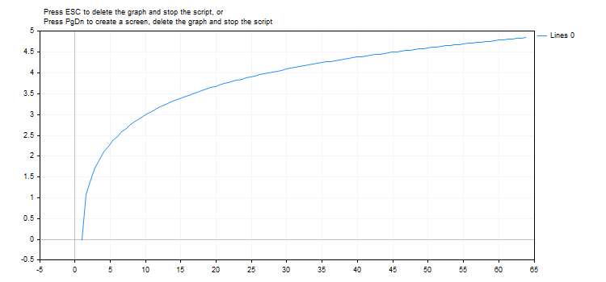

# MathArccosh

MathArccosh

Returns the hyperbolic arccosine.

|  |
| --- |
| double  MathArccosh(     double  value     // 1 <= value < ∞     ); |

Parameters

value

[in]  The value, the hyperbolic arccosine of which is to be calculated.

Return Value

The hyperbolic arccosine of the number. If value is less than +1, the function returns NaN (undefined value).

Note

Instead of the MathArccosh() function you can use the acosh() function.

 

Example:

|  |
| --- |
| #define GRAPH\_WIDTH  750  #define GRAPH\_HEIGHT 350     #include <Graphics\Graphic.mqh>     CGraphic ExtGraph;  //+------------------------------------------------------------------+  //| Script program start function                                    |  //+------------------------------------------------------------------+  void OnStart()    {     vector delta=vector::Full(101,2\*M\_PI/10);     delta[0]=1;  //--- get 101 values from 1 to 2 pi with delta step     vector X=delta.CumSum();  //--- calculate the hyperbolic arc cosine value for each value of the X vector     vector Y=MathArccosh(X);     //--- transfer the calculated values from vectors to arrays     double x\_array[],y\_array[];     X.Swap(x\_array);     Y.Swap(y\_array);     //--- draw a graph of the calculated vector values     CurvePlot(x\_array,y\_array,clrDodgerBlue);     //--- wait for pressing the Escape or PgDn keys to delete the graph (take a screenshot) and exit     while(!IsStopped())       {        if(StopKeyPressed())           break;        Sleep(16);       }     //--- clean up     ExtGraph.Destroy();    }  //+------------------------------------------------------------------+  //| When pressing ESC, return 'true'                                 |  //| When pressing PgDn, take a graph screenshot and return 'true'    |  //| Otherwise, return 'false'                                        |  //+------------------------------------------------------------------+  bool StopKeyPressed()    {  //--- if ESC is pressed, return 'true'     if(TerminalInfoInteger(TERMINAL\_KEYSTATE\_ESCAPE)!=0)        return(true);  //--- if PgDn is pressed and a graph screenshot is successfully taken, return 'true'     if(TerminalInfoInteger(TERMINAL\_KEYSTATE\_PAGEDOWN)!=0 && MakeAndSaveScreenshot(MQLInfoString(MQL\_PROGRAM\_NAME)+"\_Screenshot"))        return(true);  //--- return 'false'      return(false);    }  //+------------------------------------------------------------------+  //| Create a graph object and draw a curve                           |  //+------------------------------------------------------------------+  void CurvePlot(double &x\_array[], double &y\_array[], const color colour)    {     ExtGraph.Create(ChartID(), "Graphic", 0, 0, 0, GRAPH\_WIDTH, GRAPH\_HEIGHT);     ExtGraph.CurveAdd(x\_array, y\_array, ColorToARGB(colour), CURVE\_LINES);     ExtGraph.IndentUp(30);     ExtGraph.CurvePlotAll();     string text1="Press ESC to delete the graph and stop the script, or";     string text2="Press PgDn to create a screen, delete the graph and stop the script";     ExtGraph.TextAdd(54, 9, text1, ColorToARGB(clrBlack));     ExtGraph.TextAdd(54,21, text2, ColorToARGB(clrBlack));     ExtGraph.Update();    }  //+------------------------------------------------------------------+  //| Take a screenshot and saves the image to a file                  |  //+------------------------------------------------------------------+  bool MakeAndSaveScreenshot(const string file\_name)    {     string file\_names[];     ResetLastError();     int selected=FileSelectDialog("Save Picture", NULL, "All files (\*.\*)|\*.\*", FSD\_WRITE\_FILE, file\_names, file\_name+".png");     if(selected<1)       {        if(selected<0)           PrintFormat("%s: FileSelectDialog() function returned error %d", \_\_FUNCTION\_\_, GetLastError());        return false;       }          bool res=false;     if(ChartSetInteger(0,CHART\_SHOW,false))        res=ChartScreenShot(0, file\_names[0], GRAPH\_WIDTH, GRAPH\_HEIGHT);     ChartSetInteger(0,CHART\_SHOW,true);     return(res);    } |

 

Result:

See also

[Real types (double, float)](../../Language-Basics/Data-Types/Real-Types-(double,-float)/Real-Types-(double,-float).md), [Statistics](../../Standard-Library/Mathematics/Statistics/Statistics.md), [Scientific Charts](../../Standard-Library/Scientific-Charts/Scientific-Charts.md), [Client Terminal Properties](../../Constants,-Enumerations-and-Structures/Environment-State/Client-Terminal-Properties/Client-Terminal-Properties.md)
