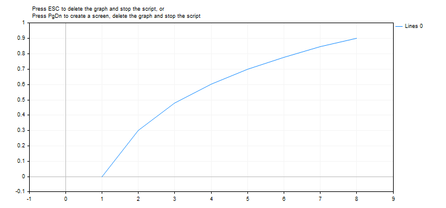

# MathLog10

MathLog

Returns the logarithm of a number by base 10.

|  |
| --- |
| double  MathLog10(     double  val      // number to take logarithm     ); |

Parameters

val

[in]  Numeric value the common logarithm of which is to be calculated.

Return Value

The common logarithm in case of success. If val is negative, the function returns NaN (undetermined value). If val is equal to 0, the function returns INF (infinity).

Note

Instead of MathLog10() you can use log10().

 

Example:

|  |
| --- |
| #define GRAPH\_WIDTH  750  #define GRAPH\_HEIGHT 350     #include <Graphics\Graphic.mqh>     CGraphic ExtGraph;  //+------------------------------------------------------------------+  //| Script program start function                                    |  //+------------------------------------------------------------------+  void OnStart()    {  //--- get 9 values from 0 to 8 with step 1     vector X(9,VectorArange);     Print("vector X = \n",X);  //--- calculate the decimal logarithm for each value of the X vector     X=MathLog10(X);     Print("MathLog10(X) = \n",X);       //--- transfer the calculated values from the vector to the array     double y\_array[];     X.Swap(y\_array);     //--- draw a graph of the calculated vector values     CurvePlot(y\_array,clrDodgerBlue);     //--- wait for pressing the Escape or PgDn keys to delete the graph (take a screenshot) and exit     while(!IsStopped())       {        if(StopKeyPressed())           break;        Sleep(16);       }     //--- clean up     ExtGraph.Destroy();     /\*     result:     vector X =      [0,1,2,3,4,5,6,7,8]     MathLog10(X) =      [-inf,0,0.3010299956639812,0.4771212547196624,0.6020599913279624,0.6989700043360189,0.7781512503836436,0.8450980400142568,0.9030899869919435]     \*/    }  //+------------------------------------------------------------------+  //| Fill a vector with 'value' in 'step' increments                  |  //+------------------------------------------------------------------+  template<typename T>   void VectorArange(vector<T> &vec,T value=0.0,T step=1.0)     {      for(ulong i=0; i<vec.Size(); i++,value+=step)         vec[i]=value;     }  //+------------------------------------------------------------------+  //| When pressing ESC, return 'true'                                 |  //| When pressing PgDn, take a graph screenshot and return 'true'    |  //| Otherwise, return 'false'                                        |  //+------------------------------------------------------------------+  bool StopKeyPressed()    {  //--- if ESC is pressed, return 'true'     if(TerminalInfoInteger(TERMINAL\_KEYSTATE\_ESCAPE)!=0)        return(true);  //--- if PgDn is pressed and a graph screenshot is successfully taken, return 'true'     if(TerminalInfoInteger(TERMINAL\_KEYSTATE\_PAGEDOWN)!=0 && MakeAndSaveScreenshot(MQLInfoString(MQL\_PROGRAM\_NAME)+"\_Screenshot"))        return(true);  //--- return 'false'      return(false);    }  //+------------------------------------------------------------------+  //| Create a graph object and draw a curve                           |  //+------------------------------------------------------------------+  void CurvePlot(double &x\_array[], double &y\_array[], const color colour)    {     ExtGraph.Create(ChartID(), "Graphic", 0, 0, 0, GRAPH\_WIDTH, GRAPH\_HEIGHT);     ExtGraph.CurveAdd(x\_array, y\_array, ColorToARGB(colour), CURVE\_LINES);     ExtGraph.IndentUp(30);     ExtGraph.CurvePlotAll();     string text1="Press ESC to delete the graph and stop the script, or";     string text2="Press PgDn to create a screen, delete the graph and stop the script";     ExtGraph.TextAdd(54, 9, text1, ColorToARGB(clrBlack));     ExtGraph.TextAdd(54,21, text2, ColorToARGB(clrBlack));     ExtGraph.Update();    }  //+------------------------------------------------------------------+  //| Take a screenshot and save the image to a file                   |  //+------------------------------------------------------------------+  bool MakeAndSaveScreenshot(const string file\_name)    {     string file\_names[];     ResetLastError();     int selected=FileSelectDialog("Save Picture", NULL, "All files (\*.\*)|\*.\*", FSD\_WRITE\_FILE, file\_names, file\_name+".png");     if(selected<1)       {        if(selected<0)           PrintFormat("%s: FileSelectDialog() function returned error %d", \_\_FUNCTION\_\_, GetLastError());        return false;       }          bool res=false;     if(ChartSetInteger(0,CHART\_SHOW,false))        res=ChartScreenShot(0, file\_names[0], GRAPH\_WIDTH, GRAPH\_HEIGHT);     ChartSetInteger(0,CHART\_SHOW,true);     return(res);    } |

 

Result:

See also

[Real types (double, float)](../../Language-Basics/Data-Types/Real-Types-(double,-float)/Real-Types-(double,-float).md), [Statistics](../../Standard-Library/Mathematics/Statistics/Statistics.md), [Scientific Charts](../../Standard-Library/Scientific-Charts/Scientific-Charts.md), [Client Terminal Properties](../../Constants,-Enumerations-and-Structures/Environment-State/Client-Terminal-Properties/Client-Terminal-Properties.md)
