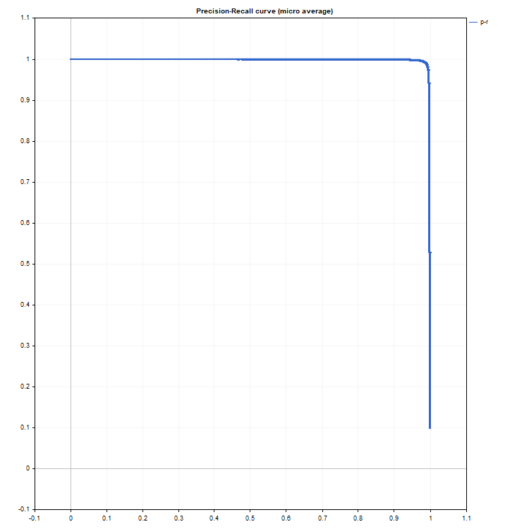
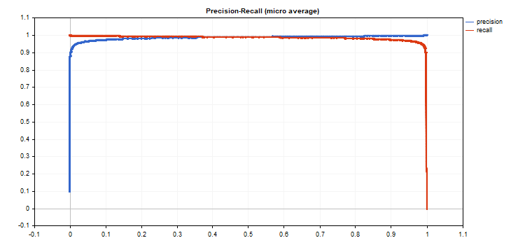

# PrecisionRecall

PrecisionRecall

Compute values to construct a precision-recall curve. Similarly to [ClassificationScore](../ClassificationScore/ClassificationScore.md), this method is applied to the vector of true values.

|  |
| --- |
| bool vector::PrecisionRecall(     const matrix&                 pred\_scores,   // matrix containing the probability distribution for each class     const ENUM\_ENUM\_AVERAGE\_MODE  mode           // averaging mode     matrix&                       precision,     // calculated precision values for each threshold value     matrix&                       recall,        // calculated recall values for each threshold value     matrix&                       thresholds,    // threshold values sorted in descending order     ); |

Parameters

pred\_scores

[in]  A matrix containing a set of horizontal vectors with probabilities for each class. The number of matrix rows must correspond to the size of the vector of true values.

mode

[in]  Averaging mode from the [ENUM\_AVERAGE\_MODE](../../Matrix-and-Vector-Types/Enumerations/Enumerations.md#enum_average_mode) enumeration. Only AVERAGE\_NONE, AVERAGE\_BINARY and AVERAGE\_MICRO are used.

precision

[out]  A matrix with calculated precision curve values. If no averaging is applied (AVERAGE\_NONE), the number of rows in the matrix corresponds to the number of model classes. The number of columns corresponds to the size of the vector of true values (or the number of rows in the probability distribution matrix pred\_score). In the case of microaveraging, the number of rows in the matrix corresponds to the total number of threshold values, excluding duplicates.

recall

[out]  A matrix with calculated recall curve values.

threshold

[out]  Threshold matrix obtained by sorting the probability matrix

 

Note

See notes for the [ClassificationScore](../ClassificationScore/ClassificationScore.md) method.

 

Example

An example of collecting statistics from the mnist.onnx model (99% accuracy).

|  |
| --- |
| //--- data for classification metrics     vectorf y\_true(images);     vectorf y\_pred(images);     matrixf y\_scores(images,10);  //--- input-output     matrixf image(28,28);     vectorf result(10);     //--- testing     for(int test=0; test<images; test++)       {        image=test\_data[test].image;        if(!OnnxRun(model,ONNX\_DEFAULT,image,result))          {           Print("OnnxRun error ",GetLastError());           break;          }        result.Activation(result,AF\_SOFTMAX);        //--- collect data        y\_true[test]=(float)test\_data[test].label;        y\_pred[test]=(float)result.ArgMax();        y\_scores.Row(result,test);       }    } |

   
[Accuracy calculation](../ClassificationMetric/ClassificationMetric.md)

|  |
| --- |
| vectorf accuracy=y\_pred.ClassificationMetric(y\_true,CLASSIFICATION\_ACCURACY);     PrintFormat("accuracy=%f",accuracy[0]);     accuracy=0.989000 |

An example of plotting precision-recall graphs, where precision values are plotted on the y-axis and recall values are plotted on the x-axis. Also precision and recall graphs are plotted separately, with threshold values plotted on the x-axis  

|  |
| --- |
| if(y\_true.PrecisionRecall(y\_scores,AVERAGE\_MICRO,mat\_precision,mat\_recall,mat\_thres))       {        double precision[],recall[],thres[];        ArrayResize(precision,mat\_thres.Cols());        ArrayResize(recall,mat\_thres.Cols());        ArrayResize(thres,mat\_thres.Cols());           for(uint i=0; i<thres.Size(); i++)          {           precision[i]=mat\_precision[0][i];           recall[i]=mat\_recall[0][i];           thres[i]=mat\_thres[0][i];          }        thres[0]=thres[1]+0.001;           PlotCurve("Precision-Recall curve (micro average)","p-r","",recall,precision);        Plot2Curves("Precision-Recall (micro average)","precision","recall",thres,precision,recall);       } |

 

 

Resulting curves:

