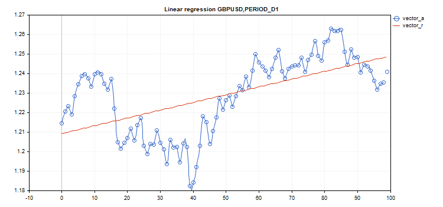

# LinearRegression

LinearRegression

Calculate a vector/matrix with calculated linear regression values.

|  |
| --- |
| vector vector::LinearRegression();     matrix matrix::LinearRegression(    ENUM\_MATRIX\_AXIS  axis=AXIS\_NONE      // axis along which regression is calculated     ); |

Parameters

axis

[in]  Specifying the axis along which the regression is calculated. [ENUM\_MATRIX\_AXIS](../../Matrix-and-Vector-Types/Enumerations/Enumerations.md#enum_matrix_axis) enumeration value (AXIS\_HORZ — horizontal axis, AXIS\_VERT — vertical axis).

Return Value

Vector or matrix with calculated linear regression values.

 

Note

Linear regression is calculated using the standard regression equation: y (x) =  a \* x + b, where a is the line slope, while b is its Y axis shift.

 

Example:

|  |
| --- |
| #include <Graphics\Graphic.mqh>     #define GRAPH\_WIDTH  750  #define GRAPH\_HEIGHT 350     //+------------------------------------------------------------------+  //| Script program start function                                    |  //+------------------------------------------------------------------+  void OnStart()    {     vector vector\_a;     vector\_a.CopyRates(\_Symbol,\_Period,COPY\_RATES\_CLOSE,1,100);     vector vector\_r=vector\_a.LinearRegression();     //--- switch off chart show     ChartSetInteger(0,CHART\_SHOW,false);     //--- arrays for drawing a graph     double x[];     double y1[];     double y2[];     ArrayResize(x,uint(vector\_a.Size()));     ArrayResize(y1,uint(vector\_a.Size()));     ArrayResize(y2,uint(vector\_a.Size()));     for(ulong i=0; i<vector\_a.Size(); i++)       {        x[i]=(double)i;        y1[i]=vector\_a[i];        y2[i]=vector\_r[i];       }     //--- graph title     string title="Linear regression "+\_Symbol+","+EnumToString(\_Period);        long   chart=0;     string name="LinearRegression";     //--- create graph     CGraphic graphic;     graphic.Create(chart,name,0,0,0,GRAPH\_WIDTH,GRAPH\_HEIGHT);     graphic.BackgroundMain(title);     graphic.BackgroundMainSize(12);       //--- activation function graph     CCurve \*curvef=graphic.CurveAdd(x,y1,CURVE\_POINTS\_AND\_LINES);     curvef.Name("vector\_a");     curvef.LinesWidth(2);     curvef.LinesSmooth(true);     curvef.LinesSmoothTension(1);     curvef.LinesSmoothStep(10);     //--- derivatives of activation function     CCurve \*curved=graphic.CurveAdd(x,y2,CURVE\_LINES);     curved.Name("vector\_r");     curved.LinesWidth(2);     curved.LinesSmooth(true);     curved.LinesSmoothTension(1);     curved.LinesSmoothStep(10);     graphic.CurvePlotAll();     graphic.Update();     //--- endless loop to recognize pressed keyboard buttons     while(!IsStopped())       {        //--- press escape button to quit program        if(TerminalInfoInteger(TERMINAL\_KEYSTATE\_ESCAPE)!=0)           break;        //--- press PdDn to save graph picture        if(TerminalInfoInteger(TERMINAL\_KEYSTATE\_PAGEDOWN)!=0)          {           string file\_names[];           if(FileSelectDialog("Save Picture",NULL,"All files (\*.\*)|\*.\*",FSD\_WRITE\_FILE,file\_names,"LinearRegression.png")<1)              continue;           ChartScreenShot(0,file\_names[0],GRAPH\_WIDTH,GRAPH\_HEIGHT);          }        Sleep(10);       }     //--- clean up     graphic.Destroy();     ObjectDelete(chart,name);     ChartSetInteger(0,CHART\_SHOW,true);    } |

 

ENUM\_MATRIX\_AXIS

Enumeration for specifying the axis in all [statistical functions](../Statistics.md) for matrices.

| ID | Description |
| --- | --- |
| AXIS\_NONE | The axis is not specified. Calculation is performed over all matrix elements, as if it were a vector (see the [Flat](../../Manipulations/Flat/Flat.md) method). |
| AXIS\_HORZ | Horizontal axis |
| AXIS\_VERT | Vertical axis |
