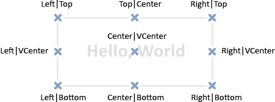

# TextOut

TextOut

The function displays a text in a custom array (buffer) and returns the result of that operation. The array is designed to create the graphical [resource](../../Common-Functions/ResourceCreate/ResourceCreate.md).

|  |
| --- |
| bool  TextOut(     const string       text,          // displayed text     int                x,             // X coordinate      int                y,             // Y coordinate      uint               anchor,        // anchor type     uint               &data[],       // output buffer     uint               width,         // buffer width in pixels     uint               height,        // buffer height in pixels     uint               color,         // text color     ENUM\_COLOR\_FORMAT  color\_format   // color format for output     ); |

Parameters

text

[in]  Displayed text that will be written to the buffer. Only one-lined text is displayed.

x

[in]  X coordinate of the anchor point of the displayed text.

y

[in]  Y coordinate of the anchor point of the displayed text.

anchor

[in]  The value out of the 9 pre-defined methods of the displayed text's anchor point location. The value is set by a combination of two flags – flags of horizontal and vertical text align. Flag names are listed in the Note below.

data[]

[in]  Buffer, in which text is displayed. The buffer is used to create the graphical [resource](../../MQL5-programs/Resources/Resources.md).

width

[in]  Buffer width in pixels.

height

[in]  Buffer height in pixels.

color

[in]  Text color.

color\_format

[in]  Color format is set by [ENUM\_COLOR\_FORMAT](../../Common-Functions/ResourceCreate/ResourceCreate.md#enum_color_format) enumeration value.

Return Value

Returns true if successful, otherwise false.

Note

Anchor point specified by anchor is a combination of two flags of horizontal and vertical text align. Horizontal text align flags:

- TA\_LEFT – anchor point on the left side of the bounding box
- TA\_CENTER – horizontal anchor point is located at the center of the bounding box
- TA\_RIGHT – anchor point on the right side of the bounding box

Vertical text align flags:

- TA\_TOP – anchor point at the upper side of the bounding box
- TA\_VCENTER – vertical anchor point is located at the center of the bounding box
- TA\_BOTTOM – anchor point at the lower side of the bounding box

 

Possible combinations of flags and specified anchor points are shown in the image.  
 

 

Example:

|  |
| --- |
| //--- width and height of the canvas (the one the drawing takes place on)  #define IMG\_WIDTH  200  #define IMG\_HEIGHT 200  //--- before running the script, show a window with parameters  #property script\_show\_inputs  //--- provide the ability to set the color format  input ENUM\_COLOR\_FORMAT clr\_format=COLOR\_FORMAT\_XRGB\_NOALPHA;  //--- array (buffer) for rendering  uint ExtImg[IMG\_WIDTH\*IMG\_HEIGHT];  //+------------------------------------------------------------------+  //| Script program start function                                    |  //+------------------------------------------------------------------+  void OnStart()    {  //--- create the OBJ\_BITMAP\_LABEL object for drawing         ObjectCreate(0,"CLOCK",OBJ\_BITMAP\_LABEL,0,0,0);  //--- set the name of the graphical resource for rendering in the CLOCK object     ObjectSetString(0,"CLOCK",OBJPROP\_BMPFILE,"::IMG");     //--- auxiliary variables     double a;            // arrow angle     uint   nm=2700;      // minute counter     uint   nh=2700\*12;   // hour counter     uint   w,h;          // variables for getting the sizes of text strings      int    x,y;          // variables for calculating the current coordinates of the anchor point of text strings      //--- spin the clock hands in an infinite loop until the script is stopped     while(!IsStopped())       {        //--- clear the clock drawing buffer array        ArrayFill(ExtImg,0,IMG\_WIDTH\*IMG\_HEIGHT,0);        //--- set the font for drawing numbers on the dial        TextSetFont("Arial",-200,FW\_EXTRABOLD,0);        //--- draw the dial        for(int i=1;i<=12;i++)          {           //--- get the size of the current hour on the dial           TextGetSize(string(i),w,h);           //--- calculate the coordinates of the current hour on the dial           a=-((i\*300)%3600\*M\_PI)/1800.0;           x=IMG\_WIDTH/2-int(sin(a)\*80+0.5+w/2);           y=IMG\_HEIGHT/2-int(cos(a)\*80+0.5+h/2);           //--- output this hour to the dial in the ExtImg[] buffer           TextOut(string(i),x,y,TA\_LEFT|TA\_TOP,ExtImg,IMG\_WIDTH,IMG\_HEIGHT,0xFFFFFFFF,clr\_format);          }        //--- set the font for drawing the minute hand              TextSetFont("Arial",-200,FW\_EXTRABOLD,-int(nm%3600));        //--- get the size of the minute hand        TextGetSize("----->",w,h);        //--- calculate the coordinates of the minute hand on the dial        a=-(nm%3600\*M\_PI)/1800.0;        x=IMG\_WIDTH/2-int(sin(a)\*h/2+0.5);        y=IMG\_HEIGHT/2-int(cos(a)\*h/2+0.5);        //--- output the minute hand to the dial in the ExtImg[] buffer         TextOut("----->",x,y,TA\_LEFT|TA\_TOP,ExtImg,IMG\_WIDTH,IMG\_HEIGHT,0xFFFFFFFF,clr\_format);           //--- set the font for drawing the hour hand              TextSetFont("Arial",-200,FW\_EXTRABOLD,-int(nh/12%3600));        TextGetSize("==>",w,h);        //--- calculate the coordinates of the hour hand on the dial        a=-(nh/12%3600\*M\_PI)/1800.0;        x=IMG\_WIDTH/2-int(sin(a)\*h/2+0.5);        y=IMG\_HEIGHT/2-int(cos(a)\*h/2+0.5);        //--- output the hour hand to the dial in the ExtImg[] buffer         TextOut("==>",x,y,TA\_LEFT|TA\_TOP,ExtImg,IMG\_WIDTH,IMG\_HEIGHT,0xFFFFFFFF,clr\_format);           //--- update the graphical resource        ResourceCreate("::IMG",ExtImg,IMG\_WIDTH,IMG\_HEIGHT,0,0,IMG\_WIDTH,clr\_format);        //--- forced chart update        ChartRedraw();           //--- increase the hour and minute counters        nm+=60;        nh+=60;        //--- take a short pause between frames        Sleep(10);       }  //--- delete the CLOCK object when the script finishes     ObjectDelete(0,"CLOCK");  //---    } |

 

See also

[Resources](../../MQL5-programs/Resources/Resources.md), [ResourceCreate()](../../Common-Functions/ResourceCreate/ResourceCreate.md), [ResourceSave()](../../Common-Functions/ResourceSave/ResourceSave.md), [TextGetSize()](../TextGetSize/TextGetSize.md), [TextSetFont()](../TextSetFont/TextSetFont.md)
