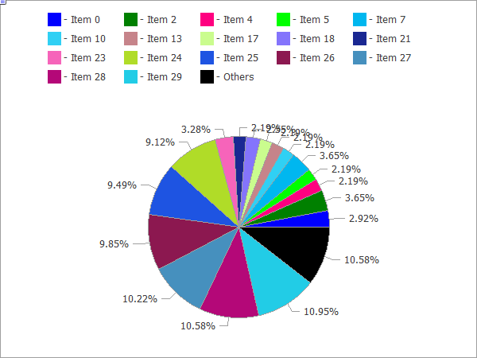

# CPieChart

CPieChart

Class for plotting pie charts.

The code of the above figure is provided [below](CPieChart.md#sample).

Description

The methods included in this class are designed for full-scale operation with pie charts, from the creating a graphical resource to designing labels to segments.

Declaration

|  |
| --- |
| class CPieChart : public CChartCanvas |

Title

|  |
| --- |
| #include <Canvas\Charts\PieChart.mqh> |

|  |
| --- |
| Inheritance hierarchy    [CCanvas](../CCanvas/CCanvas.md)        [CChartCanvas](../CChartCanvas/CChartCanvas.md)            CPieChart |

Class methods

| Method | Action |
| --- | --- |
| [Create](Create/Create.md) | Virtual method that creates a graphical resource. |
| [SeriesSet](SeriesSet/SeriesSet.md) | Sets a series of values that will be shows on the pie chart. |
| [ValueAdd](ValueAdd/ValueAdd.md) | Adds a new value to the pie chart (to the end). |
| [ValueInsert](ValueInsert/ValueInsert.md) | Inserts a new value to the pie chart (at the specified position). |
| [ValueUpdate](ValueUpdate/ValueUpdate.md) | Updates the value on the pie chart (at the specified position). |
| [ValueDelete](ValueDelete/ValueDelete.md) | Removes a value from the pie chart (at the specified position). |
| [DrawChart](DrawChart/DrawChart.md) | Virtual method which draws a pie chart and all its elements. |
| [DrawPie](DrawPie/DrawPie.md) | Draws a segment of the pie chart, which corresponds to a specified value. |
| [LabelMake](LabelMake/LabelMake.md) | Generates a segment label based on its value and the original label. |

| Methods inherited from class CCanvas  [CreateBitmap](../CCanvas/CreateBitmap/CreateBitmap.md), [CreateBitmap](../CCanvas/CreateBitmap/CreateBitmap.md), [CreateBitmapLabel](../CCanvas/CreateBitmapLabel/CreateBitmapLabel.md), [CreateBitmapLabel](../CCanvas/CreateBitmapLabel/CreateBitmapLabel.md), [Attach](../CCanvas/Attach/Attach.md), [Attach](../CCanvas/Attach/Attach.md), [Destroy](../CCanvas/Destroy/Destroy.md), [ChartObjectName](../CCanvas/ChartObjectName/ChartObjectName.md), [ResourceName](../CCanvas/ResourceName/ResourceName.md), [Width](../CCanvas/Width/Width.md), [Height](../CCanvas/Height/Height.md), [Update](../CCanvas/Update/Update.md), [Resize](../CCanvas/Resize/Resize.md), [Erase](../CCanvas/Erase/Erase.md), [PixelGet](../CCanvas/PixelGet/PixelGet.md), [PixelSet](../CCanvas/PixelSet/PixelSet.md), [LineVertical](../CCanvas/LineVertical/LineVertical.md), [LineHorizontal](../CCanvas/LineHorizontal/LineHorizontal.md), [Line](../CCanvas/Line/Line.md), [Polyline](../CCanvas/Polyline/Polyline.md), [Polygon](../CCanvas/Polygon/Polygon.md), [Rectangle](../CCanvas/Rectangle/Rectangle.md), [Triangle](../CCanvas/Triangle/Triangle.md), [Circle](../CCanvas/Circle/Circle.md), [Ellipse](../CCanvas/Ellipse/Ellipse.md), [Arc](../CCanvas/Arc/Arc.md), [Arc](../CCanvas/Arc/Arc.md), [Arc](../CCanvas/Arc/Arc.md), [Pie](../CCanvas/Pie/Pie.md), [Pie](../CCanvas/Pie/Pie.md), [FillRectangle](../CCanvas/FillRectangle/FillRectangle.md), [FillTriangle](../CCanvas/FillTriangle/FillTriangle.md), [FillPolygon](../CCanvas/FillPolygon/FillPolygon.md), [FillCircle](../CCanvas/FillCircle/FillCircle.md), [FillEllipse](../CCanvas/FillEllipse/FillEllipse.md), [Fill](../CCanvas/Fill/Fill.md), [Fill](../CCanvas/Fill/Fill.md), [PixelSetAA](../CCanvas/PixelSetAA/PixelSetAA.md), [LineAA](../CCanvas/LineAA/LineAA.md), [PolylineAA](../CCanvas/PolylineAA/PolylineAA.md), [PolygonAA](../CCanvas/PolygonAA/PolygonAA.md), [TriangleAA](../CCanvas/TriangleAA/TriangleAA.md), [CircleAA](../CCanvas/CircleAA/CircleAA.md), [EllipseAA](../CCanvas/EllipseAA/EllipseAA.md), [LineWu](../CCanvas/LineWu/LineWu.md), [PolylineWu](../CCanvas/PolylineWu/PolylineWu.md), [PolygonWu](../CCanvas/PolygonWu/PolygonWu.md), [TriangleWu](../CCanvas/TriangleWu/TriangleWu.md), [CircleWu](../CCanvas/CircleWu/CircleWu.md), [EllipseWu](../CCanvas/EllipseWu/EllipseWu.md), [LineThickVertical](../CCanvas/LineThickVertical/LineThickVertical.md), [LineThickHorizontal](../CCanvas/LineThickHorizontal/LineThickHorizontal.md), [LineThick](../CCanvas/LineThick/LineThick.md), [PolylineThick](../CCanvas/PolylineThick/PolylineThick.md), [PolygonThick](../CCanvas/PolygonThick/PolygonThick.md), [PolylineSmooth](../CCanvas/PolylineSmooth/PolylineSmooth.md), [PolygonSmooth](../CCanvas/PolygonSmooth/PolygonSmooth.md), [FontSet](../CCanvas/FontSet/FontSet.md), [FontNameSet](../CCanvas/FontNameSet/FontNameSet.md), [FontSizeSet](../CCanvas/FontSizeSet/FontSizeSet.md), [FontFlagsSet](../CCanvas/FontFlagsSet/FontFlagsSet.md), [FontAngleSet](../CCanvas/FontAngleSet/FontAngleSet.md), [FontGet](../CCanvas/FontGet/FontGet.md), [FontNameGet](../CCanvas/FontNameGet/FontNameGet.md), [FontSizeGet](../CCanvas/FontSizeGet/FontSizeGet.md), [FontFlagsGet](../CCanvas/FontFlagsGet/FontFlagsGet.md), [FontAngleGet](../CCanvas/FontAngleGet/FontAngleGet.md), [TextOut](../CCanvas/TextOut/TextOut.md), [TextWidth](../CCanvas/TextWidth/TextWidth.md), [TextHeight](../CCanvas/TextHeight/TextHeight.md), [TextSize](../CCanvas/TextSize/TextSize.md), [GetDefaultColor](../CCanvas/GetDefaultColor/GetDefaultColor.md), [TransparentLevelSet](../CCanvas/TransparentLevelSet/TransparentLevelSet.md), [LoadFromFile](../CCanvas/LoadFromFile/LoadFromFile.md), LineStyleGet, [LineStyleSet](../CCanvas/LineStyleSet/LineStyleSet.md) |
| --- |
| Methods inherited from class CChartCanvas  [ColorBackground](../CChartCanvas/ColorBackground/ColorBackground.md), [ColorBackground](../CChartCanvas/ColorBackground/ColorBackground.md), [ColorBorder](../CChartCanvas/ColorBorder/ColorBorder.md), [ColorBorder](../CChartCanvas/ColorBorder/ColorBorder.md), [ColorText](../CChartCanvas/ColorText/ColorText.md), [ColorText](../CChartCanvas/ColorText/ColorText.md), [ColorGrid](../CChartCanvas/ColorGrid/ColorGrid.md), [ColorGrid](../CChartCanvas/ColorGrid/ColorGrid.md), [MaxData](../CChartCanvas/MaxData/MaxData.md), [MaxData](../CChartCanvas/MaxData/MaxData.md), [MaxDescrLen](../CChartCanvas/MaxDescrLen/MaxDescrLen.md), [MaxDescrLen](../CChartCanvas/MaxDescrLen/MaxDescrLen.md), [AllowedShowFlags](../CChartCanvas/AllowedShowFlags/AllowedShowFlags.md), [ShowFlags](../CChartCanvas/ShowFlags/ShowFlags.md), [ShowFlags](../CChartCanvas/ShowFlags/ShowFlags.md), [IsShowLegend](../CChartCanvas/IsShowLegend/IsShowLegend.md), [IsShowScaleLeft](../CChartCanvas/IsShowScaleLeft/IsShowScaleLeft.md), [IsShowScaleRight](../CChartCanvas/IsShowScaleRight/IsShowScaleRight.md), [IsShowScaleTop](../CChartCanvas/IsShowScaleTop/IsShowScaleTop.md), [IsShowScaleBottom](../CChartCanvas/IsShowScaleBottom/IsShowScaleBottom.md), [IsShowGrid](../CChartCanvas/IsShowGrid/IsShowGrid.md), [IsShowDescriptors](../CChartCanvas/IsShowDescriptors/IsShowDescriptors.md), [IsShowPercent](../CChartCanvas/IsShowPercent/IsShowPercent.md), [ShowLegend](../CChartCanvas/ShowLegend/ShowLegend.md), [ShowScaleLeft](../CChartCanvas/ShowScaleLeft/ShowScaleLeft.md), [ShowScaleRight](../CChartCanvas/ShowScaleRight/ShowScaleRight.md), [ShowScaleTop](../CChartCanvas/ShowScaleTop/ShowScaleTop.md), [ShowScaleBottom](../CChartCanvas/ShowScaleBottom/ShowScaleBottom.md), [ShowGrid](../CChartCanvas/ShowGrid/ShowGrid.md), [ShowDescriptors](../CChartCanvas/ShowDescriptors/ShowDescriptors.md), [ShowValue](../CChartCanvas/ShowValue/ShowValue.md), [ShowPercent](../CChartCanvas/ShowPercent/ShowPercent.md), [LegendAlignment](../CChartCanvas/LegendAlignment/LegendAlignment.md), [Accumulative](../CChartCanvas/Accumulative/Accumulative.md), [VScaleMin](../CChartCanvas/VScaleMin/VScaleMin.md), [VScaleMin](../CChartCanvas/VScaleMin/VScaleMin.md), [VScaleMax](../CChartCanvas/VScaleMax/VScaleMax.md), [VScaleMax](../CChartCanvas/VScaleMax/VScaleMax.md), [NumGrid](../CChartCanvas/NumGrid/NumGrid.md), [NumGrid](../CChartCanvas/NumGrid/NumGrid.md), [VScaleParams](../CChartCanvas/VScaleParams/VScaleParams.md), [DataOffset](../CChartCanvas/DataOffset/DataOffset.md), [DataOffset](../CChartCanvas/DataOffset/DataOffset.md), [DataTotal](../CChartCanvas/DataTotal/DataTotal.md), [DescriptorUpdate](../CChartCanvas/DescriptorUpdate/DescriptorUpdate.md), [ColorUpdate](../CChartCanvas/ColorUpdate/ColorUpdate.md) |

 

Example

|  |
| --- |
| //+------------------------------------------------------------------+  //|                                               PieChartSample.mq5 |  //|                   Copyright 2009-2017, MetaQuotes Software Corp. |  //|                                              http://www.mql5.com |  //+------------------------------------------------------------------+  #property copyright   "2009-2017, MetaQuotes Software Corp."  #property link        "http://www.mql5.com"  #property description "Example of using pie chart"  //---  #include <Canvas\Charts\PieChart.mqh>  //+------------------------------------------------------------------+  //| inputs                                                           |  //+------------------------------------------------------------------+  input int      Width=600;  input int      Height=450;  //+------------------------------------------------------------------+  //| Script program start function                                    |  //+------------------------------------------------------------------+  int OnStart(void)    {  //--- check     if(Width<=0 || Height<=0)       {        Print("Too simple.");        return(-1);       }  //--- create chart     CPieChart pie\_chart;     if(!pie\_chart.CreateBitmapLabel("PieChart",10,10,Width,Height))       {        Print("Error creating pie chart: ",GetLastError());        return(-1);       }     pie\_chart.ShowPercent();  //--- draw     for(uint i=0;i<30;i++)       {        pie\_chart.ValueAdd(100\*(i+1),"Item "+IntegerToString(i));        Sleep(10);       }     Sleep(2000);  //--- disable legend     pie\_chart.LegendAlignment(ALIGNMENT\_LEFT);     Sleep(2000);  //--- disable legend     pie\_chart.LegendAlignment(ALIGNMENT\_RIGHT);     Sleep(2000);  //--- disable legend     pie\_chart.LegendAlignment(ALIGNMENT\_TOP);     Sleep(2000);  //--- disable legend     pie\_chart.ShowLegend(false);     Sleep(2000);  //--- disable percentage     pie\_chart.ShowPercent(false);     Sleep(2000);  //--- disable descriptors     pie\_chart.ShowDescriptors(false);     Sleep(2000);  //--- enable all     pie\_chart.ShowLegend();     pie\_chart.ShowValue();     pie\_chart.ShowDescriptors();     Sleep(2000);  //--- or like this     pie\_chart.ShowFlags(FLAG\_SHOW\_LEGEND|FLAG\_SHOW\_DESCRIPTORS|FLAG\_SHOW\_PERCENT);     uint total=pie\_chart.DataTotal();  //--- play with values     for(uint i=0;i<total && !IsStopped();i++)       {        pie\_chart.ValueUpdate(i,100\*(rand()%10+1));        Sleep(1000);       }  //--- play with colors     for(uint i=0;i<total && !IsStopped();i++)       {        pie\_chart.ColorUpdate(i%total,RandomRGB());        Sleep(1000);       }  //--- rotate     while(!IsStopped())       {        pie\_chart.DataOffset(pie\_chart.DataOffset()+1);        Sleep(200);       }  //--- finish     pie\_chart.Destroy();     return(0);    }  //+------------------------------------------------------------------+  //| Random RGB color                                                 |  //+------------------------------------------------------------------+  uint RandomRGB(void)    {     return(XRGB(rand()%255,rand()%255,rand()%255));    } |
