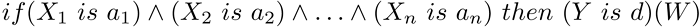

# CMamdaniFuzzyRule

CMamdaniFuzzyRule

Mamdani-type fuzzy inference — one of the two basic types of fuzzy systems. Output variable values are set using fuzzy terms.

Description

Fuzzy logic rule for the Mamdani algorithm can be described as follows:

where:

- X = (X1, X2, X3 ... Xn) — vector of input variables;
- Y — output variable;
- a = (a1, a2, a3 ... an) — vector of input variable values;
- d — output variable value;
- W — rule weight.

Declaration

|  |
| --- |
| class CMamdaniFuzzyRule : public CGenericFuzzyRule |

Title

|  |
| --- |
| #include <Math\Fuzzy\fuzzyrule.mqh> |

|  |
| --- |
| Inheritance hierarchy    [CObject](../../../../Basic-Class-CObject/Basic-Class-CObject.md)        IParsableRule            [CGenericFuzzyRule](../CGenericFuzzyRule/CGenericFuzzyRule.md)                CMamdaniFuzzyRule |

Class methods

| Class method | Description |
| --- | --- |
| [Conclusion](Conclusion/Conclusion.md) | Gets and sets the Mamdani fuzzy rule conclusion |
| [Weight](Weight/Weight.md) | Gets and sets the Mamdani fuzzy rule weight |

| Methods inherited from class CObject  Prev, Prev, Next, Next, [Save](../../../../Basic-Class-CObject/Save/Save.md), [Load](../../../../Basic-Class-CObject/Load/Load.md), [Type](../../../../Basic-Class-CObject/Type/Type.md), [Compare](../../../../Basic-Class-CObject/Compare/Compare.md) |
| --- |
| Methods inherited from class CGenericFuzzyRule  [Condition](../CGenericFuzzyRule/Condition/Condition.md), [Condition](../CGenericFuzzyRule/Condition/Condition.md), [CreateCondition](../CGenericFuzzyRule/CreateCondition/CreateCondition.md), [CreateCondition](../CGenericFuzzyRule/CreateCondition/CreateCondition.md), [CreateCondition](../CGenericFuzzyRule/CreateCondition/CreateCondition.md) |
