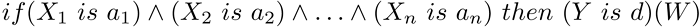

# Mamdani system

Mamdani system

Output variable values in the Mamdani system are set using fuzzy terms.

Description

Fuzzy logic rule for the Mamdani algorithm can be described as follows:

where:

- X = (X1, X2, X3 ... Xn) — vector of input variables;
- Y — output variable;
- a = (a1, a2, a3 ... an) — vector of input variable values;
- d — output variable value;
- W — rule weight.

Class methods

| Class method | Description |
| --- | --- |
| [AggregationMethod](AggregationMethod/AggregationMethod.md) | Sets the type of conditions aggregation |
| [Calculate](Calculate/Calculate.md) | Calculates a fuzzy inference for the system |
| [DefuzzificationMethod](DefuzzificationMethod/DefuzzificationMethod.md) | Sets defuzzification method type |
| [EmptyRule](EmptyRule/EmptyRule.md) | Creates an empty fuzzy Mamdani rule based on the current system |
| [ImplicationMethod](ImplicationMethod/ImplicationMethod.md) | Sets a type of the system implication operator |
| [Output](Output/Output.md) | Gets the list of fuzzy Mamdani output variables. |
| [OutputByName](OutputByName/OutputByName.md) | Gets a fuzzy Mamdani output variable by a specified name. |
| [ParseRule](ParseRule/ParseRule.md) | Creates a fuzzy Mamdani rule based on a specified line. |
| [Rules](Rules/Rules.md) | Returns the list of fuzzy Mamdani rules. |

|  |
| --- |
| Methods inherited from class CGenericFuzzySystem  Input, AndMethod, AndMethod, OrMethod, OrMethod, InputByName, Fuzzify |
