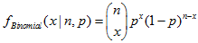
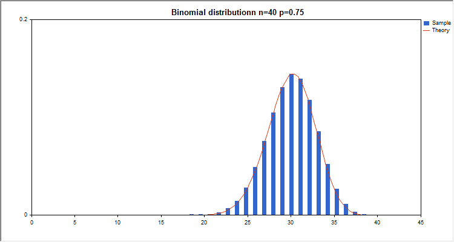

# Binomial distribution

Binomial distribution

This section contains functions for working with binomial distribution. They allow to calculate density, probability, quantiles and to generate pseudo-random numbers distributed according to the binomial law. The binomial distribution is defined by the following formula:

where:

- x — value of the random variable

- n — number of tests

- p — probability of success for each test

In addition to the calculation of the individual random variables, the library also implements the ability to work with arrays of random variables.  

| Function | Description |
| --- | --- |
| [MathProbabilityDensityBinomial](MathProbabilityDensityBinomial/MathProbabilityDensityBinomial.md) | Calculates the probability density function of the binomial distribution |
| [MathCumulativeDistributionBinomial](MathCumulativeDistributionBinomial/MathCumulativeDistributionBinomial.md) | Calculates the value of the binomial probability distribution function |
| [MathQuantileBinomial](MathQuantileBinomial/MathQuantileBinomial.md) | Calculates the value of the inverse binomial distribution function for the specified probability |
| [MathRandomBinomial](MathRandomBinomial/MathRandomBinomial.md) | Generates a pseudorandom variable/array of pseudorandom variables distributed according to the binomial law |
| [MathMomentsBinomial](MathMomentsBinomial/MathMomentsBinomial.md) | Calculates the theoretical numerical values of the first 4 moments of the binomial distribution |

Example:

|  |
| --- |
| #include <Graphics\Graphic.mqh>  #include <Math\Stat\Binomial.mqh>  #include <Math\Stat\Math.mqh>  #property script\_show\_inputs  //--- input parameters  input double n\_par=40;        // the number of tests  input double p\_par=0.75;      // probability of success for each test  //+------------------------------------------------------------------+  //| Script program start function                                    |  //+------------------------------------------------------------------+  void OnStart()    {  //--- hide the price chart     ChartSetInteger(0,CHART\_SHOW,false);  //--- initialize the random number generator       MathSrand(GetTickCount());  //--- generate a sample of the random variable     long chart=0;     string name="GraphicNormal";     int n=1000000;       // the number of values in the sample     int ncells=20;       // the number of intervals in the histogram     double x[];          // centers of the histogram intervals     double y[];          // the number of values from the sample falling within the interval     double data[];       // sample of random values     double max,min;      // the maximum and minimum values in the sample  //--- obtain a sample from the binomial distribution     MathRandomBinomial(n\_par,p\_par,n,data);  //--- calculate the data to plot the histogram     CalculateHistogramArray(data,x,y,max,min,ncells);    //--- obtain the theoretically calculated data at the interval of [min,max]     double x2[];     double y2[];     MathSequence(0,n\_par,1,x2);     MathProbabilityDensityBinomial(x2,n\_par,p\_par,false,y2);  //--- set the scale     double theor\_max=y2[ArrayMaximum(y2)];     double sample\_max=y[ArrayMaximum(y)];     double k=sample\_max/theor\_max;     for(int i=0; i<ncells; i++)        y[i]/=k;  //--- output charts     CGraphic graphic;     if(ObjectFind(chart,name)<0)        graphic.Create(chart,name,0,0,0,780,380);     else        graphic.Attach(chart,name);     graphic.BackgroundMain(StringFormat("Binomial distributionn n=%G p=%G",n\_par,p\_par));     graphic.BackgroundMainSize(16);  //--- plot all curves     graphic.CurveAdd(x,y,CURVE\_HISTOGRAM,"Sample").HistogramWidth(6);  //--- and now plot the theoretical curve of the distribution density     graphic.CurveAdd(x2,y2,CURVE\_LINES,"Theory").LinesSmooth(true);     graphic.CurvePlotAll();  //--- plot all curves     graphic.Update();    }  //+------------------------------------------------------------------+  //|  Calculate frequencies for data set                              |  //+------------------------------------------------------------------+  bool CalculateHistogramArray(const double &data[],double &intervals[],double &frequency[],                               double &maxv,double &minv,const int cells=10)    {     if(cells<=1) return (false);     int size=ArraySize(data);     if(size<cells\*10) return (false);     minv=data[ArrayMinimum(data)];     maxv=data[ArrayMaximum(data)];     double range=maxv-minv;     double width=range/cells;     if(width==0) return false;     ArrayResize(intervals,cells);     ArrayResize(frequency,cells);  //--- define the interval centers     for(int i=0; i<cells; i++)       {        intervals[i]=minv+(i+0.5)\*width;        frequency[i]=0;       }  //--- fill the frequencies of falling within the interval     for(int i=0; i<size; i++)       {        int ind=int((data[i]-minv)/width);        if(ind>=cells) ind=cells-1;        frequency[ind]++;       }     return (true);    } |
