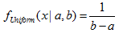
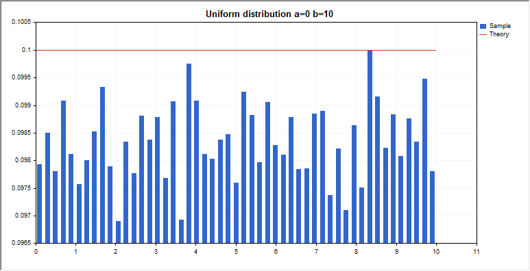

# Uniform distribution

Uniform distribution

This section contains functions for working with uniform distribution. They allow to calculate density, probability, quantiles and to generate pseudo-random numbers distributed according to the uniform law. The uniform distribution is defined by the following formula:

where:

- x — value of the random variable

- a —  parameter of the distribution (lower bound)

- b — parameter of the distribution (upper bound)

In addition to the calculation of the individual random variables, the library also implements the ability to work with arrays of random variables.  

| Function | Description |
| --- | --- |
| [MathProbabilityDensityUniform](MathProbabilityDensityUniform/MathProbabilityDensityUniform.md) | Calculates the probability density function of the uniform distribution |
| [MathCumulativeDistributionUniform](MathCumulativeDistributionUniform/MathCumulativeDistributionUniform.md) | Calculates the value of the uniform probability distribution function |
| [MathQuantileUniform](MathQuantileUniform/MathQuantileUniform.md) | Calculates the value of the inverse uniform distribution function for the specified probability |
| [MathRandomUniform](MathRandomUniform/MathRandomUniform.md) | Generates a pseudorandom variable/array of pseudorandom variables distributed according to the uniform law |
| [MathMomentsUniform](MathMomentsUniform/MathMomentsUniform.md) | Calculates the theoretical numerical values of the first 4 moments of the uniform distribution |

Example:

|  |
| --- |
| #include <Graphics\Graphic.mqh>  #include <Math\Stat\Uniform.mqh>  #include <Math\Stat\Math.mqh>  #property script\_show\_inputs  //--- input parameters  input double a\_par=0;      // distribution parameter a (lower bound)  input double b\_par=10;     // distribution parameter b (upper bound)  //+------------------------------------------------------------------+  //| Script program start function                                    |  //+------------------------------------------------------------------+  void OnStart()    {  //--- hide the price chart     ChartSetInteger(0,CHART\_SHOW,false);  //--- initialize the random number generator       MathSrand(GetTickCount());  //--- generate a sample of the random variable     long chart=0;     string name="GraphicNormal";     int n=1000000;       // the number of values in the sample     int ncells=51;       // the number of intervals in the histogram     double x[];          // centers of the histogram intervals     double y[];          // the number of values from the sample falling within the interval     double data[];       // sample of random values     double max,min;      // the maximum and minimum values in the sample  //--- obtain a sample from the uniform distribution     MathRandomUniform(a\_par,b\_par,n,data);  //--- calculate the data to plot the histogram     CalculateHistogramArray(data,x,y,max,min,ncells);  //--- obtain the sequence boundaries and the step for plotting the theoretical curve     double step;     GetMaxMinStepValues(max,min,step);     step=MathMin(step,(max-min)/ncells);  //--- obtain the theoretically calculated data at the interval of [min,max]     double x2[];     double y2[];     MathSequence(min,max,step,x2);     MathProbabilityDensityUniform(x2,a\_par,b\_par,false,y2);  //--- set the scale     double theor\_max=y2[ArrayMaximum(y2)];     double sample\_max=y[ArrayMaximum(y)];     double k=sample\_max/theor\_max;     for(int i=0; i<ncells; i++)        y[i]/=k;  //--- output charts     CGraphic graphic;     if(ObjectFind(chart,name)<0)        graphic.Create(chart,name,0,0,0,780,380);     else        graphic.Attach(chart,name);     graphic.BackgroundMain(StringFormat("Uniform distribution a=%G b=%G",a\_par,b\_par));     graphic.BackgroundMainSize(16);  //--- plot all curves     graphic.CurveAdd(x,y,CURVE\_HISTOGRAM,"Sample").HistogramWidth(6);  //--- and now plot the theoretical curve of the distribution density     graphic.CurveAdd(x2,y2,CURVE\_LINES,"Theory");     graphic.CurvePlotAll();  //--- plot all curves     graphic.Update();    }  //+------------------------------------------------------------------+  //|  Calculate frequencies for data set                              |  //+------------------------------------------------------------------+  bool CalculateHistogramArray(const double &data[],double &intervals[],double &frequency[],                               double &maxv,double &minv,const int cells=10)    {     if(cells<=1) return (false);     int size=ArraySize(data);     if(size<cells\*10) return (false);     minv=data[ArrayMinimum(data)];     maxv=data[ArrayMaximum(data)];     double range=maxv-minv;     double width=range/cells;     if(width==0) return false;     ArrayResize(intervals,cells);     ArrayResize(frequency,cells);  //--- define the interval centers     for(int i=0; i<cells; i++)       {        intervals[i]=minv+(i+0.5)\*width;        frequency[i]=0;       }  //--- fill the frequencies of falling within the interval     for(int i=0; i<size; i++)       {        int ind=int((data[i]-minv)/width);        if(ind>=cells) ind=cells-1;        frequency[ind]++;       }     return (true);    }  //+------------------------------------------------------------------+  //|  Calculates values for sequence generation                       |  //+------------------------------------------------------------------+  void GetMaxMinStepValues(double &maxv,double &minv,double &stepv)    {  //--- calculate the absolute range of the sequence to obtain the precision of normalization     double range=MathAbs(maxv-minv);     int degree=(int)MathRound(MathLog10(range));  //--- normalize the maximum and minimum values to the specified precision     maxv=NormalizeDouble(maxv,degree);     minv=NormalizeDouble(minv,degree);  //--- sequence generation step is also set based on the specified precision     stepv=NormalizeDouble(MathPow(10,-degree),degree);     if((maxv-minv)/stepv<10)        stepv/=10.;    } |
