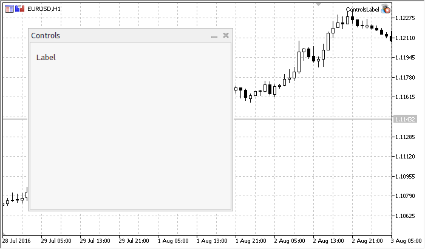

# CLabel

CLabel

CLabel is class of the simple control based on "Text label" chart object.

Description

CLabel is intended for creation of simple non-editable text labels.

Declaration

|  |
| --- |
| class CLabel : public CWndObj |

Title

|  |
| --- |
| #include <Controls\Label.mqh> |

|  |
| --- |
| Inheritance hierarchy    [CObject](../../Basic-Class-CObject/Basic-Class-CObject.md)        [CWnd](../CWnd/CWnd.md)            [CWndObj](../CWndObj/CWndObj.md)                CLabel |

Result of the [code](CLabel.md#sample) provided below:

Class Methods by Groups

| Create |  |
| --- | --- |
| [Create](Create/Create.md) | Creates control |
| Properties change event handlers |  |
| [OnSetText](OnSetText/OnSetText.md) | "SetText" event handler |
| [OnSetColor](OnSetColor/OnSetColor.md) | "SetColor" event handler |
| [OnSetFont](OnSetFont/OnSetFont.md) | "SetFont" event handler |
| [OnSetFontSize](OnSetFontSize/OnSetFontSize.md) | "SetFontSize" event handler |
| Internal event handlers |  |
| [OnCreate](OnCreate/OnCreate.md) | "Create" internal event handler |
| [OnShow](OnShow/OnShow.md) | "Show" internal event handler |
| [OnHide](OnHide/OnHide.md) | "Hide" internal event handler |
| [OnMove](OnMove/OnMove.md) | "Move" internal event handler |

| Methods inherited from class CObject  Prev, Prev, Next, Next, [Save](../../Basic-Class-CObject/Save/Save.md), [Load](../../Basic-Class-CObject/Load/Load.md), [Type](../../Basic-Class-CObject/Type/Type.md), [Compare](../../Basic-Class-CObject/Compare/Compare.md) |
| --- |
| Methods inherited from class CWnd  [Destroy](../CWnd/Destroy/Destroy.md), [OnMouseEvent](../CWnd/OnMouseEvent/OnMouseEvent.md), [Name](../CWnd/Name/Name.md), [ControlsTotal](../CWnd/ControlsTotal/ControlsTotal.md), [Control](../CWnd/Control/Control.md), [ControlFind](../CWnd/ControlFind/ControlFind.md), [Rect](../CWnd/Rect/Rect.md), [Left](../CWnd/Left/Left.md), [Left](../CWnd/Left/Left.md), [Top](../CWnd/Top/Top.md), [Top](../CWnd/Top/Top.md), [Right](../CWnd/Right/Right.md), [Right](../CWnd/Right/Right.md), [Bottom](../CWnd/Bottom/Bottom.md), [Bottom](../CWnd/Bottom/Bottom.md), [Width](../CWnd/Width/Width.md), [Width](../CWnd/Width/Width.md), [Height](../CWnd/Height/Height.md), [Height](../CWnd/Height/Height.md), Size, Size, Size, [Move](../CWnd/Move/Move.md), [Move](../CWnd/Move/Move.md), [Shift](../CWnd/Shift/Shift.md), [Contains](../CWnd/Contains/Contains.md), [Contains](../CWnd/Contains/Contains.md), [Alignment](../CWnd/Alignment/Alignment.md), [Align](../CWnd/Align/Align.md), [Id](../CWnd/Id/Id.md), [Id](../CWnd/Id/Id.md), [IsEnabled](../CWnd/IsEnabled/IsEnabled.md), [Enable](../CWnd/Enable/Enable.md), [Disable](../CWnd/Disable/Disable.md), [IsVisible](../CWnd/IsVisible/IsVisible.md), [Visible](../CWnd/Visible/Visible.md), [Show](../CWnd/Show/Show.md), [Hide](../CWnd/Hide/Hide.md), [IsActive](../CWnd/IsActive/IsActive.md), [Activate](../CWnd/Activate/Activate.md), [Deactivate](../CWnd/Deactivate/Deactivate.md), [StateFlags](../CWnd/StateFlags/StateFlags.md), [StateFlags](../CWnd/StateFlags/StateFlags.md), [StateFlagsSet](../CWnd/StateFlagsSet/StateFlagsSet.md), [StateFlagsReset](../CWnd/StateFlagsReset/StateFlagsReset.md), [PropFlags](../CWnd/PropFlags/PropFlags.md), [PropFlags](../CWnd/PropFlags/PropFlags.md), [PropFlagsSet](../CWnd/PropFlagsSet/PropFlagsSet.md), [PropFlagsReset](../CWnd/PropFlagsReset/PropFlagsReset.md), [MouseX](../CWnd/MouseX/MouseX.md), [MouseX](../CWnd/MouseX/MouseX.md), [MouseY](../CWnd/MouseY/MouseY.md), [MouseY](../CWnd/MouseY/MouseY.md), [MouseFlags](../CWnd/MouseFlags/MouseFlags.md), [MouseFlags](../CWnd/MouseFlags/MouseFlags.md), [MouseFocusKill](../CWnd/MouseFocusKill/MouseFocusKill.md), BringToTop |
| Methods inherited from class CWndObj  [OnEvent](../CWndObj/OnEvent/OnEvent.md), [Text](../CWndObj/Text/Text.md), [Text](../CWndObj/Text/Text.md), [Color](../CWndObj/Color/Color.md), [Color](../CWndObj/Color/Color.md), [ColorBackground](../CWndObj/ColorBackground/ColorBackground.md), [ColorBackground](../CWndObj/ColorBackground/ColorBackground.md), [ColorBorder](../CWndObj/ColorBorder/ColorBorder.md), [ColorBorder](../CWndObj/ColorBorder/ColorBorder.md), [Font](../CWndObj/Font/Font.md), [Font](../CWndObj/Font/Font.md), [FontSize](../CWndObj/FontSize/FontSize.md), [FontSize](../CWndObj/FontSize/FontSize.md), [ZOrder](../CWndObj/ZOrder/ZOrder.md), [ZOrder](../CWndObj/ZOrder/ZOrder.md) |

Example of creating a panel with text label:

|  |
| --- |
| //+------------------------------------------------------------------+  //|                                                ControlsLabel.mq5 |  //|                         Copyright 2000-2024, MetaQuotes Ltd. |  //|                                             https://www.mql5.com |  //+------------------------------------------------------------------+  #property copyright "Copyright 2017, MetaQuotes Software Corp."  #property link      "https://www.mql5.com"  #property version   "1.00"  #property description "Control Panels and Dialogs. Demonstration class CLabel"  #include <Controls\Dialog.mqh>  #include <Controls\Label.mqh>  //+------------------------------------------------------------------+  //| defines                                                          |  //+------------------------------------------------------------------+  //--- indents and gaps  #define INDENT\_LEFT                         (11)      // indent from left (with allowance for border width)  #define INDENT\_TOP                          (11)      // indent from top (with allowance for border width)  #define INDENT\_RIGHT                        (11)      // indent from right (with allowance for border width)  #define INDENT\_BOTTOM                       (11)      // indent from bottom (with allowance for border width)  #define CONTROLS\_GAP\_X                      (5)       // gap by X coordinate  #define CONTROLS\_GAP\_Y                      (5)       // gap by Y coordinate  //--- for buttons  #define BUTTON\_WIDTH                        (100)     // size by X coordinate  #define BUTTON\_HEIGHT                       (20)      // size by Y coordinate  //--- for the indication area  #define EDIT\_HEIGHT                         (20)      // size by Y coordinate  //--- for group controls  #define GROUP\_WIDTH                         (150)     // size by X coordinate  #define LIST\_HEIGHT                         (179)     // size by Y coordinate  #define RADIO\_HEIGHT                        (56)      // size by Y coordinate  #define CHECK\_HEIGHT                        (93)      // size by Y coordinate  //+------------------------------------------------------------------+  //| Class CControlsDialog                                            |  //| Usage: main dialog of the Controls application                   |  //+------------------------------------------------------------------+  class CControlsDialog : public CAppDialog    {  private:     CLabel            m\_label;                         // CLabel object  public:                       CControlsDialog(void);                      ~CControlsDialog(void);     //--- create     virtual bool      Create(const long chart,const string name,const int subwin,const int x1,const int y1,const int x2,const int y2);     //--- chart event handler     virtual bool      OnEvent(const int id,const long &lparam,const double &dparam,const string &sparam);  protected:     //--- create dependent controls     bool              CreateLabel(void);     //--- handlers of the dependent controls events     void              OnClickLabel(void);    };  //+------------------------------------------------------------------+  //| Event Handling                                                   |  //+------------------------------------------------------------------+  EVENT\_MAP\_BEGIN(CControlsDialog)     EVENT\_MAP\_END(CAppDialog)  //+------------------------------------------------------------------+  //| Constructor                                                      |  //+------------------------------------------------------------------+  CControlsDialog::CControlsDialog(void)    {    }  //+------------------------------------------------------------------+  //| Destructor                                                       |  //+------------------------------------------------------------------+  CControlsDialog::~CControlsDialog(void)    {    }  //+------------------------------------------------------------------+  //| Create                                                           |  //+------------------------------------------------------------------+  bool CControlsDialog::Create(const long chart,const string name,const int subwin,const int x1,const int y1,const int x2,const int y2)    {     if(!CAppDialog::Create(chart,name,subwin,x1,y1,x2,y2))        return(false);  //--- create dependent controls     if(!CreateLabel())        return(false);  //--- succeed     return(true);    }  //+------------------------------------------------------------------+  //| Create the "CLabel"                                              |  //+------------------------------------------------------------------+  bool CControlsDialog::CreateLabel(void)    {  //--- coordinates     int x1=INDENT\_RIGHT;     int y1=INDENT\_TOP+CONTROLS\_GAP\_Y;     int x2=x1+100;     int y2=y1+20;  //--- create     if(!m\_label.Create(m\_chart\_id,m\_name+"Label",m\_subwin,x1,y1,x2,y2))        return(false);     if(!m\_label.Text("Label"))        return(false);     if(!Add(m\_label))        return(false);  //--- succeed     return(true);    }  //+------------------------------------------------------------------+  //| Global Variables                                                 |  //+------------------------------------------------------------------+  CControlsDialog ExtDialog;  //+------------------------------------------------------------------+  //| Expert initialization function                                   |  //+------------------------------------------------------------------+  int OnInit()    {  //--- create application dialog     if(!ExtDialog.Create(0,"Controls",0,40,40,380,344))        return(INIT\_FAILED);  //--- run application     ExtDialog.Run();  //--- succeed     return(INIT\_SUCCEEDED);    }  //+------------------------------------------------------------------+  //| Expert deinitialization function                                 |  //+------------------------------------------------------------------+  void OnDeinit(const int reason)    {  //---      Comment("");  //--- destroy dialog     ExtDialog.Destroy(reason);    }  //+------------------------------------------------------------------+  //| Expert chart event function                                      |  //+------------------------------------------------------------------+  void OnChartEvent(const int id,         // event ID                      const long& lparam,   // event parameter of the long type                    const double& dparam, // event parameter of the double type                    const string& sparam) // event parameter of the string type    {     ExtDialog.ChartEvent(id,lparam,dparam,sparam);    } |
