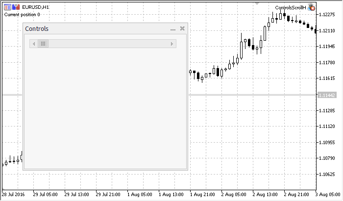

# CScrollH

CScrollH

CScrollH is a class of the "Horizontal scroll bar" complex control.

Description

CScrollH is intended for creation of horizontal scroll bars.

Declaration

|  |
| --- |
| class CScrollH : public CScroll |

Title

|  |
| --- |
| #include <Controls\Scrolls.mqh> |

|  |
| --- |
| Inheritance hierarchy    [CObject](../../Basic-Class-CObject/Basic-Class-CObject.md)        [CWnd](../CWnd/CWnd.md)            [CWndContainer](../CWndContainer/CWndContainer.md)                [CScroll](../CScroll/CScroll.md)                    CScrollH |

Result of the [code](CScrollH.md#sample) provided below:

Class Methods by Groups

| Dependent controls |  |
| --- | --- |
| [CreateInc](CreateInc/CreateInc.md) | Creates scroll bar increment button |
| [CreateDec](CreateDec/CreateDec.md) | Creates scroll bar decrement button |
| [CreateThumb](CreateThumb/CreateThumb.md) | Creates scroll bar thumb button (can be dragged) |
| Internal event handlers |  |
| [OnResize](OnResize/OnResize.md) | "Resize" internal event handler |
| [OnChangePos](OnChangePos/OnChangePos.md) | "ChangePosition" internal event handler |
| Drag event handlers |  |
| [OnThumbDragStart](OnThumbDragStart/OnThumbDragStart.md) | "ThumbDragStart" event handler |
| [OnThumbDragProcess](OnThumbDragProcess/OnThumbDragProcess.md) | "ThumbDragProcess" event handler |
| [OnThumbDragEnd](OnThumbDragEnd/OnThumbDragEnd.md) | "ThumbDragEnd" event handler |
| Position |  |
| [CalcPos](CalcPos/CalcPos.md) | Gets scroll bar position by coordinate |

| Methods inherited from class CObject  Prev, Prev, Next, Next, [Type](../../Basic-Class-CObject/Type/Type.md), [Compare](../../Basic-Class-CObject/Compare/Compare.md) |
| --- |
| Methods inherited from class CWnd  [Name](../CWnd/Name/Name.md), [ControlsTotal](../CWnd/ControlsTotal/ControlsTotal.md), [Control](../CWnd/Control/Control.md), [Rect](../CWnd/Rect/Rect.md), [Left](../CWnd/Left/Left.md), [Left](../CWnd/Left/Left.md), [Top](../CWnd/Top/Top.md), [Top](../CWnd/Top/Top.md), [Right](../CWnd/Right/Right.md), [Right](../CWnd/Right/Right.md), [Bottom](../CWnd/Bottom/Bottom.md), [Bottom](../CWnd/Bottom/Bottom.md), [Width](../CWnd/Width/Width.md), [Width](../CWnd/Width/Width.md), [Height](../CWnd/Height/Height.md), [Height](../CWnd/Height/Height.md), Size, Size, Size, [Contains](../CWnd/Contains/Contains.md), [Contains](../CWnd/Contains/Contains.md), [Alignment](../CWnd/Alignment/Alignment.md), [Align](../CWnd/Align/Align.md), [Id](../CWnd/Id/Id.md), [IsEnabled](../CWnd/IsEnabled/IsEnabled.md), [IsVisible](../CWnd/IsVisible/IsVisible.md), [Visible](../CWnd/Visible/Visible.md), [IsActive](../CWnd/IsActive/IsActive.md), [Activate](../CWnd/Activate/Activate.md), [Deactivate](../CWnd/Deactivate/Deactivate.md), [StateFlags](../CWnd/StateFlags/StateFlags.md), [StateFlags](../CWnd/StateFlags/StateFlags.md), [StateFlagsSet](../CWnd/StateFlagsSet/StateFlagsSet.md), [StateFlagsReset](../CWnd/StateFlagsReset/StateFlagsReset.md), [PropFlags](../CWnd/PropFlags/PropFlags.md), [PropFlags](../CWnd/PropFlags/PropFlags.md), [PropFlagsSet](../CWnd/PropFlagsSet/PropFlagsSet.md), [PropFlagsReset](../CWnd/PropFlagsReset/PropFlagsReset.md), [MouseX](../CWnd/MouseX/MouseX.md), [MouseX](../CWnd/MouseX/MouseX.md), [MouseY](../CWnd/MouseY/MouseY.md), [MouseY](../CWnd/MouseY/MouseY.md), [MouseFlags](../CWnd/MouseFlags/MouseFlags.md), [MouseFlags](../CWnd/MouseFlags/MouseFlags.md), [MouseFocusKill](../CWnd/MouseFocusKill/MouseFocusKill.md), BringToTop |
| Methods inherited from class CWndContainer  [Destroy](../CWndContainer/Destroy/Destroy.md), [OnMouseEvent](../CWndContainer/OnMouseEvent/OnMouseEvent.md), [ControlsTotal](../CWndContainer/ControlsTotal/ControlsTotal.md), [Control](../CWndContainer/Control/Control.md), [ControlFind](../CWndContainer/ControlFind/ControlFind.md), [MouseFocusKill](../CWndContainer/MouseFocusKill/MouseFocusKill.md), [Add](../CWndContainer/Add/Add.md), [Add](../CWndContainer/Add/Add.md), [Delete](../CWndContainer/Delete/Delete.md), [Delete](../CWndContainer/Delete/Delete.md), [Move](../CWndContainer/Move/Move.md), [Move](../CWndContainer/Move/Move.md), [Shift](../CWndContainer/Shift/Shift.md), [Id](../CWndContainer/Id/Id.md), [Enable](../CWndContainer/Enable/Enable.md), [Disable](../CWndContainer/Disable/Disable.md), [Show](../CWndContainer/Show/Show.md), [Hide](../CWndContainer/Hide/Hide.md), [Save](../CWndContainer/Save/Save.md), [Load](../CWndContainer/Load/Load.md) |
| Methods inherited from class CScroll  [Create](../CScroll/Create/Create.md), [OnEvent](../CScroll/OnEvent/OnEvent.md), [MinPos](../CScroll/MinPos/MinPos.md), [MinPos](../CScroll/MinPos/MinPos.md), [MaxPos](../CScroll/MaxPos/MaxPos.md), [MaxPos](../CScroll/MaxPos/MaxPos.md), [CurrPos](../CScroll/CurrPos/CurrPos.md), [CurrPos](../CScroll/CurrPos/CurrPos.md) |

Example of creating a panel with horizontal scrollbar:

|  |
| --- |
| //+------------------------------------------------------------------+  //|                                              ControlsScrollH.mq5 |  //|                         Copyright 2000-2024, MetaQuotes Ltd. |  //|                                             https://www.mql5.com |  //+------------------------------------------------------------------+  #property copyright "Copyright 2017, MetaQuotes Software Corp."  #property link      "https://www.mql5.com"  #property version   "1.00"  #property description "Control Panels and Dialogs. Demonstration class CScrollH"  #include <Controls\Dialog.mqh>  #include <Controls\Scrolls.mqh>  //+------------------------------------------------------------------+  //| defines                                                          |  //+------------------------------------------------------------------+  //--- indents and gaps  #define INDENT\_LEFT                         (11)      // indent from left (with allowance for border width)  #define INDENT\_TOP                          (11)      // indent from top (with allowance for border width)  #define INDENT\_RIGHT                        (11)      // indent from right (with allowance for border width)  #define INDENT\_BOTTOM                       (11)      // indent from bottom (with allowance for border width)  #define CONTROLS\_GAP\_X                      (5)       // gap by X coordinate  #define CONTROLS\_GAP\_Y                      (5)       // gap by Y coordinate  //--- for buttons  #define BUTTON\_WIDTH                        (100)     // size by X coordinate  #define BUTTON\_HEIGHT                       (20)      // size by Y coordinate  //--- for the indication area  #define EDIT\_HEIGHT                         (20)      // size by Y coordinate  //--- for group controls  #define GROUP\_WIDTH                         (150)     // size by X coordinate  #define LIST\_HEIGHT                         (179)     // size by Y coordinate  #define RADIO\_HEIGHT                        (56)      // size by Y coordinate  #define CHECK\_HEIGHT                        (93)      // size by Y coordinate  //+------------------------------------------------------------------+  //| Class CControlsDialog                                            |  //| Usage: main dialog of the Controls application                   |  //+------------------------------------------------------------------+  class CControlsDialog : public CAppDialog    {  private:     CScrollH          m\_scroll\_v;                     // CScrollH object     public:                       CControlsDialog(void);                      ~CControlsDialog(void);     //--- create     virtual bool      Create(const long chart,const string name,const int subwin,const int x1,const int y1,const int x2,const int y2);     //--- chart event handler     virtual bool      OnEvent(const int id,const long &lparam,const double &dparam,const string &sparam);     protected:     //--- create dependent controls     bool              CreateScrollsH(void);     //--- handlers of the dependent controls events     void              OnScrollInc(void);     void              OnScrollDec(void);    };  //+------------------------------------------------------------------+  //| Event Handling                                                   |  //+------------------------------------------------------------------+  EVENT\_MAP\_BEGIN(CControlsDialog)  ON\_EVENT(ON\_SCROLL\_INC,m\_scroll\_v,OnScrollInc)  ON\_EVENT(ON\_SCROLL\_DEC,m\_scroll\_v,OnScrollDec)  EVENT\_MAP\_END(CAppDialog)  //+------------------------------------------------------------------+  //| Constructor                                                      |  //+------------------------------------------------------------------+  CControlsDialog::CControlsDialog(void)    {    }  //+------------------------------------------------------------------+  //| Destructor                                                       |  //+------------------------------------------------------------------+  CControlsDialog::~CControlsDialog(void)    {    }  //+------------------------------------------------------------------+  //| Create                                                           |  //+------------------------------------------------------------------+  bool CControlsDialog::Create(const long chart,const string name,const int subwin,const int x1,const int y1,const int x2,const int y2)    {     if(!CAppDialog::Create(chart,name,subwin,x1,y1,x2,y2))        return(false);  //--- create dependent controls     if(!CreateScrollsH())        return(false);  //--- succeed     return(true);    }  //+------------------------------------------------------------------+  //| Create the CScrollsH object                                      |  //+------------------------------------------------------------------+  bool CControlsDialog::CreateScrollsH(void)    {  //--- coordinates     int x1=INDENT\_LEFT;     int y1=INDENT\_TOP;     int x2=x1+3\*BUTTON\_WIDTH;     int y2=y1+18;  //--- create     if(!m\_scroll\_v.Create(m\_chart\_id,m\_name+"ScrollsH",m\_subwin,x1,y1,x2,y2))        return(false);  //--- set up the scrollbar     m\_scroll\_v.MinPos(0);  //--- set up the scrollbar     m\_scroll\_v.MaxPos(10);     if(!Add(m\_scroll\_v))        return(false);     Comment("Position of the scrollbar ",m\_scroll\_v.CurrPos());  //--- succeed     return(true);    }  //+------------------------------------------------------------------+  //| Event handler                                                    |  //+------------------------------------------------------------------+  void CControlsDialog::OnScrollInc(void)    {     Comment("Position of the scrollbar ",m\_scroll\_v.CurrPos());    }  //+------------------------------------------------------------------+  //| Event handler                                                    |  //+------------------------------------------------------------------+  void CControlsDialog::OnScrollDec(void)    {     Comment("Position of the scrollbar ",m\_scroll\_v.CurrPos());    }  //+------------------------------------------------------------------+  //| Global Variables                                                 |  //+------------------------------------------------------------------+  CControlsDialog ExtDialog;  //+------------------------------------------------------------------+  //| Expert initialization function                                   |  //+------------------------------------------------------------------+  int OnInit()    {  //--- create application dialog     if(!ExtDialog.Create(0,"Controls",0,40,40,380,344))        return(INIT\_FAILED);  //--- run application     ExtDialog.Run();  //--- succeed     return(INIT\_SUCCEEDED);    }  //+------------------------------------------------------------------+  //| Expert deinitialization function                                 |  //+------------------------------------------------------------------+  void OnDeinit(const int reason)    {  //--- clear comments     Comment("");  //--- destroy dialog     ExtDialog.Destroy(reason);    }  //+------------------------------------------------------------------+  //| Expert chart event function                                      |  //+------------------------------------------------------------------+  void OnChartEvent(const int id,         // event ID                      const long& lparam,   // event parameter of the long type                    const double& dparam, // event parameter of the double type                    const string& sparam) // event parameter of the string type    {     ExtDialog.ChartEvent(id,lparam,dparam,sparam);    } |
