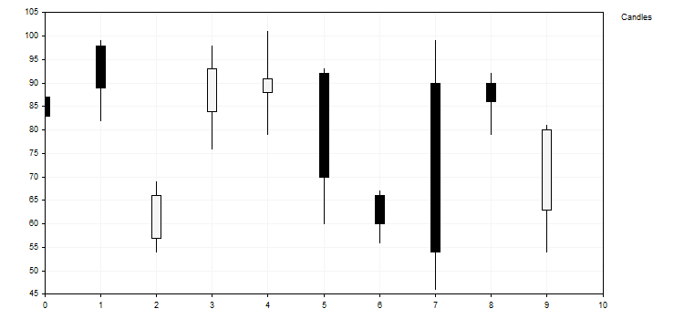

# CustomPlotFunction

CustomPlotFunction (Get method)

Get the pointer to the function implementing the custom curve plotting mode.

|  |
| --- |
| PlotFucntion  CustomPlotFunction() |

Return Value

Pointer to the function implementing the custom curve plotting mode.

CustomPlotFunction (Set method)

Set the pointer to the function implementing the custom curve plotting mode.

|  |
| --- |
| void  CustomPlotFunction(     PlotFucntion  func      // pointer to the function     ) |

Parameters

func

[in]  Pointer to the function implementing the custom curve plotting mode

Example:

This curve consisting of bars is built using the following code:

|  |
| --- |
| //+------------------------------------------------------------------+  //|                                                CandleGraphic.mq5 |  //|                         Copyright 2000-2024, MetaQuotes Ltd. |  //|                                             https://www.mql5.com |  //+------------------------------------------------------------------+  #include <Graphics\Graphic.mqh>  //+------------------------------------------------------------------+  //| Class CCandle                                                    |  //| Usage: class to represent the candle                             |  //+------------------------------------------------------------------+  class CCandle: public CObject    {  private:     double            m\_open;     double            m\_close;     double            m\_high;     double            m\_low;     uint              m\_clr\_inc;     uint              m\_clr\_dec;     int               m\_width;     public:                       CCandle(const double open,const double close,const double high,const double low,                                                         const int width,const uint clr\_inc=0x000000,const uint clr\_dec=0xF5F5F5);                      ~CCandle(void);     double            OpenValue(void)            const { return(m\_open);     }     double            CloseValue(void)           const { return(m\_close);    }     double            HigthValue(void)           const { return(m\_high);     }     double            LowValue(void)             const { return(m\_low);      }     uint              CandleColorIncrement(void) const { return(m\_clr\_inc);  }     uint              CandleColorDecrement(void) const { return(m\_clr\_dec);  }     int               CandleWidth(void)          const { return(m\_width);    }    };  //+------------------------------------------------------------------+  //| Constructor                                                      |  //+------------------------------------------------------------------+  CCandle::CCandle(const double open,const double close,const double high,const double low,                                   const int width,const uint clr\_inc=0x000000,const uint clr\_dec=0xF5F5F5):                                   m\_open(open),m\_close(close),m\_high(high),m\_low(low),                                   m\_clr\_inc(clr\_inc),m\_clr\_dec(clr\_dec),m\_width(width)    {    }  //+------------------------------------------------------------------+  //| Destructor                                                       |  //+------------------------------------------------------------------+  CCandle::~CCandle(void)    {    }  //+------------------------------------------------------------------+  //| Custom method for plot candles                                   |  //+------------------------------------------------------------------+  void PlotCandles(double &x[],double &y[],int size,CGraphic \*graphic,CCanvas \*canvas,void \*cbdata)    {  //--- check obj     CArrayObj \*candles=dynamic\_cast<CArrayObj\*>(cbdata);     if(candles==NULL || candles.Total()!=size)        return;  //--- plot candles       for(int i=0; i<size; i++)       {        CCandle \*candle=dynamic\_cast<CCandle\*>(candles.At(i));        if(candle==NULL)           return;        //--- primary calculate        int xc=graphic.ScaleX(x[i]);        int width\_2=candle.CandleWidth()/2;        int open=graphic.ScaleY(candle.OpenValue());        int close=graphic.ScaleY(candle.CloseValue());        int high=graphic.ScaleY(candle.HigthValue());        int low=graphic.ScaleY(candle.LowValue());        uint clr=(open<=close) ? candle.CandleColorIncrement() :  candle.CandleColorDecrement();        //--- plot candle        canvas.LineVertical(xc,high,low,0x000000);        //--- plot candle real body        canvas.FillRectangle(xc+width\_2,open,xc-width\_2,close,clr);        canvas.Rectangle(xc+width\_2,open,xc-width\_2,close,0x000000);       }    }  //+------------------------------------------------------------------+  //| Script program start function                                    |  //+------------------------------------------------------------------+  void OnStart()    {     int count=10;     int width=10;     double x[];     double y[];     ArrayResize(x,count);     ArrayResize(y,count);     CArrayObj candles();     double max=0;     double min=0;  //--- create values      for(int i=0; i<count; i++)       {        x[i] = i;        y[i] = i;        //--- calculate values        double open=MathRound(50.0+(MathRand()/32767.0)\*50.0);        double close=MathRound(50.0+(MathRand()/32767.0)\*50.0);        double high=MathRound(MathMax(open,close)+(MathRand()/32767.0)\*10.0);        double low=MathRound(MathMin(open,close) -(MathRand()/32767.0)\*10.0);        //--- find max and min        if(i==0 || max<high)           max=high;        if(i==0 || min>low)           min=low;        //--- create candle        CCandle \*candle=new CCandle(open,close,high,low,width);        candles.Add(candle);       }  //--- create graphic     CGraphic graphic;     if(!graphic.Create(0,"CandleGraphic",0,30,30,780,380))       {        graphic.Attach(0,"CandleGraphic");       }  //--- create curve     CCurve \*curve=graphic.CurveAdd(x,y,CURVE\_CUSTOM,"Candles");  //--- sets the curve properties     curve.CustomPlotFunction(PlotCandles);     curve.CustomPlotCBData(GetPointer(candles));  //--- sets the graphic properties     graphic.YAxis().Max((int)max);     graphic.YAxis().Min((int)min);  //--- plot      graphic.CurvePlotAll();     graphic.Update();    } |
