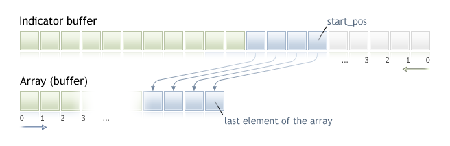

# CopyBuffer

CopyBuffer

Gets data of a specified buffer of a certain indicator in the necessary quantity.

Counting of elements of copied data (indicator buffer with the index buffer\_num) from the starting position is performed from the present to the past, i.e., starting position of 0 means the current bar (indicator value for the current bar).

When copying the yet unknown amount of data, it is recommended to use a [dynamic array](../../Language-Basics/Data-Types/Dynamic-Array-Object/Dynamic-Array-Object.md) as a buffer[] recipient buffer, because the CopyBuffer() function tries to allocate the size of the receiving array to the size of the copied data. If an indicator buffer (array that is pre-allocated for storing indicator values by the [SetIndexBufer()](../../Custom-Indicators/SetIndexBuffer/SetIndexBuffer.md) function) is used as the buffer[] recipient array, partial copying is allowed. An example can be found in the Awesome\_Oscillator.mql5 custom indicator in the standard terminal package.

If you need to make a partial copy of the indicator values into another array (non-indicator buffer), you should use an intermediate array, to which the desired number is copied. After that conduct the element-wise copying of the required number of values into the required places of a receiving array from this intermediate one.

If you know the amount of data you need to copy, it should better be done to a [statically allocated buffer](../../Language-Basics/Data-Types/Dynamic-Array-Object/Dynamic-Array-Object.md#static_array), in order to prevent the allocation of excessive memory.

No matter what is the property of the target array - as\_series=true or as\_series=false. Data will be copied so that the oldest element will be located at the start of the physical memory allocated for the array. There are 3 variants of function calls.

Call by the first position and the number of required elements

|  |
| --- |
| int  CopyBuffer(     int       indicator\_handle,     // indicator handle     int       buffer\_num,           // indicator buffer number     int       start\_pos,            // start position     int       count,                // amount to copy     double    buffer[]              // target array to copy     ); |

Call by the start date and the number of required elements

|  |
| --- |
| int  CopyBuffer(     int       indicator\_handle,     // indicator handle     int       buffer\_num,           // indicator buffer number     datetime  start\_time,           // start date and time     int       count,                // amount to copy     double    buffer[]              // target array to copy     ); |

Call by the start and end dates of a required time interval

|  |
| --- |
| int  CopyBuffer(     int       indicator\_handle,     // indicator handle     int       buffer\_num,           // indicator buffer number     datetime  start\_time,           // start date and time     datetime  stop\_time,            // end date and time     double    buffer[]              // target array to copy     ); |

Parameters

indicator\_handle

[in]  The indicator handle, returned by the corresponding indicator function.

buffer\_num

[in]  The indicator buffer number.

start\_pos

[in]  The position of the first element to copy.

count

[in]  Data count to copy.

start\_time

[in]  Bar time, corresponding to the first element.

stop\_time

[in]  Bar time, corresponding to the last element.

buffer[]

[out]  Array of [double](../../Language-Basics/Data-Types/Real-Types-(double,-float)/Real-Types-(double,-float).md) type.

Return Value

Returns the copied data count or -1 in case of an [error](../../Constants,-Enumerations-and-Structures/Codes-of-Errors-and-Warnings/Runtime-Errors/Runtime-Errors.md).

Note

When requesting data from the indicator, if requested timeseries are not yet built or they need to be downloaded from the server, the function will immediately return -1, but the process of downloading/building will be initiated.

When requesting data from an Expert Advisor or script, [downloading from the server](../Organizing-Data-Access/Organizing-Data-Access.md#synchronized) will be initiated, if  the terminal does not have these data locally, or building of a required timeseries will start, if data can be built from the local history but they are not ready yet. The function will return the amount of data that will be ready by the moment of timeout expiration.

Example:

|  |
| --- |
| //+------------------------------------------------------------------+  //|                                              TestCopyBuffer3.mq5 |  //|                        Copyright 2009, MetaQuotes Software Corp. |  //|                                              https://www.mql5.com |  //+------------------------------------------------------------------+  #property copyright "2009, MetaQuotes Software Corp."  #property link      "https://www.mql5.com"  #property version   "1.00"     #property indicator\_separate\_window  #property indicator\_buffers 1  #property indicator\_plots   1  //---- plot MA  #property indicator\_label1  "MA"  #property indicator\_type1   DRAW\_LINE  #property indicator\_color1  clrRed  #property indicator\_style1  STYLE\_SOLID  #property indicator\_width1  1  //--- input parameters  input bool               AsSeries=true;  input int                period=15;  input ENUM\_MA\_METHOD     smootMode=MODE\_EMA;  input ENUM\_APPLIED\_PRICE price=PRICE\_CLOSE;  input int                shift=0;  //--- indicator buffers  double                   MABuffer[];  int                      ma\_handle;  //+------------------------------------------------------------------+  //| Custom indicator initialization function                         |  //+------------------------------------------------------------------+  int OnInit()    {  //--- indicator buffers mapping     SetIndexBuffer(0,MABuffer,INDICATOR\_DATA);     Print("Parameter AsSeries = ",AsSeries);     Print("Indicator buffer after SetIndexBuffer() is a timeseries = ",           ArrayGetAsSeries(MABuffer));  //--- set short indicator name     IndicatorSetString(INDICATOR\_SHORTNAME,"MA("+period+")"+AsSeries);  //--- set AsSeries (depends on input parameter)     ArraySetAsSeries(MABuffer,AsSeries);     Print("Indicator buffer after ArraySetAsSeries(MABuffer,true); is a timeseries = ",           ArrayGetAsSeries(MABuffer));  //---     ma\_handle=iMA(Symbol(),0,period,shift,smootMode,price);     return(INIT\_SUCCEEDED);    }  //+------------------------------------------------------------------+  //| Custom indicator iteration function                              |  //+------------------------------------------------------------------+  int OnCalculate(const int rates\_total,                  const int prev\_calculated,                  const datetime &time[],                  const double &open[],                  const double &high[],                  const double &low[],                  const double &close[],                  const long &tick\_volume[],                  const long &volume[],                  const int &spread[])    {  //--- check if all data calculated     if(BarsCalculated(ma\_handle)<rates\_total) return(0);  //--- we can copy not all data     int to\_copy;     if(prev\_calculated>rates\_total || prev\_calculated<=0) to\_copy=rates\_total;     else       {        to\_copy=rates\_total-prev\_calculated;        //--- last value is always copied        to\_copy++;       }  //--- try to copy     if(CopyBuffer(ma\_handle,0,0,to\_copy,MABuffer)<=0) return(0);  //--- return value of prev\_calculated for next call     return(rates\_total);    }  //+------------------------------------------------------------------+ |

The above example illustrates how an indicator buffer is filled out with the values of another indicator buffer from the indicator on the same symbol/period.

See a detailed example of history requesting data in section [Methods of Object Binding](../../Constants,-Enumerations-and-Structures/Objects-Constants/Methods-of-Object-Binding/Methods-of-Object-Binding.md). The script available in that section shows how to get the values of indicator [iFractals](../../Technical-Indicators/iFractals/iFractals.md) on the last 1000 bars and how to display the last 10 up and 10 down fractals on the chart. A similar technique can be used for all indicators that have missing data and that are usually drawn using the following [styles](../../Custom-Indicators/Indicator-Styles-in-Examples/Indicator-Styles-in-Examples.md):

- [DRAW\_SECTION](../../Custom-Indicators/Indicator-Styles-in-Examples/DRAW_SECTION/DRAW_SECTION.md),
- [DRAW\_ARROW](../../Custom-Indicators/Indicator-Styles-in-Examples/DRAW_ARROW/DRAW_ARROW.md),
- [DRAW\_ZIGZAG](../../Custom-Indicators/Indicator-Styles-in-Examples/DRAW_ZIGZAG/DRAW_ZIGZAG.md),
- [DRAW\_COLOR\_SECTION](../../Custom-Indicators/Indicator-Styles-in-Examples/DRAW_COLOR_SECTION/DRAW_COLOR_SECTION.md),
- [DRAW\_COLOR\_ARROW](../../Custom-Indicators/Indicator-Styles-in-Examples/DRAW_COLOR_ARROW/DRAW_COLOR_ARROW.md),
- [DRAW\_COLOR\_ZIGZAG](../../Custom-Indicators/Indicator-Styles-in-Examples/DRAW_COLOR_ZIGZAG/DRAW_COLOR_ZIGZAG.md).

 

See also

[Properties of Custom Indicators](../../Constants,-Enumerations-and-Structures/Indicator-Constants/Custom-Indicator-Properties/Custom-Indicator-Properties.md), [SetIndexBuffer](../../Custom-Indicators/SetIndexBuffer/SetIndexBuffer.md)
