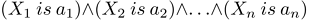

# CConditions


Class defines a set of fuzzy conditions connected to each other by an operator.  

Description

A set of fuzzy conditions connected to each other by an operator may be described as follows:



where:

- X = (X1, X2, X3 ... Xn) — vector of input variables;

- a = (a1, a2, a3 ... an) — vector of input variable values.

In this example, the and operator is used. Besides, the or operator is available in this class.

### Declaration

```cpp
   class CConditions : public ICondition
```

### Title

```cpp
   #include <Math\Fuzzy\fuzzyrule.mqh>
```

|  |
| --- |
| Inheritance hierarchy    [CObject](../../../../Basic-Class-CObject/Basic-Class-CObject.md)        ICondition            CConditions |

### Class methods

| Class method | Description |
| --- | --- |
| [ConditionsList](ConditionsList/ConditionsList.md) | Gets the list of all conditions |
| [Not](Not/Not.md) | Gets and sets the flag indicating whether it is necessary to apply negation to these conditions |
| [Op](Op/Op.md) | Gets and sets a type of the conditions bundle operator. |

|  |
| --- |
| Methods inherited from class CObject  Prev, Prev, Next, Next, [Save](../../../../Basic-Class-CObject/Save/Save.md), [Load](../../../../Basic-Class-CObject/Load/Load.md), [Type](../../../../Basic-Class-CObject/Type/Type.md), [Compare](../../../../Basic-Class-CObject/Compare/Compare.md) |