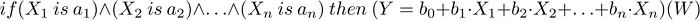

# Sugeno system

Sugeno fuzzy logic system is one of the two basic types of fuzzy systems. Output variable values are set as a linear combination of input variables.

### Description

Unlike the Mamdani rule, an input variable value is set by a linear function from entries rather than by a fuzzy term. Fuzzy logic rule for the Sugeno algorithm can be described as follows:

where:

- X = (X1, X2, X3 ... Xn) — vector of input variables;
- Y — output variable;
- a = (a1, a2, a3 ... an) — vector of input variable values;
- b = (b1, b2, b3 ... bn) — free term ratio in the linear function for an output value
- W — rule weight.

Note

This notation symbolically indicates that each rule has a weight W; it is not a literal mathematical expression.

 

### Class methods

| Class method | Description |
| --- | --- |
| [Calculate](Calculate/Calculate.md) | Calculates a fuzzy inference for the system |
| [CreateSugenoFunction](CreateSugenoFunction/CreateSugenoFunction.md) | Creates a linear Sugeno function for the system. |
| [EmptyRule](EmptyRule/EmptyRule.md) | Creates an empty fuzzy Sugeno rule based on the current system. |
| [Output](Output/Output.md) | Gets the list of fuzzy Sugeno output variables. |
| [OutputByName](OutputByName/OutputByName.md) | Gets a fuzzy Sugeno output variable by a specified name. |
| [ParseRule](ParseRule/ParseRule.md) | Creates a fuzzy Sugeno rule based on a specified line. |
| [Rules](Rules/Rules.md) | Returns the list of fuzzy rules. |

|  |
| --- |
| Methods inherited from class CGenericFuzzySystem  Input, AndMethod, AndMethod, OrMethod, OrMethod, InputByName, Fuzzify |
