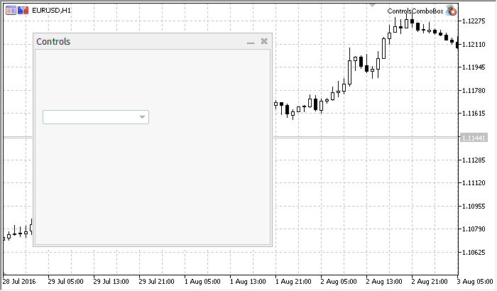

# CComboBox


CComboBox is a class of the ComboBox complex control (with dependent controls).

### Description

ComboBox consists of a list box, combined with a static control, intended for selection. The list-box portion of the control may be dropped down when a user selects the drop-down arrow next to the control

### Declaration

```cpp
   class CComboBox : public CWndContainer
```

### Title

```cpp
   #include <Controls\ComboBox.mqh>
```

|  |
| --- |
| Inheritance hierarchy    [CObject](../../Basic-Class-CObject/Basic-Class-CObject.md)        [CWnd](../CWnd/CWnd.md)            [CWndContainer](../CWndContainer/CWndContainer.md)                CComboBox |

Result of the [code](CComboBox.md#sample) provided below:



### Class Methods by Groups

| Create |  |
| --- | --- |
| [Create](Create/Create.md) | Creates control |
| Chart event handlers |  |
| [OnEvent](OnEvent/OnEvent.md) | Event handler of all chart events |
| Add |  |
| [AddItem](AddItem/AddItem.md) | Adds an item to control |
| Settings |  |
| [ListViewItems](ListViewItems/ListViewItems.md) | Sets the number of items shown on the control |
| Data |  |
| [Select](Select/Select.md) | Selects the current list element by index |
| [SelectByText](SelectByText/SelectByText.md) | Selects the current list element by text |
| [SelectByValue](SelectByValue/SelectByValue.md) | Selects the current list element by value |
| Read-only data |  |
| [Value](Value/Value.md) | Gets the value of the current list element |
| Dependent controls |  |
| [CreateEdit](CreateEdit/CreateEdit.md) | Creates dependent control (edit) |
| [CreateButton](CreateButton/CreateButton.md) | Creates dependent control (button) |
| [CreateList](CreateList/CreateList.md) | Creates dependent control (list view) |
| Dependent controls event handlers |  |
| [OnClickEdit](OnClickEdit/OnClickEdit.md) | "ClickEdit" internal event handler (virtual) |
| [OnClickButton](OnClickButton/OnClickButton.md) | "ClickButton" internal event handler (virtual) |
| [OnChangeList](OnChangeList/OnChangeList.md) | "ChangeList" internal event handler (virtual) |
| Show/Hide the drop-down list |  |
| [ListShow](ListShow/ListShow.md) | Shows the items list |
| [ListHide](ListHide/ListHide.md) | Hides the items list |

| Methods inherited from class CObject  Prev, Prev, Next, Next, [Type](../../Basic-Class-CObject/Type/Type.md), [Compare](../../Basic-Class-CObject/Compare/Compare.md) |
| --- |
| Methods inherited from class CWnd  [Name](../CWnd/Name/Name.md), [ControlsTotal](../CWnd/ControlsTotal/ControlsTotal.md), [Control](../CWnd/Control/Control.md), [Rect](../CWnd/Rect/Rect.md), [Left](../CWnd/Left/Left.md), [Left](../CWnd/Left/Left.md), [Top](../CWnd/Top/Top.md), [Top](../CWnd/Top/Top.md), [Right](../CWnd/Right/Right.md), [Right](../CWnd/Right/Right.md), [Bottom](../CWnd/Bottom/Bottom.md), [Bottom](../CWnd/Bottom/Bottom.md), [Width](../CWnd/Width/Width.md), [Width](../CWnd/Width/Width.md), [Height](../CWnd/Height/Height.md), [Height](../CWnd/Height/Height.md), Size, Size, Size, [Contains](../CWnd/Contains/Contains.md), [Contains](../CWnd/Contains/Contains.md), [Alignment](../CWnd/Alignment/Alignment.md), [Align](../CWnd/Align/Align.md), [Id](../CWnd/Id/Id.md), [IsEnabled](../CWnd/IsEnabled/IsEnabled.md), [IsVisible](../CWnd/IsVisible/IsVisible.md), [Visible](../CWnd/Visible/Visible.md), [IsActive](../CWnd/IsActive/IsActive.md), [Activate](../CWnd/Activate/Activate.md), [Deactivate](../CWnd/Deactivate/Deactivate.md), [StateFlags](../CWnd/StateFlags/StateFlags.md), [StateFlags](../CWnd/StateFlags/StateFlags.md), [StateFlagsSet](../CWnd/StateFlagsSet/StateFlagsSet.md), [StateFlagsReset](../CWnd/StateFlagsReset/StateFlagsReset.md), [PropFlags](../CWnd/PropFlags/PropFlags.md), [PropFlags](../CWnd/PropFlags/PropFlags.md), [PropFlagsSet](../CWnd/PropFlagsSet/PropFlagsSet.md), [PropFlagsReset](../CWnd/PropFlagsReset/PropFlagsReset.md), [MouseX](../CWnd/MouseX/MouseX.md), [MouseX](../CWnd/MouseX/MouseX.md), [MouseY](../CWnd/MouseY/MouseY.md), [MouseY](../CWnd/MouseY/MouseY.md), [MouseFlags](../CWnd/MouseFlags/MouseFlags.md), [MouseFlags](../CWnd/MouseFlags/MouseFlags.md), [MouseFocusKill](../CWnd/MouseFocusKill/MouseFocusKill.md), BringToTop |
| Methods inherited from class CWndContainer  [Destroy](../CWndContainer/Destroy/Destroy.md), [OnMouseEvent](../CWndContainer/OnMouseEvent/OnMouseEvent.md), [ControlsTotal](../CWndContainer/ControlsTotal/ControlsTotal.md), [Control](../CWndContainer/Control/Control.md), [ControlFind](../CWndContainer/ControlFind/ControlFind.md), [MouseFocusKill](../CWndContainer/MouseFocusKill/MouseFocusKill.md), [Add](../CWndContainer/Add/Add.md), [Add](../CWndContainer/Add/Add.md), [Delete](../CWndContainer/Delete/Delete.md), [Delete](../CWndContainer/Delete/Delete.md), [Move](../CWndContainer/Move/Move.md), [Move](../CWndContainer/Move/Move.md), [Shift](../CWndContainer/Shift/Shift.md), [Id](../CWndContainer/Id/Id.md), [Enable](../CWndContainer/Enable/Enable.md), [Disable](../CWndContainer/Disable/Disable.md), [Hide](../CWndContainer/Hide/Hide.md) |

Example of creating a panel with Combobox control:

```cpp
//+------------------------------------------------------------------+
//|                                             ControlsComboBox.mq5 |
//|                        Copyright 2015, MetaQuotes Software Corp. |
//|                                             https://www.mql5.com |
//+------------------------------------------------------------------+
#property copyright "Copyright 2015, MetaQuotes Software Corp."
#property link      "https://www.mql5.com"
#property version   "1.00"
#property description "Control Panels and Dialogs. Demonstration class CComboBox"
#include <Controls\Dialog.mqh>
#include <Controls\ComboBox.mqh>
//+------------------------------------------------------------------+
//| defines                                                          |
//+------------------------------------------------------------------+
//--- indents and gaps
#define INDENT_LEFT                         (11)      // indent from left (with allowance for border width)
#define INDENT_TOP                          (11)      // indent from top (with allowance for border width)
#define INDENT_RIGHT                        (11)      // indent from right (with allowance for border width)
#define INDENT_BOTTOM                       (11)      // indent from bottom (with allowance for border width)
#define CONTROLS_GAP_X                      (5)       // gap by X coordinate
#define CONTROLS_GAP_Y                      (5)       // gap by Y coordinate
//--- for buttons
#define BUTTON_WIDTH                        (100)     // size by X coordinate
#define BUTTON_HEIGHT                       (20)      // size by Y coordinate
//--- for the indication area
#define EDIT_HEIGHT                         (20)      // size by Y coordinate
//--- for group controls
#define GROUP_WIDTH                         (150)     // size by X coordinate
#define LIST_HEIGHT                         (179)     // size by Y coordinate
#define RADIO_HEIGHT                        (56)      // size by Y coordinate
#define CHECK_HEIGHT                        (93)      // size by Y coordinate
//+------------------------------------------------------------------+
//| Class CControlsDialog                                            |
//| Usage: main dialog of the Controls application                   |
//+------------------------------------------------------------------+
class CControlsDialog : public CAppDialog
  {
private:
   CComboBox         m_combo_box;;                    // CComboBox object
public:
                     CControlsDialog(void);
                    ~CControlsDialog(void);
   //--- create
   virtual bool      Create(const long chart,const string name,const int subwin,const int x1,const int y1,const int x2,const int y2);
   //--- chart event handler
   virtual bool      OnEvent(const int id,const long &lparam,const double &dparam,const string &sparam);
protected:
   //--- create dependent controls
   bool              CreateComboBox(void);
   //--- handlers of the dependent controls events
   void              OnChangeComboBox(void);
  };
//+------------------------------------------------------------------+
//| Event Handling                                                   |
//+------------------------------------------------------------------+
EVENT_MAP_BEGIN(CControlsDialog)
ON_EVENT(ON_CHANGE,m_combo_box,OnChangeComboBox)
EVENT_MAP_END(CAppDialog)
//+------------------------------------------------------------------+
//| Constructor                                                      |
//+------------------------------------------------------------------+
CControlsDialog::CControlsDialog(void)
  {
  }
//+------------------------------------------------------------------+
//| Destructor                                                       |
//+------------------------------------------------------------------+
CControlsDialog::~CControlsDialog(void)
  {
  }
//+------------------------------------------------------------------+
//| Create                                                           |
//+------------------------------------------------------------------+
bool CControlsDialog::Create(const long chart,const string name,const int subwin,const int x1,const int y1,const int x2,const int y2)
  {
   if(!CAppDialog::Create(chart,name,subwin,x1,y1,x2,y2))
      return(false);
//--- create dependent controls
   if(!CreateComboBox())
      return(false);
//--- succeed
   return(true);
  }
//+------------------------------------------------------------------+
//| Create the "ComboBox" element                                    |
//+------------------------------------------------------------------+
bool CControlsDialog::CreateComboBox(void)
  {
//--- coordinates
   int x1=INDENT_LEFT;
   int y1=INDENT_TOP+(EDIT_HEIGHT+CONTROLS_GAP_Y)+
          (BUTTON_HEIGHT+CONTROLS_GAP_Y)+
          (EDIT_HEIGHT+CONTROLS_GAP_Y);
   int x2=x1+GROUP_WIDTH;
   int y2=y1+EDIT_HEIGHT;
//--- create
   if(!m_combo_box.Create(m_chart_id,m_name+"ComboBox",m_subwin,x1,y1,x2,y2))
      return(false);
   if(!Add(m_combo_box))
      return(false);
//--- fill out with strings
   for(int i=0;i<16;i++)
      if(!m_combo_box.ItemAdd("Item "+IntegerToString(i)))
         return(false);
//--- succeed
   return(true);
  }
//+------------------------------------------------------------------+
//| Event handler                                                    |
//+------------------------------------------------------------------+
void CControlsDialog::OnChangeComboBox(void)
  {
   Comment(__FUNCTION__+" \""+m_combo_box.Select()+"\"");
  }
//+------------------------------------------------------------------+
//| Global Variables                                                 |
//+------------------------------------------------------------------+
CControlsDialog ExtDialog;
//+------------------------------------------------------------------+
//| Expert initialization function                                   |
//+------------------------------------------------------------------+
int OnInit()
  {
//--- create application dialog
   if(!ExtDialog.Create(0,"Controls",0,40,40,380,344))
      return(INIT_FAILED);
//--- run application
   ExtDialog.Run();
//--- succeed
   return(INIT_SUCCEEDED);
  }
//+------------------------------------------------------------------+
//| Expert deinitialization function                                 |
//+------------------------------------------------------------------+
void OnDeinit(const int reason)
  {
//---
   Comment("");
//--- destroy dialog
   ExtDialog.Destroy(reason);
  }
//+------------------------------------------------------------------+
//| Expert chart event function                                      |
//+------------------------------------------------------------------+
void OnChartEvent(const int id,         // event ID
                  const long& lparam,   // event parameter of the long type
                  const double& dparam, // event parameter of the double type
                  const string& sparam) // event parameter of the string type
  {
   ExtDialog.ChartEvent(id,lparam,dparam,sparam);
  }
```